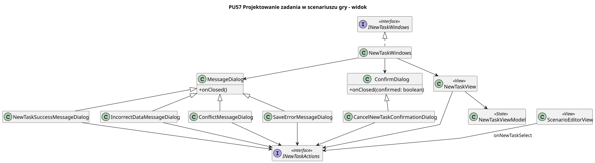

<div hidden>

```
@startuml new-task-view
skinparam classAttributeIconSize 0
skinparam packageStyle rectangle
skinparam shadowing false
skinparam roundcorner 4
skinparam linetype polyline
skinparam nodesep 30
skinparam ranksep 40
hide empty members

title PU57 Projektowanie zadania w scenariuszu gry - widok

class NewTaskView <<View>> {
    + onFieldChange(field: string, value: string | number)
    + onSaveAndCloseClick()
    + onCancelClick()
}

class ConfirmDialog {
    + show(title: string, message: string)
    + onConfirmClick()
    + onCancelClick()
}

class MessageDialog {
    + show(title: string, message: string)
    + onOkClick()
}

class CancelNewTaskConfirmationDialog
class NewTaskSuccessMessageDialog
class IncorrectDataMessageDialog
class ConflictMessageDialog
class SaveErrorMessageDialog

CancelNewTaskConfirmationDialog -u-|> ConfirmDialog
NewTaskSuccessMessageDialog -u-|> MessageDialog
IncorrectDataMessageDialog -u-|> MessageDialog
ConflictMessageDialog -u-|> MessageDialog
SaveErrorMessageDialog -u-|> MessageDialog

class NewTaskWindows
interface INewTaskWindows <<interface>>
interface INewTaskActions <<interface>>
class NewTaskViewModel <<State>>
class ScenarioEditorView <<View>>

NewTaskWindows .u.|> INewTaskWindows
NewTaskWindows --> NewTaskView
NewTaskWindows --> ConfirmDialog
NewTaskWindows --> MessageDialog

ScenarioEditorView --> INewTaskActions : onNewTaskSelect
NewTaskView --> INewTaskActions
NewTaskView --> NewTaskViewModel
CancelNewTaskConfirmationDialog --> INewTaskActions
NewTaskSuccessMessageDialog --> INewTaskActions
IncorrectDataMessageDialog --> INewTaskActions
ConflictMessageDialog --> INewTaskActions
SaveErrorMessageDialog --> INewTaskActions
@enduml
```

</div>


