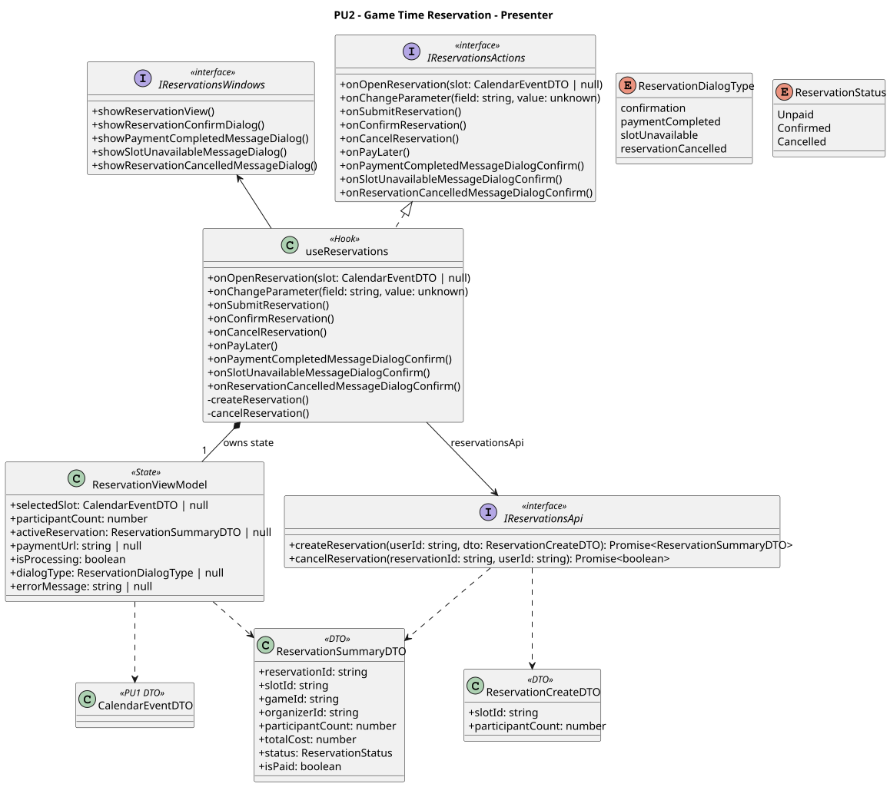

<div hidden>

```

@startuml reservation-presenter

skinparam classAttributeIconSize 0
skinparam packageStyle rectangle
skinparam shadowing false
skinparam roundcorner 4
skinparam nodesep 26
skinparam ranksep 34
skinparam linetype polyline

title PU2 - Game Time Reservation - Presenter

class useReservations <<Hook>> {
    + onOpenReservation(slot: CalendarEventDTO | null)
    + onChangeParameter(field: string, value: unknown)
    + onSubmitReservation()
    + onConfirmReservation()
    + onCancelReservation()
    + onPayLater()
    + onPaymentCompletedMessageDialogConfirm()
    + onSlotUnavailableMessageDialogConfirm()
    + onReservationCancelledMessageDialogConfirm()
    - createReservation()
    - cancelReservation()
}

interface IReservationsActions <<interface>> {
    + onOpenReservation(slot: CalendarEventDTO | null)
    + onChangeParameter(field: string, value: unknown)
    + onSubmitReservation()
    + onConfirmReservation()
    + onCancelReservation()
    + onPayLater()
    + onPaymentCompletedMessageDialogConfirm()
    + onSlotUnavailableMessageDialogConfirm()
    + onReservationCancelledMessageDialogConfirm()
}

interface IReservationsWindows <<interface>> {
    + showReservationView()
    + showReservationConfirmDialog()
    + showPaymentCompletedMessageDialog()
    + showSlotUnavailableMessageDialog()
    + showReservationCancelledMessageDialog()
}

class ReservationViewModel <<State>> {
    + selectedSlot: CalendarEventDTO | null
    + participantCount: number
    + activeReservation: ReservationSummaryDTO | null
    + paymentUrl: string | null
    + isProcessing: boolean
    + dialogType: ReservationDialogType | null
    + errorMessage: string | null
}

class ReservationSummaryDTO <<DTO>> {
    + reservationId: string
    + slotId: string
    + gameId: string
    + organizerId: string
    + participantCount: number
    + totalCost: number
    + status: ReservationStatus
    + isPaid: boolean
}

enum ReservationDialogType {
    confirmation
    paymentCompleted
    slotUnavailable
    reservationCancelled
}

interface IReservationsApi <<interface>> {
    + createReservation(userId: string, dto: ReservationCreateDTO): Promise<ReservationSummaryDTO>
    + cancelReservation(reservationId: string, userId: string): Promise<boolean>
}

class ReservationCreateDTO <<DTO>> {
    + slotId: string
    + participantCount: number
}

class CalendarEventDTO <<PU1 DTO>>

enum ReservationStatus {
    Unpaid
    Confirmed
    Cancelled
}

useReservations .u.|> IReservationsActions
useReservations -u-> IReservationsWindows
useReservations --> IReservationsApi : reservationsApi
useReservations *-- "1" ReservationViewModel : owns state

ReservationViewModel ..> CalendarEventDTO
ReservationViewModel ..> ReservationSummaryDTO

IReservationsApi ..> ReservationCreateDTO
IReservationsApi ..> ReservationSummaryDTO

@enduml

```

</div>


