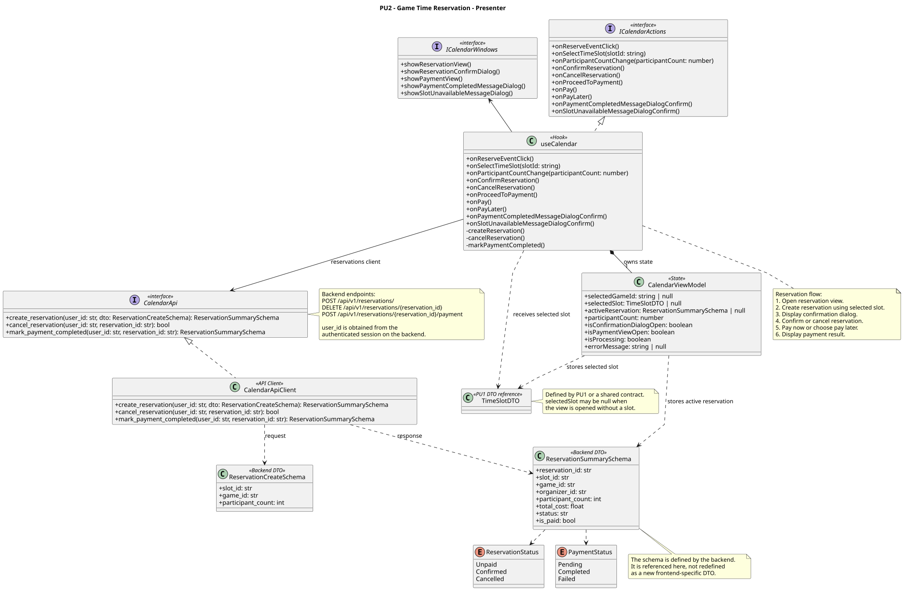

<div hidden>

```


@startuml reservation-presenter
skinparam classAttributeIconSize 0
skinparam packageStyle rectangle
skinparam shadowing false
skinparam roundcorner 4
skinparam nodesep 26
skinparam ranksep 34
skinparam linetype polyline

title PU2 - Game Time Reservation - Presenter

class useCalendar <<Hook>> {
    +onReserveEventClick()
    +onSelectTimeSlot(slotId: string)
    +onParticipantCountChange(participantCount: number)
    +onConfirmReservation()
    +onCancelReservation()
    +onProceedToPayment()
    +onPay()
    +onPayLater()
    +onPaymentCompletedMessageDialogConfirm()
    +onSlotUnavailableMessageDialogConfirm()
    -createReservation()
    -cancelReservation()
    -markPaymentCompleted()
}

interface ICalendarActions <<interface>> {
    +onReserveEventClick()
    +onSelectTimeSlot(slotId: string)
    +onParticipantCountChange(participantCount: number)
    +onConfirmReservation()
    +onCancelReservation()
    +onProceedToPayment()
    +onPay()
    +onPayLater()
    +onPaymentCompletedMessageDialogConfirm()
    +onSlotUnavailableMessageDialogConfirm()
}

interface ICalendarWindows <<interface>> {
    +showReservationView()
    +showReservationConfirmDialog()
    +showPaymentView()
    +showPaymentCompletedMessageDialog()
    +showSlotUnavailableMessageDialog()
}

class CalendarViewModel <<State>> {
    +selectedGameId: string | null
    +selectedSlot: TimeSlotDTO | null
    +activeReservation: ReservationSummarySchema | null
    +participantCount: number
    +isConfirmationDialogOpen: boolean
    +isPaymentViewOpen: boolean
    +isProcessing: boolean
    +errorMessage: string | null
}

interface CalendarApi <<interface>> {
    +create_reservation(user_id: str, dto: ReservationCreateSchema): ReservationSummarySchema
    +cancel_reservation(user_id: str, reservation_id: str): bool
    +mark_payment_completed(user_id: str, reservation_id: str): ReservationSummarySchema
}

class CalendarApiClient <<API Client>> {
    +create_reservation(user_id: str, dto: ReservationCreateSchema): ReservationSummarySchema
    +cancel_reservation(user_id: str, reservation_id: str): bool
    +mark_payment_completed(user_id: str, reservation_id: str): ReservationSummarySchema
}

class ReservationCreateSchema <<Backend DTO>> {
    +slot_id: str
    +game_id: str
    +participant_count: int
}

class ReservationSummarySchema <<Backend DTO>> {
    +reservation_id: str
    +slot_id: str
    +game_id: str
    +organizer_id: str
    +participant_count: int
    +total_cost: float
    +status: str
    +is_paid: bool
}

class TimeSlotDTO <<PU1 DTO reference>>

enum ReservationStatus {
    Unpaid
    Confirmed
    Cancelled
}

enum PaymentStatus {
    Pending
    Completed
    Failed
}

useCalendar .u.|> ICalendarActions
useCalendar -u-> ICalendarWindows
useCalendar --> CalendarApi : reservations client
CalendarApiClient .u.|> CalendarApi
CalendarApiClient ..> ReservationCreateSchema : request
CalendarApiClient ..> ReservationSummarySchema : response

useCalendar *-- "1" CalendarViewModel : owns state

useCalendar ..> TimeSlotDTO : receives selected slot
CalendarViewModel ..> TimeSlotDTO : stores selected slot
CalendarViewModel ..> ReservationSummarySchema : stores active reservation
ReservationSummarySchema ..> ReservationStatus
ReservationSummarySchema ..> PaymentStatus

note right of CalendarApi
    Backend endpoints:
    POST   /api/v1/reservations/
    DELETE /api/v1/reservations/{reservation_id}
    POST   /api/v1/reservations/{reservation_id}/payment

    user_id is obtained from the
    authenticated session on the backend.
end note

note bottom of useCalendar
    Reservation flow:
    1. Open reservation view.
    2. Create reservation using selected slot.
    3. Display confirmation dialog.
    4. Confirm or cancel reservation.
    5. Pay now or choose pay later.
    6. Display payment result.
end note

note bottom of ReservationSummarySchema
    The schema is defined by the backend.
    It is referenced here, not redefined
    as a new frontend-specific DTO.
end note

note right of TimeSlotDTO
    Defined by PU1 or a shared contract.
    selectedSlot may be null when
    the view is opened without a slot.
end note

@enduml

```

</div>


