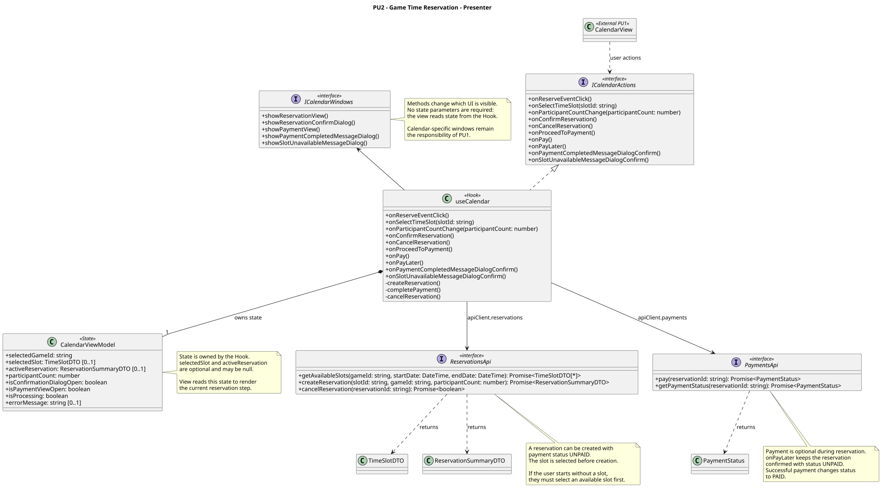

<div hidden>

```
@startuml reservation-view
skinparam classAttributeIconSize 0
skinparam packageStyle rectangle
skinparam shadowing false
skinparam roundcorner 4
skinparam linetype polyline

title PU2 Rezerwacja czasu dla gry - widok

class CalendarView

class ReservationView {
    + show(slot: TimeSlotDTO, reservation: ReservationSummaryDTO | null, isConfirmationDialogOpen: boolean, errorMessage: string)
}

class ReservationFormPanel {
    + show(slot: TimeSlotDTO)
    + onParticipantCountChange(participantCount: number)
    + onConfirmReservationClick()
    + onCancelClick()
}

class ReservationConfirmDialog {
    + show(reservation: ReservationSummaryDTO)
    + onConfirmClick()
    + onCancelClick()
}

class PaymentPanel {
    + show(reservation: ReservationSummaryDTO)
    + onPayClick()
}

class MessageDialog {
    + show(title: string, message: string)
    + onOkClick()
}

class ReservationCompletedMessageDialog
class SlotUnavailableMessageDialog

ReservationCompletedMessageDialog -u-|> MessageDialog
SlotUnavailableMessageDialog -u-|> MessageDialog

ReservationView *-- ReservationFormPanel
ReservationView *-- ReservationConfirmDialog
ReservationView *-- PaymentPanel
ReservationView *-- ReservationCompletedMessageDialog
ReservationView *-- SlotUnavailableMessageDialog

interface ICalendarActions <<interface>> {
    + onReserveEventClick()
    + onSelectTimeSlot(slotId: string)
    + onParticipantCountChange(participantCount: number)
    + onConfirmReservation(participantCount: number)
    + onCancelReservation()
    + onProceedToPayment(reservationId: string)
    + onPay()
    + onPaymentCompletedMessageDialogConfirm()
    + onSlotUnavailableMessageDialogConfirm()
}

ICalendarActions <-u- ReservationFormPanel
ICalendarActions <-u- ReservationConfirmDialog
ICalendarActions <-u- PaymentPanel
ICalendarActions <-u- ReservationCompletedMessageDialog
ICalendarActions <-u- SlotUnavailableMessageDialog

interface ICalendarWindows <<interface>> {
    + showReservationView(slot: TimeSlotDTO)
    + showReservationConfirmDialog(reservation: ReservationSummaryDTO)
    + showPaymentView(reservation: ReservationSummaryDTO)
    + showPaymentCompletedMessageDialog()
    + showSlotUnavailableMessageDialog()
}

class CalendarWindows {
    + showReservationView(slot: TimeSlotDTO)
    + showReservationConfirmDialog(reservation: ReservationSummaryDTO)
    + showPaymentView(reservation: ReservationSummaryDTO)
    + showPaymentCompletedMessageDialog()
    + showSlotUnavailableMessageDialog()
}

CalendarWindows .u.|> ICalendarWindows
CalendarWindows -u-> ReservationView

CalendarView ..> ReservationView : "Rezerwuj" przy wydarzeniu
CalendarView ..> ReservationView : wybór kafelka wolnego terminu

note right of CalendarView
    Widok z PU1 - brak własnego interfejsu
    (zawartość kalendarza projektuje PU1).
    Dwie ścieżki wejścia do PU2:
    - przycisk „Rezerwuj” przy wydarzeniu,
    - wybranie kafelka wolnego terminu -
    w obu przypadkach termin przekazywany
    z góry (showReservationView).
end note

note right of ReservationFormPanel
    Wybór liczby uczestników to zwykły
    input field, nie osobny widok.
end note

note right of PaymentPanel
    Płatność przez zewnętrzną bramę -
    po jej zakończeniu frontend wywołuje
    markPaymentCompleted.
end note

note right of ReservationCompletedMessageDialog
    Potwierdzenie rezerwacji wysyła backend
    do skrzynki wiadomości organizatora.
    Skrzynka wiadomości to osobny PU -
    tu wyświetlany jest tylko komunikat.
end note
@enduml
```

</div>


