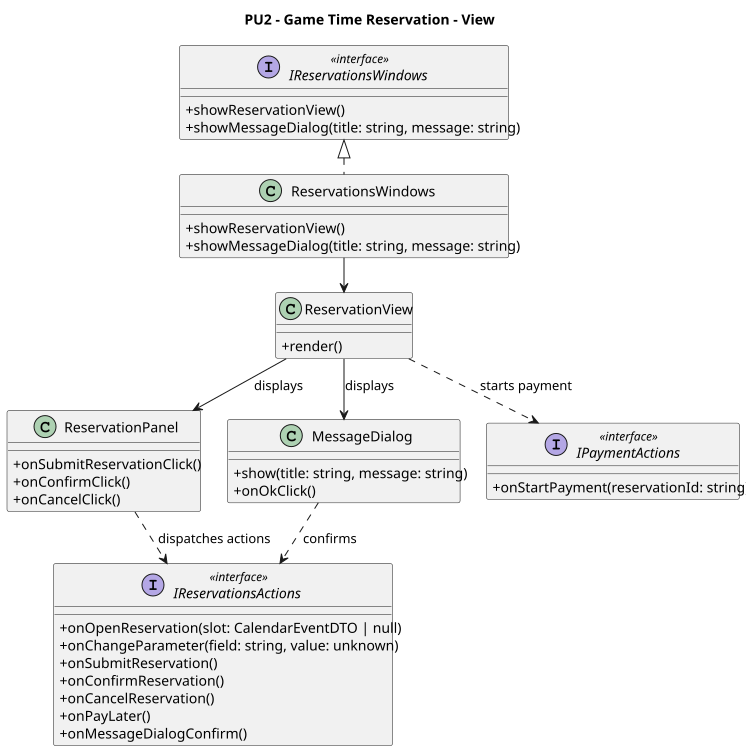

<div hidden>

```


@startuml reservation-view
skinparam classAttributeIconSize 0
skinparam packageStyle rectangle
skinparam shadowing false
skinparam roundcorner 4
skinparam nodesep 26
skinparam ranksep 34
skinparam linetype polyline

title PU2 - Game Time Reservation - View

class CalendarView <<External PU1>>

class ReservationView {
    + render()
}

class ReservationFormPanel {
    + onGameChange(gameId: string)
    + onTimeSlotChange(slotId: string)
    + onParticipantCountChange(participantCount: number)
    + onSubmitReservationClick()
    + onCancelClick()
}

class ReservationConfirmDialog {
    + onConfirmClick()
    + onCancelClick()
}

class PaymentPanel {
    + onPayClick()
    + onPayLaterClick()
}

class MessageDialog {
    + show(title: string, message: string)
    + onOkClick()
}

class PaymentCompletedMessageDialog
class SlotUnavailableMessageDialog
class ReservationCancelledMessageDialog

PaymentCompletedMessageDialog -u-|> MessageDialog
SlotUnavailableMessageDialog -u-|> MessageDialog
ReservationCancelledMessageDialog -u-|> MessageDialog

interface IReservationsActions <<interface>> {
    + onOpenReservation(slot: TimeSlotDTO | null)
    + onChangeParticipantCount(count: number)
    + onSubmitReservation()
    + onConfirmReservation()
    + onCancelReservation()
    + onPayLater()
    + onPaymentCompletedMessageDialogConfirm()
    + onSlotUnavailableMessageDialogConfirm()
    + onReservationCancelledMessageDialogConfirm()
}

interface IPaymentActions <<interface>> {
    + onPay(reservationId: string)
}

interface IReservationsWindows <<interface>> {
    + showReservationView()
    + showReservationConfirmDialog()
    + showPaymentCompletedMessageDialog()
    + showSlotUnavailableMessageDialog()
    + showReservationCancelledMessageDialog()
}

class ReservationsWindows {
    + showReservationView()
    + showReservationConfirmDialog()
    + showPaymentCompletedMessageDialog()
    + showSlotUnavailableMessageDialog()
    + showReservationCancelledMessageDialog()
}

ReservationsWindows .u.|> IReservationsWindows

ReservationView --> ReservationFormPanel : displays
ReservationView --> ReservationConfirmDialog : displays
ReservationView --> PaymentPanel : displays
ReservationView --> PaymentCompletedMessageDialog : displays
ReservationView --> SlotUnavailableMessageDialog : displays
ReservationView --> ReservationCancelledMessageDialog : displays

ReservationFormPanel ..> IReservationsActions : dispatches actions
ReservationConfirmDialog ..> IReservationsActions : dispatches actions
PaymentPanel ..> IReservationsActions : pay later
PaymentPanel ..> IPaymentActions : pay now

PaymentCompletedMessageDialog ..> IReservationsActions
SlotUnavailableMessageDialog ..> IReservationsActions
ReservationCancelledMessageDialog ..> IReservationsActions

ReservationsWindows --> ReservationView
ReservationsWindows --> ReservationFormPanel
ReservationsWindows --> ReservationConfirmDialog
ReservationsWindows --> PaymentCompletedMessageDialog
ReservationsWindows --> SlotUnavailableMessageDialog
ReservationsWindows --> ReservationCancelledMessageDialog

note right of CalendarView
    External PU1.

    Does not open ReservationView directly.
    Navigation is performed through
    the presenter of PU1.
end note

note right of ReservationView
    One view for the entire reservation flow.

    State changes trigger re-rendering.
    No show() parameters are required.
end note

note bottom of PaymentPanel
    Pay now:
    Calls IPaymentActions.onPay().
    Payment flow is handled by usePayment.

    Pay later:
    Calls IReservationsActions.onPayLater().
    Reservation remains Unpaid.
end note

note bottom of IReservationsActions
    Only reservation-related actions.
    Payment processing is not implemented here.
end note

@enduml


```

</div>


