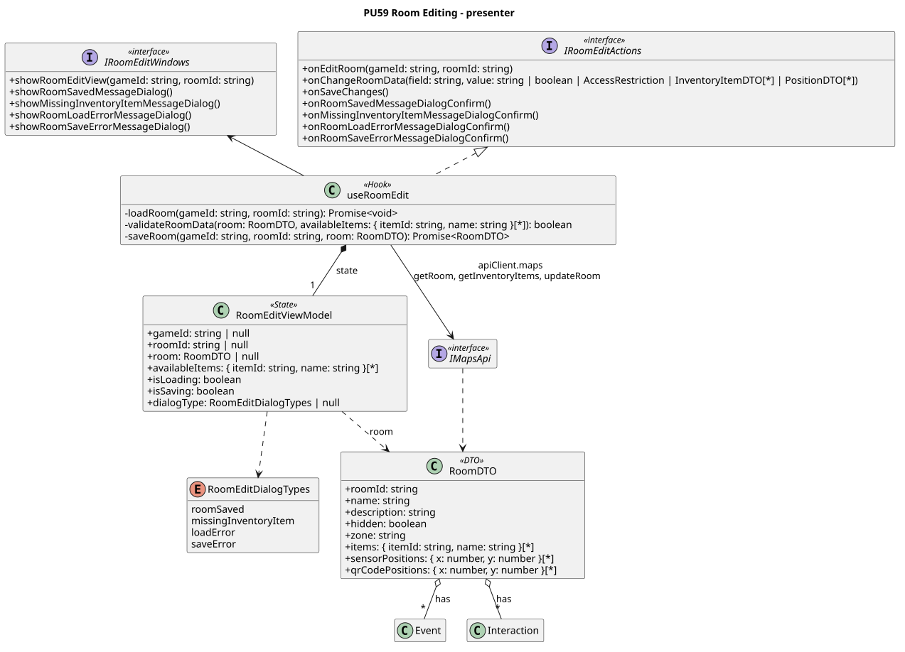

<div hidden>

```
@startuml room-edit-presenter
skinparam classAttributeIconSize 0
skinparam packageStyle rectangle
skinparam shadowing false
skinparam roundcorner 4
skinparam linetype polyline
skinparam nodesep 30
skinparam ranksep 40
hide empty members

title PU59 Room Editing - presenter

interface IRoomEditActions <<interface>> {
    + onEditRoom(gameId: string, roomId: string)
    + onChangeRoomData(field: string, value: string | boolean | AccessRestriction | InventoryItemDTO[*] | PositionDTO[*])
    + onSaveChanges()
    + onRoomSavedMessageDialogConfirm()
    + onMissingInventoryItemMessageDialogConfirm()
    + onRoomLoadErrorMessageDialogConfirm()
    + onRoomSaveErrorMessageDialogConfirm()
}

interface IRoomEditWindows <<interface>> {
    + showRoomEditView(gameId: string, roomId: string)
    + showRoomSavedMessageDialog()
    + showMissingInventoryItemMessageDialog()
    + showRoomLoadErrorMessageDialog()
    + showRoomSaveErrorMessageDialog()
}

class useRoomEdit <<Hook>> {
    - loadRoom(gameId: string, roomId: string): Promise<void>
    - validateRoomData(room: RoomDTO, availableItems: { itemId: string, name: string }[*]): boolean
    - saveRoom(gameId: string, roomId: string, room: RoomDTO): Promise<RoomDTO>
}

class RoomEditViewModel <<State>> {
    + gameId: string | null
    + roomId: string | null
    + room: RoomDTO | null
    + availableItems: { itemId: string, name: string }[*]
    + isLoading: boolean
    + isSaving: boolean
    + dialogType: RoomEditDialogTypes | null
}

class RoomDTO <<DTO>> {
    + roomId: string
    + name: string
    + description: string
    + hidden: boolean
    + zone: string
    + items: { itemId: string, name: string }[*]
    + sensorPositions: { x: number, y: number }[*]
    + qrCodePositions: { x: number, y: number }[*]
}

enum RoomEditDialogTypes {
    roomSaved
    missingInventoryItem
    loadError
    saveError
}

interface IMapsApi <<interface>>

useRoomEdit .u.|> IRoomEditActions
useRoomEdit -u-> IRoomEditWindows
useRoomEdit *-- "1" RoomEditViewModel : state
RoomEditViewModel ..> RoomDTO : room
RoomEditViewModel ..> RoomEditDialogTypes
useRoomEdit --> IMapsApi : apiClient.maps\ngetRoom, getInventoryItems, updateRoom
IMapsApi ..> RoomDTO

class Event
class Interaction

RoomDTO o-- "*" Event : has
RoomDTO o-- "*" Interaction : has
@enduml
```

</div>

