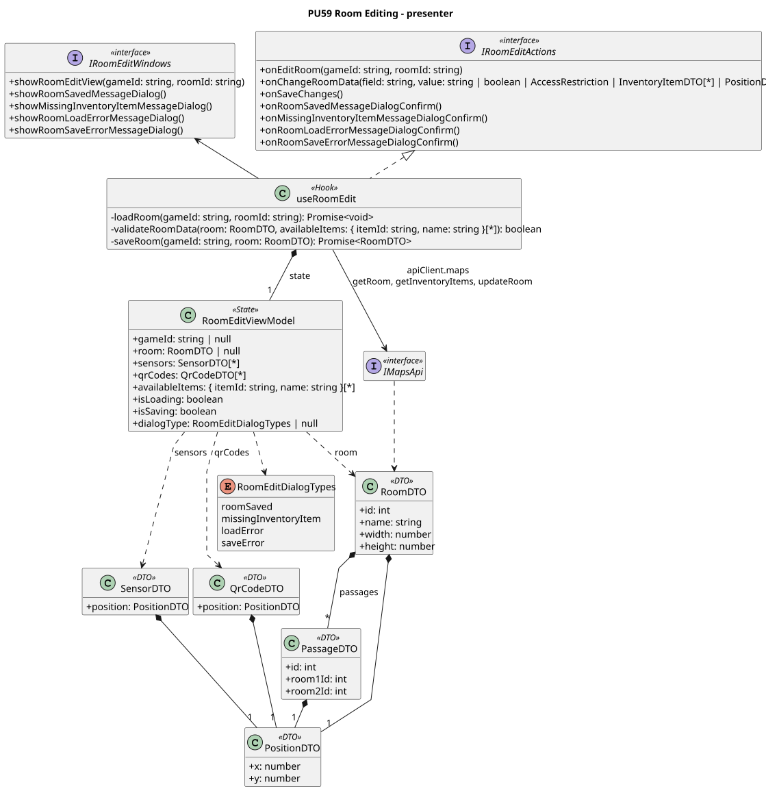

<div hidden>

```
@startuml room-edit-presenter
skinparam classAttributeIconSize 0
skinparam packageStyle rectangle
skinparam shadowing false
skinparam roundcorner 4
skinparam linetype polyline
skinparam nodesep 30
skinparam ranksep 40
hide empty members

title PU59 Room Editing - presenter

interface IRoomEditActions <<interface>> {
    + onEditRoom(gameId: string, roomId: string)
    + onChangeRoomData(field: string, value: string | boolean | AccessRestriction | InventoryItemDTO[*] | PositionDTO[*])
    + onSaveChanges()
    + onRoomSavedMessageDialogConfirm()
    + onMissingInventoryItemMessageDialogConfirm()
    + onRoomLoadErrorMessageDialogConfirm()
    + onRoomSaveErrorMessageDialogConfirm()
}

interface IRoomEditWindows <<interface>> {
    + showRoomEditView(gameId: string, roomId: string)
    + showRoomSavedMessageDialog()
    + showMissingInventoryItemMessageDialog()
    + showRoomLoadErrorMessageDialog()
    + showRoomSaveErrorMessageDialog()
}

class useRoomEdit <<Hook>> {
    - loadRoom(gameId: string, roomId: string): Promise<void>
    - validateRoomData(room: RoomDTO, availableItems: { itemId: string, name: string }[*]): boolean
    - saveRoom(gameId: string, room: RoomDTO): Promise<RoomDTO>
}

class RoomEditViewModel <<State>> {
    + gameId: string | null
    + room: RoomDTO | null
    + sensors: SensorDTO[*]
    + qrCodes: QrCodeDTO[*]
    + availableItems: { itemId: string, name: string }[*]
    + isLoading: boolean
    + isSaving: boolean
    + dialogType: RoomEditDialogTypes | null
}

class RoomDTO <<DTO>> {
    + id: int
    + name: string
    + width: number
    + height: number
}

class SensorDTO <<DTO>> {
    + position: PositionDTO
}

class QrCodeDTO <<DTO>> {
    + position: PositionDTO
}

class PassageDTO <<DTO>> {
    + id: int
    + room1Id: int
    + room2Id: int
}

class PositionDTO <<DTO>> {
    + x: number
    + y: number
}

enum RoomEditDialogTypes {
    roomSaved
    missingInventoryItem
    loadError
    saveError
}

interface IMapsApi <<interface>>

useRoomEdit .u.|> IRoomEditActions
useRoomEdit -u-> IRoomEditWindows
useRoomEdit *-- "1" RoomEditViewModel : state
RoomEditViewModel ..> RoomDTO : room
RoomEditViewModel ..> SensorDTO : sensors
RoomEditViewModel ..> QrCodeDTO : qrCodes
RoomEditViewModel ..> RoomEditDialogTypes
useRoomEdit --> IMapsApi : apiClient.maps\ngetRoom, getInventoryItems, updateRoom
IMapsApi ..> RoomDTO
RoomDTO *-- "*" PassageDTO : passages
RoomDTO *-- "1" PositionDTO
PassageDTO *-- "1" PositionDTO
SensorDTO *-- "1" PositionDTO
QrCodeDTO *-- "1" PositionDTO

@enduml
```

</div>

