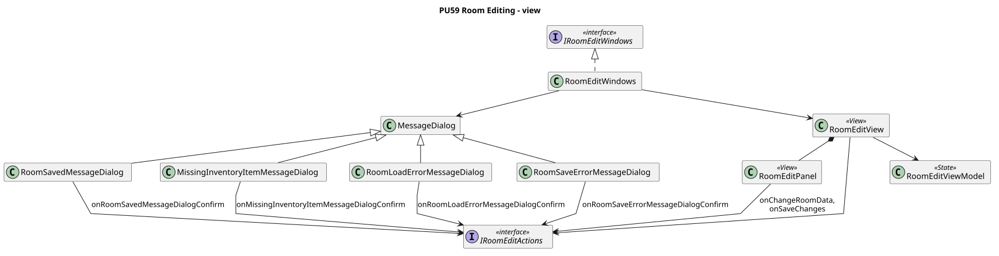

<div hidden>

```
@startuml room-edit-view
skinparam classAttributeIconSize 0
skinparam packageStyle rectangle
skinparam shadowing false
skinparam roundcorner 4
skinparam linetype polyline
skinparam nodesep 30
skinparam ranksep 40
hide empty members

title PU59 Room Editing - view

class RoomEditView <<View>>
class RoomEditPanel <<View>>
class MessageDialog
class RoomSavedMessageDialog
class MissingInventoryItemMessageDialog
class RoomLoadErrorMessageDialog
class RoomSaveErrorMessageDialog

RoomSavedMessageDialog -u-|> MessageDialog
MissingInventoryItemMessageDialog -u-|> MessageDialog
RoomLoadErrorMessageDialog -u-|> MessageDialog
RoomSaveErrorMessageDialog -u-|> MessageDialog

class RoomEditWindows
interface IRoomEditWindows <<interface>>
interface IRoomEditActions <<interface>>
class RoomEditViewModel <<State>>

RoomEditWindows .u.|> IRoomEditWindows
RoomEditWindows --> RoomEditView
RoomEditWindows --> RoomSavedMessageDialog
RoomEditWindows --> MissingInventoryItemMessageDialog
RoomEditWindows --> RoomLoadErrorMessageDialog
RoomEditWindows --> RoomSaveErrorMessageDialog

RoomEditView *-- RoomEditPanel
RoomEditView --> IRoomEditActions
RoomEditView --> RoomEditViewModel
RoomEditPanel --> IRoomEditActions : onChangeRoomData,\nonSaveChanges

RoomSavedMessageDialog --> IRoomEditActions : onRoomSavedMessageDialogConfirm
MissingInventoryItemMessageDialog --> IRoomEditActions : onMissingInventoryItemMessageDialogConfirm
RoomLoadErrorMessageDialog --> IRoomEditActions : onRoomLoadErrorMessageDialogConfirm
RoomSaveErrorMessageDialog --> IRoomEditActions : onRoomSaveErrorMessageDialogConfirm
@enduml

```

</div>

