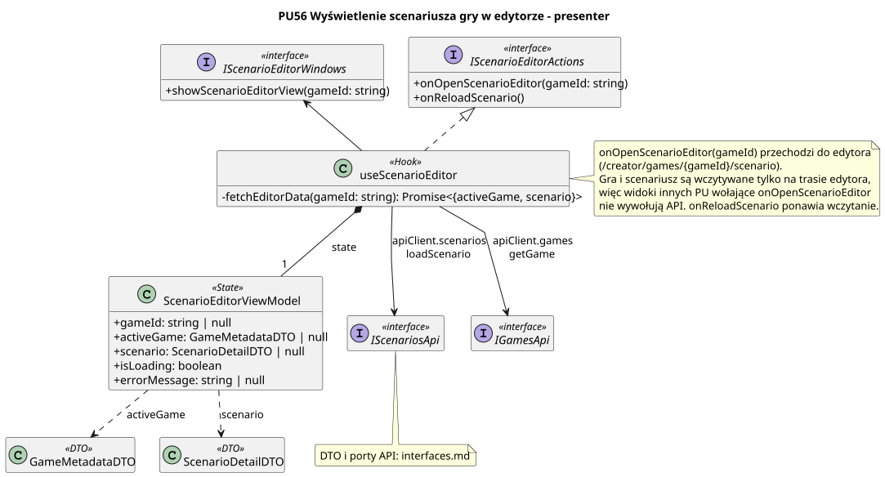

<div hidden>

```
@startuml scenario-editor-presenter
skinparam classAttributeIconSize 0
skinparam packageStyle rectangle
skinparam shadowing false
skinparam roundcorner 4
skinparam linetype polyline
skinparam nodesep 30
skinparam ranksep 40
hide empty members

title PU56 Wyświetlenie scenariusza gry w edytorze - presenter

interface IScenarioEditorActions <<interface>> {
    + onOpenScenarioEditor(gameId: string)
    + onReloadScenario()
}

interface IScenarioEditorWindows <<interface>> {
    + showScenarioEditorView(gameId: string)
}

class useScenarioEditor <<Hook>> {
    - fetchEditorData(gameId: string): Promise<{activeGame, scenario}>
}

class ScenarioEditorViewModel <<State>> {
    + gameId: string | null
    + activeGame: GameMetadataDTO | null
    + scenario: ScenarioDetailDTO | null
    + isLoading: boolean
    + errorMessage: string | null
}

interface IScenariosApi <<interface>>
interface IGamesApi <<interface>>
class GameMetadataDTO <<DTO>>
class ScenarioDetailDTO <<DTO>>

useScenarioEditor .u.|> IScenarioEditorActions
useScenarioEditor -u-> IScenarioEditorWindows
useScenarioEditor *-- "1" ScenarioEditorViewModel : state
ScenarioEditorViewModel ..> GameMetadataDTO : activeGame
ScenarioEditorViewModel ..> ScenarioDetailDTO : scenario
useScenarioEditor --> IScenariosApi : apiClient.scenarios\nloadScenario
useScenarioEditor --> IGamesApi : apiClient.games\ngetGame

note right of useScenarioEditor
    onOpenScenarioEditor(gameId) przechodzi do edytora
    (/creator/games/{gameId}/scenario).
    Gra i scenariusz są wczytywane tylko na trasie edytora,
    więc widoki innych PU wołające onOpenScenarioEditor
    nie wywołują API. onReloadScenario ponawia wczytanie.
end note

note bottom of IScenariosApi
    DTO i porty API: interfaces.md
end note
@enduml
```

</div>


