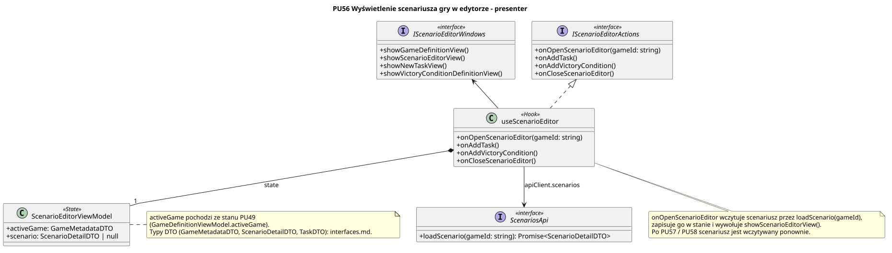

<div hidden>

```
@startuml scenario-editor-presenter
skinparam classAttributeIconSize 0
skinparam packageStyle rectangle
skinparam shadowing false
skinparam roundcorner 4
skinparam linetype polyline

title PU56 Wyświetlenie scenariusza gry w edytorze - presenter

class useScenarioEditor <<Hook>> {
    + onOpenScenarioEditor(gameId: string)
    + onAddTask()
    + onAddVictoryCondition()
    + onCloseScenarioEditor()
}

interface IScenarioEditorActions <<interface>> {
    + onOpenScenarioEditor(gameId: string)
    + onAddTask()
    + onAddVictoryCondition()
    + onCloseScenarioEditor()
}

interface IScenarioEditorWindows <<interface>> {
    + showGameDefinitionView()
    + showScenarioEditorView()
    + showNewTaskView()
    + showVictoryConditionDefinitionView()
}

interface ScenariosApi <<interface>> {
    + loadScenario(gameId: string): Promise<ScenarioDetailDTO>
}

class ScenarioEditorViewModel <<State>> {
    + activeGame: GameMetadataDTO
    + scenario: ScenarioDetailDTO | null
}

class GameMetadataDTO <<DTO>>
class ScenarioDetailDTO <<DTO>> {
    + scenarioId: string
    + gameId: string
    + tasks: TaskDTO[*]
    + victoryConditions: string[*]
}
class TaskDTO <<DTO>>

useScenarioEditor .u.|> IScenarioEditorActions
useScenarioEditor -u-> IScenarioEditorWindows
useScenarioEditor --> ScenariosApi : apiClient.scenarios
useScenarioEditor *-- "1" ScenarioEditorViewModel : state

ScenarioEditorViewModel --> GameMetadataDTO
ScenarioEditorViewModel --> ScenarioDetailDTO
ScenarioDetailDTO *-- "*" TaskDTO
ScenariosApi ..> ScenarioDetailDTO

note bottom of useScenarioEditor
    onOpenScenarioEditor wczytuje scenariusz przez loadScenario(gameId),
    zapisuje go w stanie i wywołuje showScenarioEditorView().
    Po PU57 / PU58 scenariusz jest wczytywany ponownie.
end note

note right of ScenarioEditorViewModel
    activeGame pochodzi ze stanu PU49
    (GameDefinitionViewModel.activeGame).
    Pełne pola DTO: interfaces.md.
end note
@enduml
```

</div>


