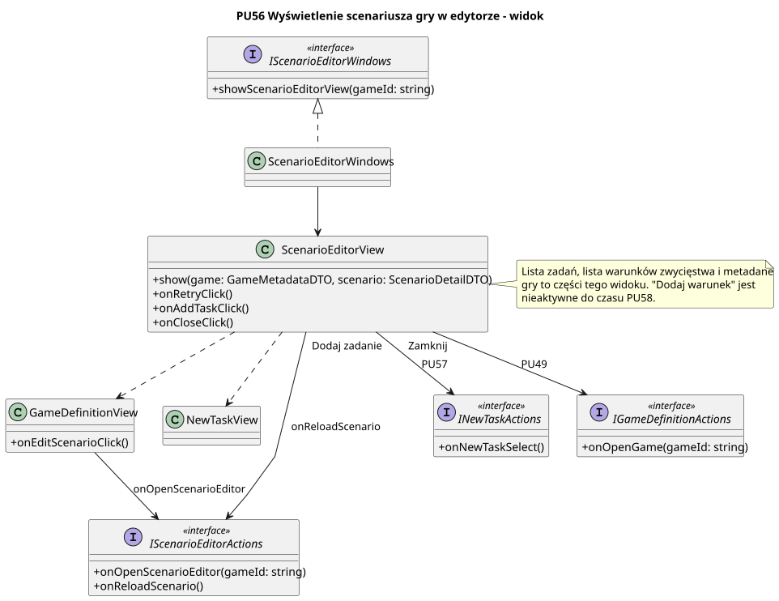

<div hidden>

```
@startuml scenario-editor-view
skinparam classAttributeIconSize 0
skinparam packageStyle rectangle
skinparam shadowing false
skinparam roundcorner 4
skinparam linetype polyline
skinparam nodesep 30
skinparam ranksep 40
hide empty members

title PU56 Wyświetlenie scenariusza gry w edytorze - widok

class ScenarioEditorView <<View>>

class ScenarioEditorWindows
interface IScenarioEditorWindows <<interface>>
interface IScenarioEditorActions <<interface>>
class ScenarioEditorViewModel <<State>>
interface INewTaskActions <<interface>>
interface IGameDefinitionActions <<interface>>
class GameDefinitionView <<View>>

ScenarioEditorWindows .u.|> IScenarioEditorWindows
ScenarioEditorWindows --> ScenarioEditorView

GameDefinitionView --> IScenarioEditorActions : onOpenScenarioEditor
ScenarioEditorView --> IScenarioEditorActions : onReloadScenario
ScenarioEditorView --> ScenarioEditorViewModel
ScenarioEditorView --> INewTaskActions : onNewTaskSelect (PU57)
ScenarioEditorView --> IGameDefinitionActions : onOpenGame (PU49)

note right of ScenarioEditorView
    Lista zadań, lista warunków zwycięstwa i metadane
    gry to części tego widoku. "Dodaj warunek" jest
    nieaktywne do czasu PU58.
end note
@enduml
```

</div>


