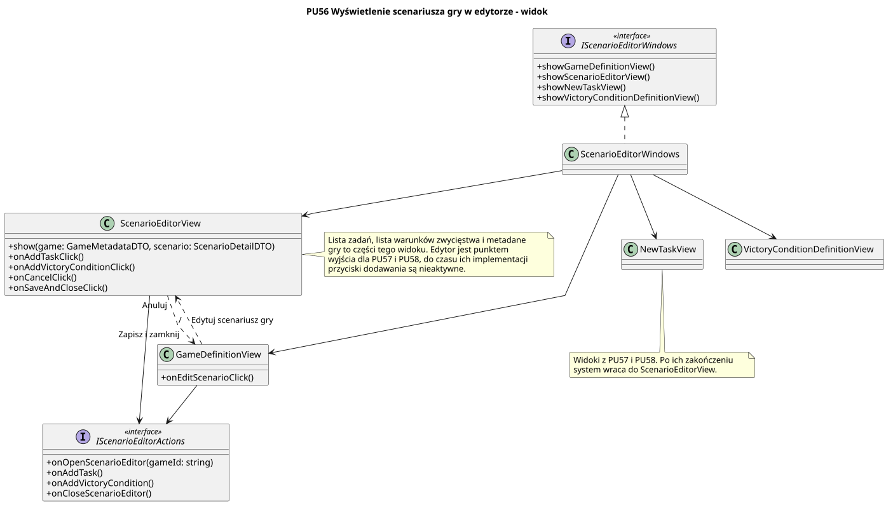

<div hidden>

```
@startuml scenario-editor-view
skinparam classAttributeIconSize 0
skinparam packageStyle rectangle
skinparam shadowing false
skinparam roundcorner 4
skinparam linetype polyline

title PU56 Wyświetlenie scenariusza gry w edytorze - widok

class GameDefinitionView {
    + onEditScenarioClick()
}

class ScenarioEditorView {
    + show(game: GameMetadataDTO, scenario: ScenarioDetailDTO)
    + onAddTaskClick()
    + onAddVictoryConditionClick()
    + onCancelClick()
    + onSaveAndCloseClick()
}

class NewTaskView
class VictoryConditionDefinitionView

interface IScenarioEditorActions <<interface>> {
    + onOpenScenarioEditor(gameId: string)
    + onAddTask()
    + onAddVictoryCondition()
    + onCloseScenarioEditor()
}

GameDefinitionView --> IScenarioEditorActions
ScenarioEditorView --> IScenarioEditorActions

interface IScenarioEditorWindows <<interface>> {
    + showGameDefinitionView()
    + showScenarioEditorView()
    + showNewTaskView()
    + showVictoryConditionDefinitionView()
}

class ScenarioEditorWindows

ScenarioEditorWindows .u.|> IScenarioEditorWindows

ScenarioEditorWindows --> GameDefinitionView
ScenarioEditorWindows --> ScenarioEditorView
ScenarioEditorWindows --> NewTaskView
ScenarioEditorWindows --> VictoryConditionDefinitionView

GameDefinitionView ..> ScenarioEditorView : "Edytuj scenariusz gry"
ScenarioEditorView ..> GameDefinitionView : "Anuluj" / "Zapisz i zamknij"

note right of ScenarioEditorView
    Lista zadań, lista warunków zwycięstwa i metadane
    gry to części tego widoku. Edytor jest punktem
    wyjścia dla PU57 i PU58, do czasu ich implementacji
    przyciski dodawania są nieaktywne.
end note

note bottom of NewTaskView
    Widoki z PU57 i PU58. Po ich zakończeniu
    system wraca do ScenarioEditorView.
end note
@enduml
```

</div>


