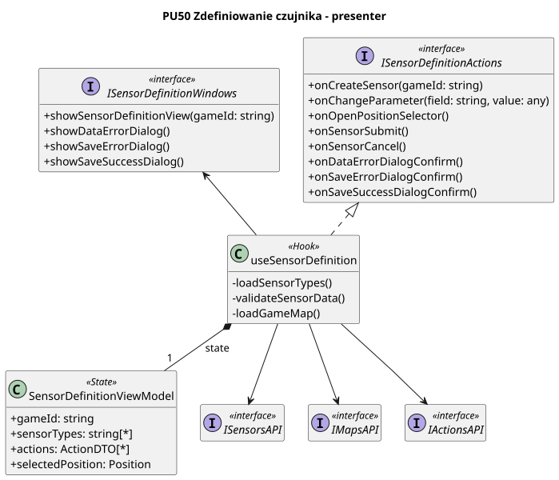

<div hidden>

```
@startuml sensor-definition-presenter
skinparam classAttributeIconSize 0
skinparam packageStyle rectangle
skinparam shadowing false
skinparam roundcorner 4
skinparam linetype polyline
skinparam nodesep 30
skinparam ranksep 40
hide empty members

title PU50 Zdefiniowanie czujnika - presenter

interface ISensorDefinitionWindows <<interface>> {
    +showSensorDefinitionView(gameId: string)
    +showDataErrorDialog()
    +showSaveErrorDialog()
    +showSaveSuccessDialog()
}

interface ISensorDefinitionActions <<interface>> {
    +onCreateSensor(gameId: string)
    +onChangeParameter(field: string, value: any)
    +onOpenPositionSelector()
    +onSensorSubmit()
    +onSensorCancel()
    +onDataErrorDialogConfirm()
    +onSaveErrorDialogConfirm()
    +onSaveSuccessDialogConfirm()
}

class useSensorDefinition <<Hook>> {
    -loadSensorTypes()
    -validateSensorData()
    -loadGameMap()
}

class SensorDefinitionViewModel <<State>> {
    +gameId: string
    +sensorTypes: string[*]
    +actions: ActionDTO[*]
    +selectedPosition: Position
}

interface ISensorsApi <<interface>>
interface IMapsApi <<interface>>
interface IActionsApi <<interface>>

useSensorDefinition .u.|> ISensorDefinitionActions
useSensorDefinition -u-> ISensorDefinitionWindows
useSensorDefinition *-- "1" SensorDefinitionViewModel : state
useSensorDefinition --> ISensorsApi
useSensorDefinition --> IMapsApi
useSensorDefinition --> IActionsApi
@enduml
```

</div>


