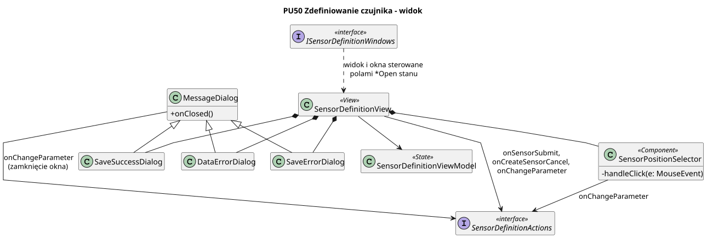

<div hidden>

```
@startuml sensor-definition-view
skinparam classAttributeIconSize 0
skinparam packageStyle rectangle
skinparam shadowing false
skinparam roundcorner 4
skinparam linetype polyline
skinparam nodesep 30
skinparam ranksep 40
hide empty members

title PU50 Zdefiniowanie czujnika - widok

class SensorDefinitionView <<View>>

class SensorPositionSelector <<Component>> {
    - handleClick(e: MouseEvent)
}

class MessageDialog {
    + onClosed()
}

class DataErrorDialog
class SaveErrorDialog
class SaveSuccessDialog

interface ISensorDefinitionWindows <<interface>>
interface SensorDefinitionActions <<interface>>
class SensorDefinitionViewModel <<State>>

DataErrorDialog -u-|> MessageDialog
SaveErrorDialog -u-|> MessageDialog
SaveSuccessDialog -u-|> MessageDialog

SensorDefinitionView *-- SensorPositionSelector
SensorDefinitionView *-- DataErrorDialog
SensorDefinitionView *-- SaveErrorDialog
SensorDefinitionView *-- SaveSuccessDialog

SensorDefinitionView --> SensorDefinitionActions : onSensorSubmit,\nonCreateSensorCancel,\nonChangeParameter
SensorPositionSelector --> SensorDefinitionActions : onChangeParameter
MessageDialog --> SensorDefinitionActions : onChangeParameter\n(zamknięcie okna)
SensorDefinitionView --> SensorDefinitionViewModel
ISensorDefinitionWindows ..> SensorDefinitionView : widok i okna sterowane\npolami *Open stanu
@enduml
```

</div>


