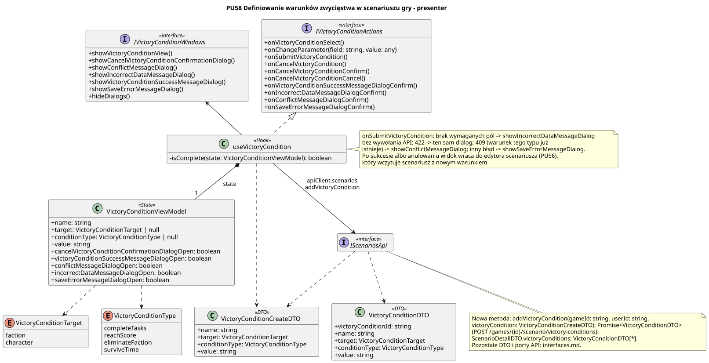

<div hidden>

```
@startuml victory-condition-presenter
skinparam classAttributeIconSize 0
skinparam packageStyle rectangle
skinparam shadowing false
skinparam roundcorner 4
skinparam linetype polyline
skinparam nodesep 30
skinparam ranksep 40
hide empty members

title PU58 Definiowanie warunków zwycięstwa w scenariuszu gry - presenter

interface IVictoryConditionActions <<interface>> {
    + onVictoryConditionSelect()
    + onChangeParameter(field: string, value: any)
    + onSubmitVictoryCondition()
    + onCancelVictoryCondition()
    + onCancelVictoryConditionConfirm()
    + onCancelVictoryConditionCancel()
    + onVictoryConditionSuccessMessageDialogConfirm()
    + onIncorrectDataMessageDialogConfirm()
    + onConflictMessageDialogConfirm()
    + onSaveErrorMessageDialogConfirm()
}

interface IVictoryConditionWindows <<interface>> {
    + showVictoryConditionView()
    + showCancelVictoryConditionConfirmationDialog()
    + showConflictMessageDialog()
    + showIncorrectDataMessageDialog()
    + showVictoryConditionSuccessMessageDialog()
    + showSaveErrorMessageDialog()
    + hideDialogs()
}

class useVictoryCondition <<Hook>> {
    - isComplete(state: VictoryConditionViewModel): boolean
}

class VictoryConditionViewModel <<State>> {
    + name: string
    + target: VictoryConditionTarget | null
    + conditionType: VictoryConditionType | null
    + value: string
    + cancelVictoryConditionConfirmationDialogOpen: boolean
    + victoryConditionSuccessMessageDialogOpen: boolean
    + conflictMessageDialogOpen: boolean
    + incorrectDataMessageDialogOpen: boolean
    + saveErrorMessageDialogOpen: boolean
}

class VictoryConditionCreateDTO <<DTO>> {
    + name: string
    + target: VictoryConditionTarget
    + conditionType: VictoryConditionType
    + value: string
}

class VictoryConditionDTO <<DTO>> {
    + victoryConditionId: string
    + name: string
    + target: VictoryConditionTarget
    + conditionType: VictoryConditionType
    + value: string
}

enum VictoryConditionTarget {
    faction
    character
}

enum VictoryConditionType {
    completeTasks
    reachScore
    eliminateFaction
    surviveTime
}

interface IScenariosApi <<interface>>

useVictoryCondition .u.|> IVictoryConditionActions
useVictoryCondition -u-> IVictoryConditionWindows
useVictoryCondition *-- "1" VictoryConditionViewModel : state
useVictoryCondition ..> VictoryConditionCreateDTO
useVictoryCondition --> IScenariosApi : apiClient.scenarios\naddVictoryCondition
VictoryConditionViewModel ..> VictoryConditionTarget
VictoryConditionViewModel ..> VictoryConditionType
IScenariosApi ..> VictoryConditionCreateDTO
IScenariosApi ..> VictoryConditionDTO

note right of useVictoryCondition
    onSubmitVictoryCondition: brak wymaganych pól -> showIncorrectDataMessageDialog
    bez wywołania API; 422 -> ten sam dialog; 409 (warunek tego typu już
    istnieje) -> showConflictMessageDialog; inny błąd -> showSaveErrorMessageDialog.
    Po sukcesie albo anulowaniu widok wraca do edytora scenariusza (PU56),
    który wczytuje scenariusz z nowym warunkiem.
end note

note bottom of IScenariosApi
    Nowa metoda: addVictoryCondition(gameId: string, userId: string,
    victoryCondition: VictoryConditionCreateDTO): Promise<VictoryConditionDTO>
    (POST /games/{id}/scenario/victory-conditions).
    ScenarioDetailDTO.victoryConditions: VictoryConditionDTO[*].
    Pozostałe DTO i porty API: interfaces.md.
end note
@enduml
```

</div>


