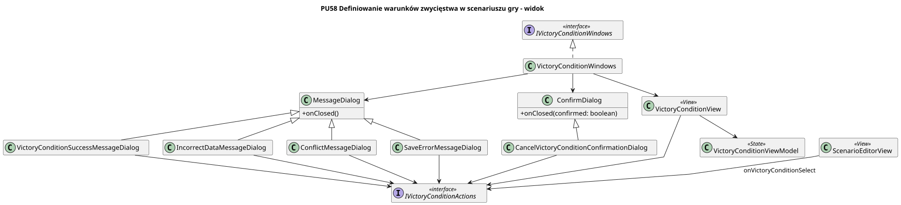

<div hidden>

```
@startuml victory-condition-view
skinparam classAttributeIconSize 0
skinparam packageStyle rectangle
skinparam shadowing false
skinparam roundcorner 4
skinparam linetype polyline
skinparam nodesep 30
skinparam ranksep 40
hide empty members

title PU58 Definiowanie warunków zwycięstwa w scenariuszu gry - widok

class VictoryConditionView <<View>>

class ConfirmDialog {
    + onClosed(confirmed: boolean)
}

class MessageDialog {
    + onClosed()
}

class CancelVictoryConditionConfirmationDialog
class VictoryConditionSuccessMessageDialog
class IncorrectDataMessageDialog
class ConflictMessageDialog
class SaveErrorMessageDialog

CancelVictoryConditionConfirmationDialog -u-|> ConfirmDialog
VictoryConditionSuccessMessageDialog -u-|> MessageDialog
IncorrectDataMessageDialog -u-|> MessageDialog
ConflictMessageDialog -u-|> MessageDialog
SaveErrorMessageDialog -u-|> MessageDialog

class VictoryConditionWindows
interface IVictoryConditionWindows <<interface>>
interface IVictoryConditionActions <<interface>>
class VictoryConditionViewModel <<State>>
class ScenarioEditorView <<View>>

VictoryConditionWindows .u.|> IVictoryConditionWindows
VictoryConditionWindows --> VictoryConditionView
VictoryConditionWindows --> ConfirmDialog
VictoryConditionWindows --> MessageDialog

ScenarioEditorView --> IVictoryConditionActions : onVictoryConditionSelect
VictoryConditionView --> IVictoryConditionActions
VictoryConditionView --> VictoryConditionViewModel
CancelVictoryConditionConfirmationDialog --> IVictoryConditionActions
VictoryConditionSuccessMessageDialog --> IVictoryConditionActions
IncorrectDataMessageDialog --> IVictoryConditionActions
ConflictMessageDialog --> IVictoryConditionActions
SaveErrorMessageDialog --> IVictoryConditionActions
@enduml
```

</div>


