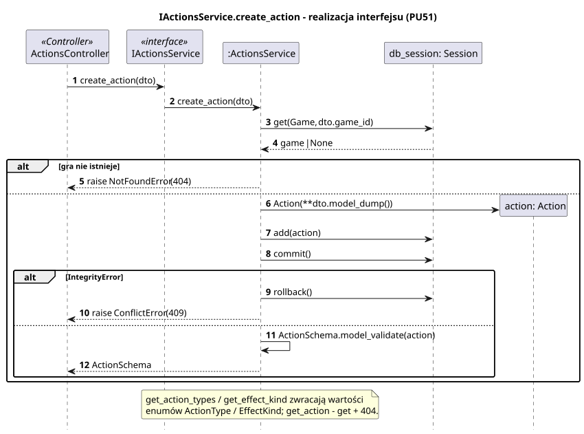

<div hidden>

```
@startuml actions-service-create-action
skinparam shadowing false
skinparam roundcorner 4
skinparam sequenceMessageAlign left
skinparam responseMessageBelowArrow true
skinparam maxMessageSize 260
skinparam ParticipantPadding 8
hide footbox
autonumber

title IActionsService.create_action - realizacja interfejsu (PU51)

participant "ActionsController" as C <<Controller>>
participant "IActionsService" as I <<interface>>
participant ":ActionsService" as S
participant "db_session: Session" as DB
participant "action: Action" as A

C -> I : create_action(dto)
I -> S : create_action(dto)
S -> DB : get(Game, dto.game_id)
DB --> S : game | None
alt gra nie istnieje
    S --> C : raise NotFoundError (404)
else
    S -> A ** : Action(**dto.model_dump())
    S -> DB : add(action)
    S -> DB : commit()
    alt IntegrityError
        S -> DB : rollback()
        S --> C : raise ConflictError (409)
    else
        S -> S : ActionSchema.model_validate(action)
        S --> C : ActionSchema
    end
end

note over S
    get_action_types / get_effect_kind zwracają wartości
    enumów ActionType / EffectKind; get_action - get + 404.
end note
@enduml
```

</div>


