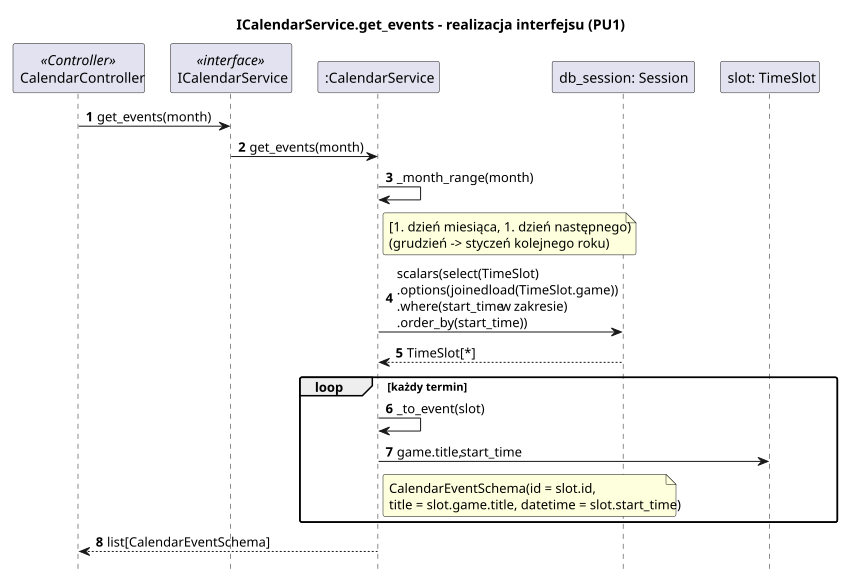

<div hidden>

```
@startuml calendar-service-get-events
skinparam shadowing false
skinparam roundcorner 4
skinparam sequenceMessageAlign left
skinparam responseMessageBelowArrow true
skinparam maxMessageSize 260
skinparam ParticipantPadding 8
hide footbox
autonumber

title ICalendarService.get_events - realizacja interfejsu (PU1)

participant "CalendarController" as C <<Controller>>
participant "ICalendarService" as I <<interface>>
participant ":CalendarService" as S
participant "db_session: Session" as DB
participant "slot: TimeSlot" as T

C -> I : get_events(month)
I -> S : get_events(month)
S -> S : _month_range(month)
note right of S : [1. dzień miesiąca, 1. dzień następnego)\n(grudzień -> styczeń kolejnego roku)
S -> DB : scalars(select(TimeSlot)\n.options(joinedload(TimeSlot.game))\n.where(start_time w zakresie)\n.order_by(start_time))
DB --> S : TimeSlot[*]
loop każdy termin
    S -> S : _to_event(slot)
    S -> T : game.title, start_time
    note right of S : CalendarEventSchema(id = slot.id,\ntitle = slot.game.title, datetime = slot.start_time)
end
S --> C : list[CalendarEventSchema]
@enduml
```

</div>


