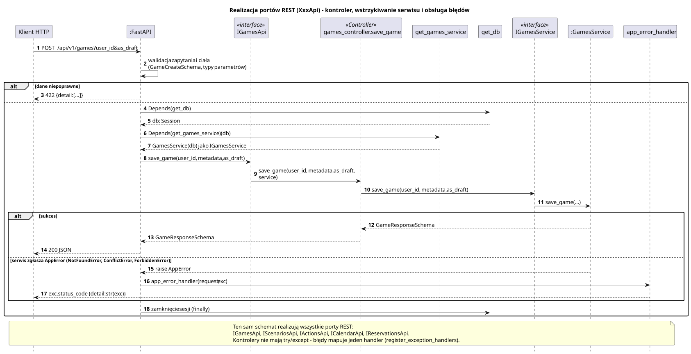

<div hidden>

```
@startuml controller-pipeline
skinparam shadowing false
skinparam roundcorner 4
skinparam sequenceMessageAlign left
skinparam responseMessageBelowArrow true
skinparam maxMessageSize 260
skinparam ParticipantPadding 8
hide footbox
autonumber

title Realizacja portów REST (XxxApi) - kontroler, wstrzykiwanie serwisu i obsługa błędów

participant "Klient HTTP" as H
participant ":FastAPI" as F
participant "IGamesApi" as API <<interface>>
participant "games_controller.save_game" as C <<Controller>>
participant "get_games_service" as D
participant "get_db" as DBF
participant "IGamesService" as I <<interface>>
participant ":GamesService" as S
participant "app_error_handler" as EH

H -> F : POST /api/v1/games?user_id&as_draft
F -> F : walidacja zapytania i ciała\n(GameCreateSchema, typy parametrów)
alt dane niepoprawne
    F --> H : 422 {detail: [...]}
else
    F -> DBF : Depends(get_db)
    DBF --> F : db: Session
    F -> D : Depends(get_games_service)(db)
    D --> F : GamesService(db) jako IGamesService
    F -> API : save_game(user_id, metadata, as_draft)
    API -> C : save_game(user_id, metadata, as_draft, service)
    C -> I : save_game(user_id, metadata, as_draft)
    I -> S : save_game(...)
    alt sukces
        S --> C : GameResponseSchema
        C --> F : GameResponseSchema
        F --> H : 200 JSON
    else serwis zgłasza AppError (NotFoundError, ConflictError, ForbiddenError)
        S --> F : raise AppError
        F -> EH : app_error_handler(request, exc)
        EH --> H : exc.status_code {detail: str(exc)}
    end
    F -> DBF : zamknięcie sesji (finally)
end

note over H, EH
    Ten sam schemat realizują wszystkie porty REST:
    IGamesApi, IScenariosApi, IActionsApi, ICalendarApi, IReservationsApi.
    Kontrolery nie mają try/except - błędy mapuje jeden handler (register_exception_handlers).
end note
@enduml
```

</div>


