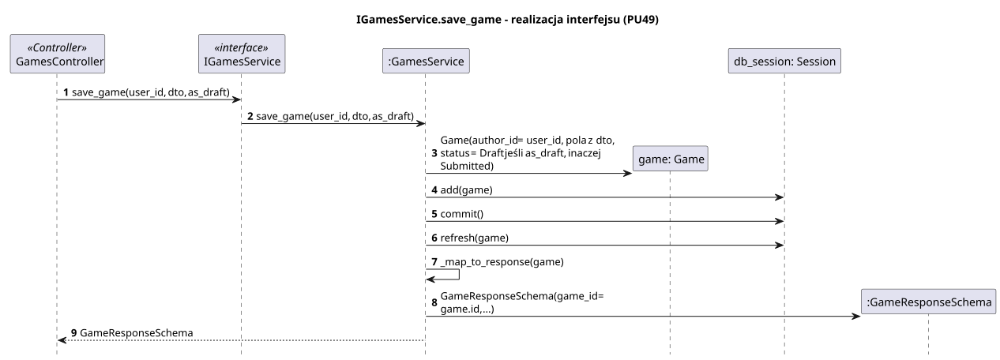
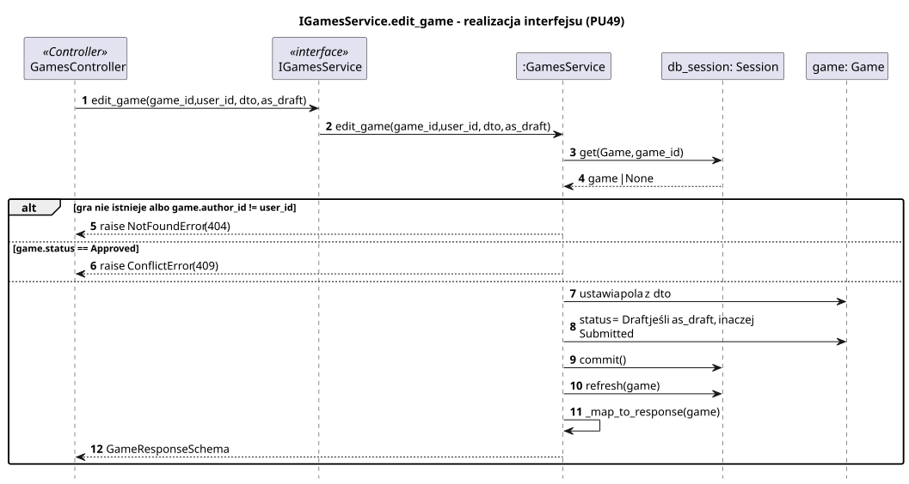
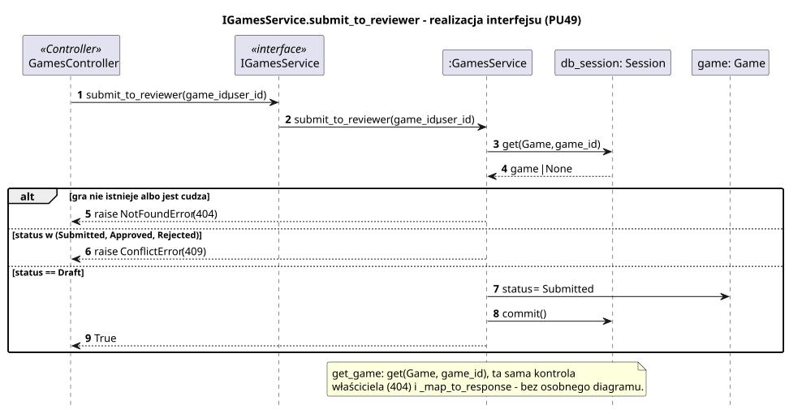
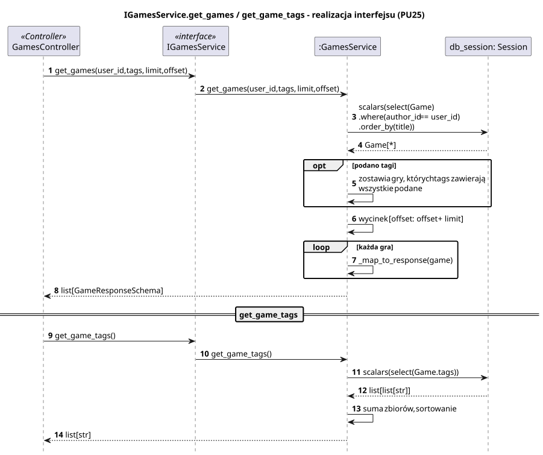

<div hidden>

```
@startuml games-service-save-game
skinparam shadowing false
skinparam roundcorner 4
skinparam sequenceMessageAlign left
skinparam responseMessageBelowArrow true
skinparam maxMessageSize 260
skinparam ParticipantPadding 8
hide footbox
autonumber

title IGamesService.save_game - realizacja interfejsu (PU49)

participant "GamesController" as C <<Controller>>
participant "IGamesService" as I <<interface>>
participant ":GamesService" as S
participant "game: Game" as G
participant "db_session: Session" as DB
participant ":GameResponseSchema" as R

C -> I : save_game(user_id, dto, as_draft)
I -> S : save_game(user_id, dto, as_draft)
S -> G ** : Game(author_id = user_id, pola z dto,\nstatus = Draft jeśli as_draft, inaczej Submitted)
S -> DB : add(game)
S -> DB : commit()
S -> DB : refresh(game)
S -> S : _map_to_response(game)
S -> R ** : GameResponseSchema(game_id = game.id, ...)
S --> C : GameResponseSchema
@enduml
```

</div>



<div hidden>

```
@startuml games-service-edit-game
skinparam shadowing false
skinparam roundcorner 4
skinparam sequenceMessageAlign left
skinparam responseMessageBelowArrow true
skinparam maxMessageSize 260
skinparam ParticipantPadding 8
hide footbox
autonumber

title IGamesService.edit_game - realizacja interfejsu (PU49)

participant "GamesController" as C <<Controller>>
participant "IGamesService" as I <<interface>>
participant ":GamesService" as S
participant "db_session: Session" as DB
participant "game: Game" as G

C -> I : edit_game(game_id, user_id, dto, as_draft)
I -> S : edit_game(game_id, user_id, dto, as_draft)
S -> DB : get(Game, game_id)
DB --> S : game | None
alt gra nie istnieje albo game.author_id != user_id
    S --> C : raise NotFoundError (404)
else game.status == Approved
    S --> C : raise ConflictError (409)
else
    S -> G : ustawia pola z dto
    S -> G : status = Draft jeśli as_draft, inaczej Submitted
    S -> DB : commit()
    S -> DB : refresh(game)
    S -> S : _map_to_response(game)
    S --> C : GameResponseSchema
end
@enduml
```

</div>



<div hidden>

```
@startuml games-service-submit-to-reviewer
skinparam shadowing false
skinparam roundcorner 4
skinparam sequenceMessageAlign left
skinparam responseMessageBelowArrow true
skinparam maxMessageSize 260
skinparam ParticipantPadding 8
hide footbox
autonumber

title IGamesService.submit_to_reviewer - realizacja interfejsu (PU49)

participant "GamesController" as C <<Controller>>
participant "IGamesService" as I <<interface>>
participant ":GamesService" as S
participant "db_session: Session" as DB
participant "game: Game" as G

C -> I : submit_to_reviewer(game_id, user_id)
I -> S : submit_to_reviewer(game_id, user_id)
S -> DB : get(Game, game_id)
DB --> S : game | None
alt gra nie istnieje albo jest cudza
    S --> C : raise NotFoundError (404)
else status w (Submitted, Approved, Rejected)
    S --> C : raise ConflictError (409)
else status == Draft
    S -> G : status = Submitted
    S -> DB : commit()
    S --> C : True
end

note over S
    get_game: get(Game, game_id), ta sama kontrola
    właściciela (404) i _map_to_response - bez osobnego diagramu.
end note
@enduml
```

</div>



<div hidden>

```
@startuml games-service-get-games
skinparam shadowing false
skinparam roundcorner 4
skinparam sequenceMessageAlign left
skinparam responseMessageBelowArrow true
skinparam maxMessageSize 260
skinparam ParticipantPadding 8
hide footbox
autonumber

title IGamesService.get_games / get_game_tags - realizacja interfejsu (PU25)

participant "GamesController" as C <<Controller>>
participant "IGamesService" as I <<interface>>
participant ":GamesService" as S
participant "db_session: Session" as DB

C -> I : get_games(user_id, tags, limit, offset)
I -> S : get_games(user_id, tags, limit, offset)
S -> DB : scalars(select(Game)\n.where(author_id == user_id)\n.order_by(title))
DB --> S : Game[*]
opt podano tagi
    S -> S : zostawia gry, których tags zawierają wszystkie podane
end
S -> S : wycinek [offset : offset + limit]
loop każda gra
    S -> S : _map_to_response(game)
end
S --> C : list[GameResponseSchema]

== get_game_tags ==
C -> I : get_game_tags()
I -> S : get_game_tags()
S -> DB : scalars(select(Game.tags))
DB --> S : list[list[str]]
S -> S : suma zbiorów, sortowanie
S --> C : list[str]
@enduml
```

</div>


