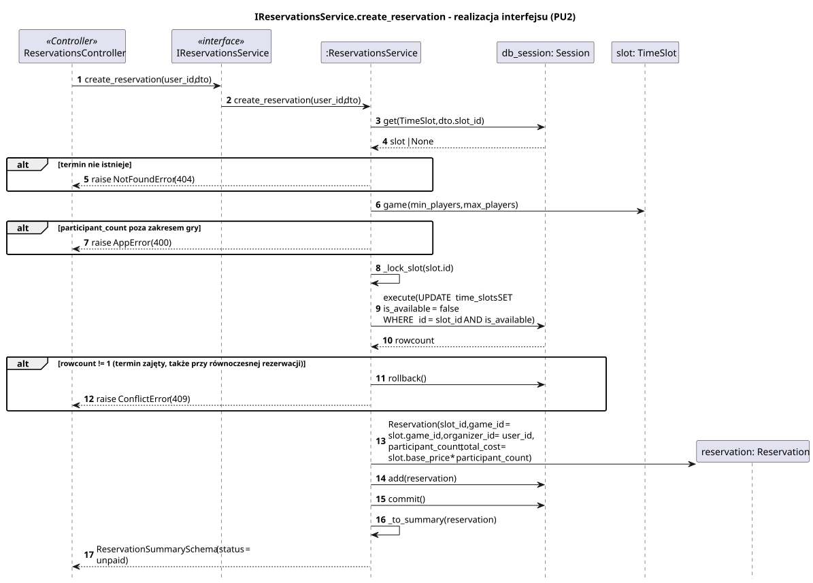
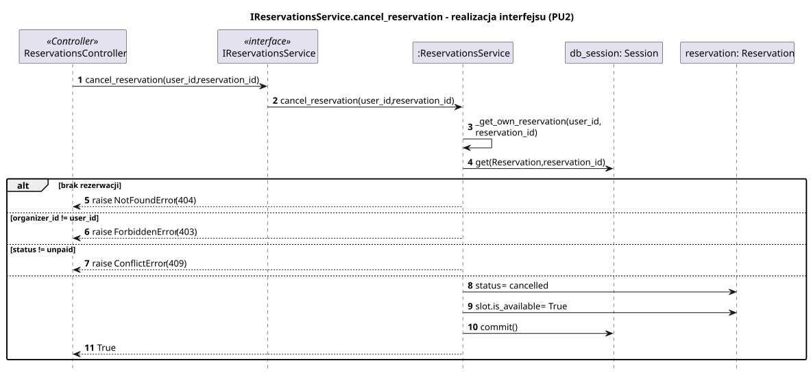
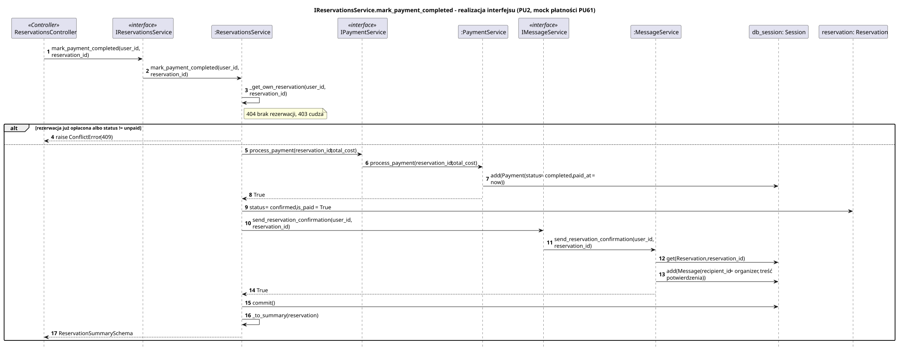

<div hidden>

```
@startuml reservations-service-create-reservation
skinparam shadowing false
skinparam roundcorner 4
skinparam sequenceMessageAlign left
skinparam responseMessageBelowArrow true
skinparam maxMessageSize 260
skinparam ParticipantPadding 8
hide footbox
autonumber

title IReservationsService.create_reservation - realizacja interfejsu (PU2)

participant "ReservationsController" as C <<Controller>>
participant "IReservationsService" as I <<interface>>
participant ":ReservationsService" as S
participant "db_session: Session" as DB
participant "slot: TimeSlot" as T
participant "reservation: Reservation" as R

C -> I : create_reservation(user_id, dto)
I -> S : create_reservation(user_id, dto)
S -> DB : get(TimeSlot, dto.slot_id)
DB --> S : slot | None
alt termin nie istnieje
    S --> C : raise NotFoundError (404)
end
S -> T : game (min_players, max_players)
alt participant_count poza zakresem gry
    S --> C : raise AppError (400)
end
S -> S : _lock_slot(slot.id)
S -> DB : execute(UPDATE time_slots SET is_available = false\nWHERE id = slot_id AND is_available)
DB --> S : rowcount
alt rowcount != 1 (termin zajęty, także przy równoczesnej rezerwacji)
    S -> DB : rollback()
    S --> C : raise ConflictError (409)
end
S -> R ** : Reservation(slot_id, game_id = slot.game_id, organizer_id = user_id,\nparticipant_count, total_cost = slot.base_price * participant_count)
S -> DB : add(reservation)
S -> DB : commit()
S -> S : _to_summary(reservation)
S --> C : ReservationSummarySchema (status = unpaid)
@enduml
```

</div>



<div hidden>

```
@startuml reservations-service-cancel-reservation
skinparam shadowing false
skinparam roundcorner 4
skinparam sequenceMessageAlign left
skinparam responseMessageBelowArrow true
skinparam maxMessageSize 260
skinparam ParticipantPadding 8
hide footbox
autonumber

title IReservationsService.cancel_reservation - realizacja interfejsu (PU2)

participant "ReservationsController" as C <<Controller>>
participant "IReservationsService" as I <<interface>>
participant ":ReservationsService" as S
participant "db_session: Session" as DB
participant "reservation: Reservation" as R

C -> I : cancel_reservation(user_id, reservation_id)
I -> S : cancel_reservation(user_id, reservation_id)
S -> S : _get_own_reservation(user_id, reservation_id)
S -> DB : get(Reservation, reservation_id)
alt brak rezerwacji
    S --> C : raise NotFoundError (404)
else organizer_id != user_id
    S --> C : raise ForbiddenError (403)
else status != unpaid
    S --> C : raise ConflictError (409)
else
    S -> R : status = cancelled
    S -> R : slot.is_available = True
    S -> DB : commit()
    S --> C : True
end
@enduml
```

</div>



<div hidden>

```
@startuml reservations-service-mark-payment-completed
skinparam shadowing false
skinparam roundcorner 4
skinparam sequenceMessageAlign left
skinparam responseMessageBelowArrow true
skinparam maxMessageSize 260
skinparam ParticipantPadding 8
hide footbox
autonumber

title IReservationsService.mark_payment_completed - realizacja interfejsu (PU2, mock płatności PU61)

participant "ReservationsController" as C <<Controller>>
participant "IReservationsService" as I <<interface>>
participant ":ReservationsService" as S
participant "IPaymentService" as IP <<interface>>
participant ":PaymentService" as PS
participant "IMessageService" as IM <<interface>>
participant ":MessageService" as MS
participant "db_session: Session" as DB
participant "reservation: Reservation" as R

C -> I : mark_payment_completed(user_id, reservation_id)
I -> S : mark_payment_completed(user_id, reservation_id)
S -> S : _get_own_reservation(user_id, reservation_id)
note right of S : 404 brak rezerwacji, 403 cudza
alt rezerwacja już opłacona albo status != unpaid
    S --> C : raise ConflictError (409)
else
    S -> IP : process_payment(reservation_id, total_cost)
    IP -> PS : process_payment(reservation_id, total_cost)
    PS -> DB : add(Payment(status = completed, paid_at = now))
    PS --> S : True
    S -> R : status = confirmed, is_paid = True
    S -> IM : send_reservation_confirmation(user_id, reservation_id)
    IM -> MS : send_reservation_confirmation(user_id, reservation_id)
    MS -> DB : get(Reservation, reservation_id)
    MS -> DB : add(Message(recipient_id = organizer, treść potwierdzenia))
    MS --> S : True
    S -> DB : commit()
    S -> S : _to_summary(reservation)
    S --> C : ReservationSummarySchema
end
@enduml
```

</div>


