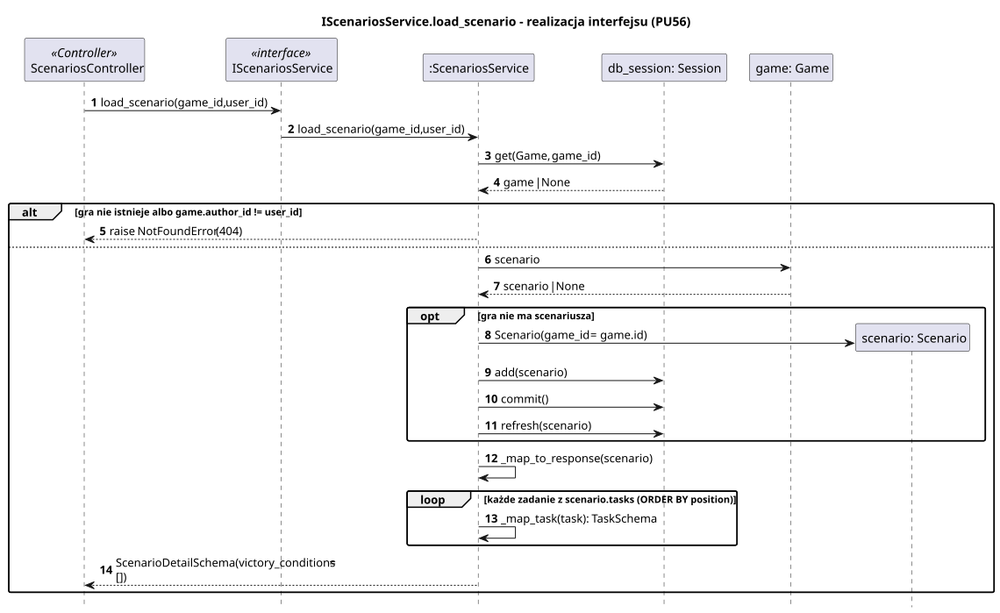
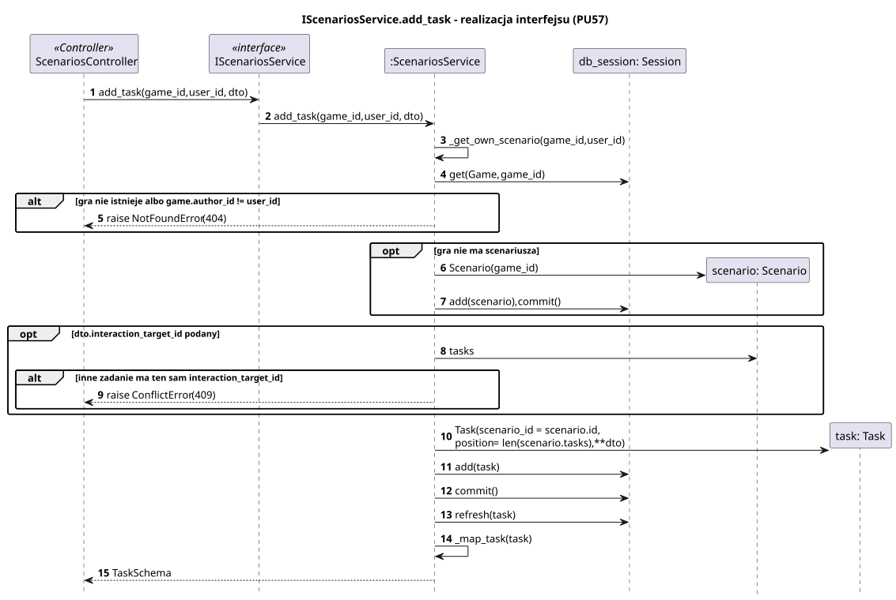

<div hidden>

```
@startuml scenarios-service-load-scenario
skinparam shadowing false
skinparam roundcorner 4
skinparam sequenceMessageAlign left
skinparam responseMessageBelowArrow true
skinparam maxMessageSize 260
skinparam ParticipantPadding 8
hide footbox
autonumber

title IScenariosService.load_scenario - realizacja interfejsu (PU56)

participant "ScenariosController" as C <<Controller>>
participant "IScenariosService" as I <<interface>>
participant ":ScenariosService" as S
participant "db_session: Session" as DB
participant "game: Game" as G
participant "scenario: Scenario" as SC

C -> I : load_scenario(game_id, user_id)
I -> S : load_scenario(game_id, user_id)
S -> DB : get(Game, game_id)
DB --> S : game | None
alt gra nie istnieje albo game.author_id != user_id
    S --> C : raise NotFoundError (404)
else
    S -> G : scenario
    G --> S : scenario | None
    opt gra nie ma scenariusza
        S -> SC ** : Scenario(game_id = game.id)
        S -> DB : add(scenario)
        S -> DB : commit()
        S -> DB : refresh(scenario)
    end
    S -> S : _map_to_response(scenario)
    loop każde zadanie z scenario.tasks (ORDER BY position)
        S -> S : _map_task(task): TaskSchema
    end
    S --> C : ScenarioDetailSchema(victory_conditions = [])
end
@enduml
```

</div>



<div hidden>

```
@startuml scenarios-service-add-task
skinparam shadowing false
skinparam roundcorner 4
skinparam sequenceMessageAlign left
skinparam responseMessageBelowArrow true
skinparam maxMessageSize 260
skinparam ParticipantPadding 8
hide footbox
autonumber

title IScenariosService.add_task - realizacja interfejsu (PU57)

participant "ScenariosController" as C <<Controller>>
participant "IScenariosService" as I <<interface>>
participant ":ScenariosService" as S
participant "db_session: Session" as DB
participant "scenario: Scenario" as SC
participant "task: Task" as T

C -> I : add_task(game_id, user_id, dto)
I -> S : add_task(game_id, user_id, dto)
S -> S : _get_own_scenario(game_id, user_id)
S -> DB : get(Game, game_id)
alt gra nie istnieje albo game.author_id != user_id
    S --> C : raise NotFoundError (404)
end
opt gra nie ma scenariusza
    S -> SC ** : Scenario(game_id)
    S -> DB : add(scenario), commit()
end
opt dto.interaction_target_id podany
    S -> SC : tasks
    alt inne zadanie ma ten sam interaction_target_id
        S --> C : raise ConflictError (409)
    end
end
S -> T ** : Task(scenario_id = scenario.id,\nposition = len(scenario.tasks), **dto)
S -> DB : add(task)
S -> DB : commit()
S -> DB : refresh(task)
S -> S : _map_task(task)
S --> C : TaskSchema
@enduml
```

</div>


