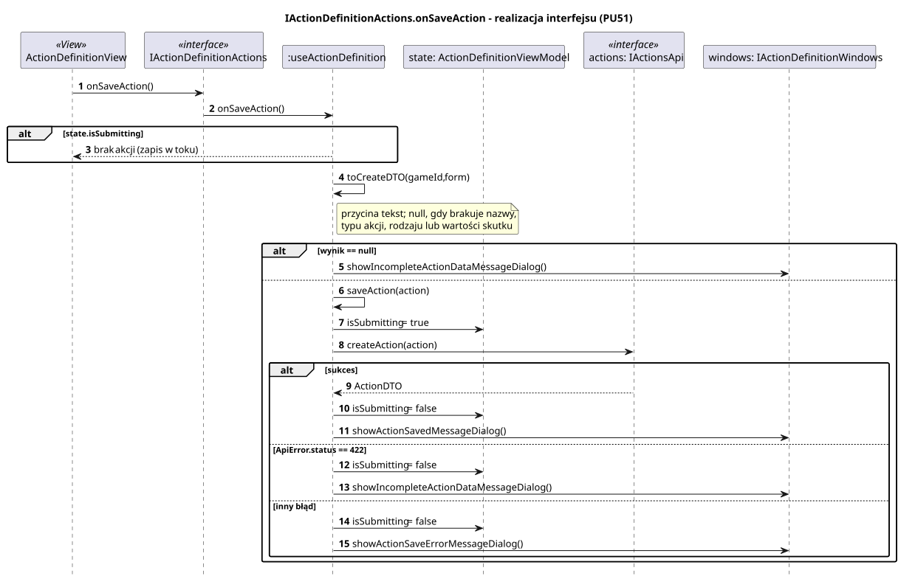

<div hidden>

```
@startuml action-definition-on-save-action
skinparam shadowing false
skinparam roundcorner 4
skinparam sequenceMessageAlign left
skinparam responseMessageBelowArrow true
skinparam maxMessageSize 260
skinparam ParticipantPadding 8
hide footbox
autonumber

title IActionDefinitionActions.onSaveAction - realizacja interfejsu (PU51)

participant "ActionDefinitionView" as V <<View>>
participant "IActionDefinitionActions" as I <<interface>>
participant ":useActionDefinition" as H
participant "state: ActionDefinitionViewModel" as ST
participant "actions: IActionsApi" as API <<interface>>
participant "windows: IActionDefinitionWindows" as W

V -> I : onSaveAction()
I -> H : onSaveAction()
alt state.isSubmitting
    H --> V : brak akcji (zapis w toku)
end
H -> H : toCreateDTO(gameId, form)
note right of H : przycina tekst; null, gdy brakuje nazwy,\ntypu akcji, rodzaju lub wartości skutku
alt wynik == null
    H -> W : showIncompleteActionDataMessageDialog()
else
    H -> H : saveAction(action)
    H -> ST : isSubmitting = true
    H -> API : createAction(action)
    alt sukces
        API --> H : ActionDTO
        H -> ST : isSubmitting = false
        H -> W : showActionSavedMessageDialog()
    else ApiError.status == 422
        H -> ST : isSubmitting = false
        H -> W : showIncompleteActionDataMessageDialog()
    else inny błąd
        H -> ST : isSubmitting = false
        H -> W : showActionSaveErrorMessageDialog()
    end
end
@enduml
```

</div>


