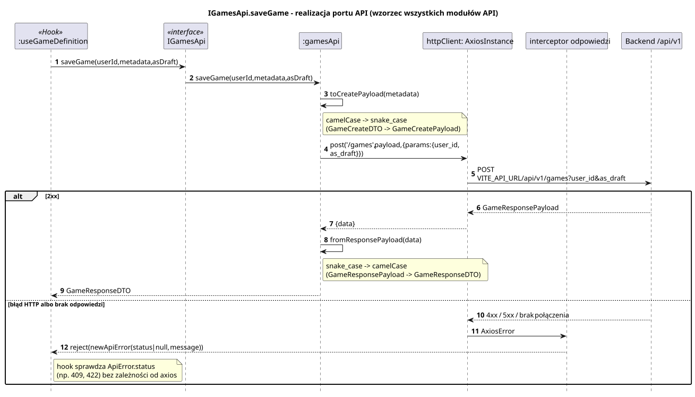

<div hidden>

```
@startuml api-module-save-game
skinparam shadowing false
skinparam roundcorner 4
skinparam sequenceMessageAlign left
skinparam responseMessageBelowArrow true
skinparam maxMessageSize 260
skinparam ParticipantPadding 8
hide footbox
autonumber

title IGamesApi.saveGame - realizacja portu API (wzorzec wszystkich modułów API)

participant ":useGameDefinition" as H <<Hook>>
participant "IGamesApi" as I <<interface>>
participant ":gamesApi" as M
participant "httpClient: AxiosInstance" as HC
participant "interceptor odpowiedzi" as IC
participant "Backend /api/v1" as BE

H -> I : saveGame(userId, metadata, asDraft)
I -> M : saveGame(userId, metadata, asDraft)
M -> M : toCreatePayload(metadata)
note right of M : camelCase -> snake_case\n(GameCreateDTO -> GameCreatePayload)
M -> HC : post('/games', payload, {params: {user_id, as_draft}})
HC -> BE : POST VITE_API_URL/api/v1/games?user_id&as_draft
alt 2xx
    BE --> HC : GameResponsePayload
    HC --> M : {data}
    M -> M : fromResponsePayload(data)
    note right of M : snake_case -> camelCase\n(GameResponsePayload -> GameResponseDTO)
    M --> H : GameResponseDTO
else błąd HTTP albo brak odpowiedzi
    BE --> HC : 4xx / 5xx / brak połączenia
    HC -> IC : AxiosError
    IC --> H : reject(new ApiError(status | null, message))
    note right of H : hook sprawdza ApiError.status\n(np. 409, 422) bez zależności od axios
end
@enduml
```

</div>


