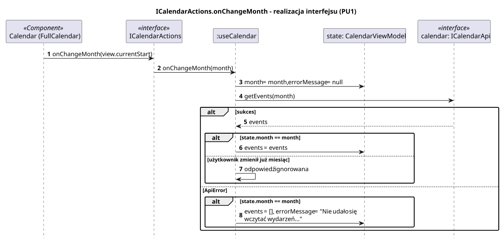

<div hidden>

```
@startuml calendar-on-change-month
skinparam shadowing false
skinparam roundcorner 4
skinparam sequenceMessageAlign left
skinparam responseMessageBelowArrow true
skinparam maxMessageSize 260
skinparam ParticipantPadding 8
hide footbox
autonumber

title ICalendarActions.onChangeMonth - realizacja interfejsu (PU1)

participant "Calendar (FullCalendar)" as V <<Component>>
participant "ICalendarActions" as I <<interface>>
participant ":useCalendar" as H
participant "state: CalendarViewModel" as ST
participant "calendar: ICalendarApi" as API <<interface>>

V -> I : onChangeMonth(view.currentStart)
I -> H : onChangeMonth(month)
H -> ST : month = month, errorMessage = null
H -> API : getEvents(month)
alt sukces
    API --> H : events
    alt state.month == month
        H -> ST : events = events
    else użytkownik zmienił już miesiąc
        H -> H : odpowiedź ignorowana
    end
else ApiError
    alt state.month == month
        H -> ST : events = [], errorMessage = "Nie udało się wczytać wydarzeń..."
    end
end
@enduml
```

</div>


