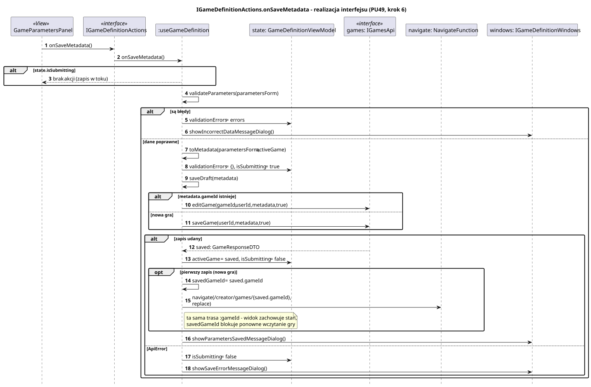
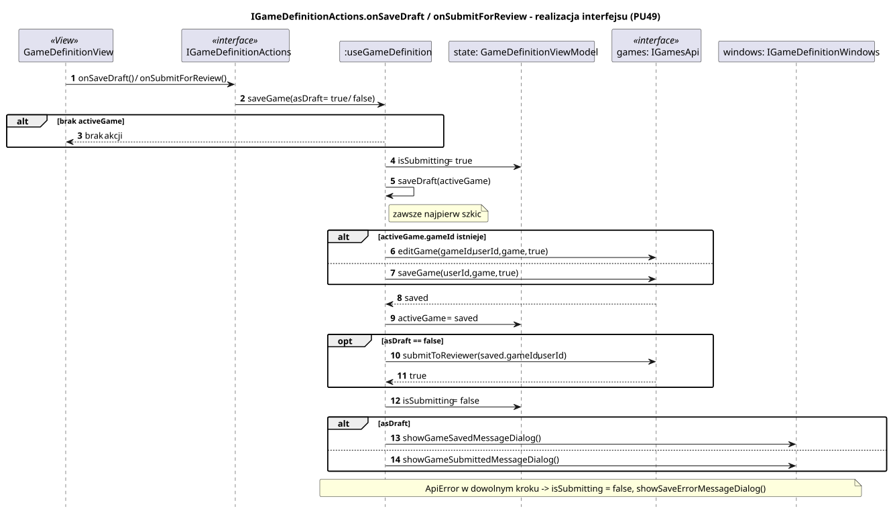
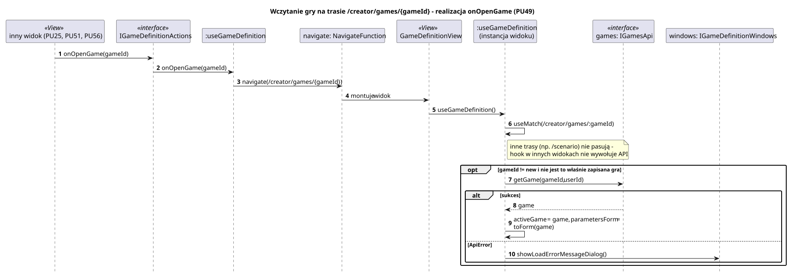

<div hidden>

```
@startuml game-definition-on-save-metadata
skinparam shadowing false
skinparam roundcorner 4
skinparam sequenceMessageAlign left
skinparam responseMessageBelowArrow true
skinparam maxMessageSize 260
skinparam ParticipantPadding 8
hide footbox
autonumber

title IGameDefinitionActions.onSaveMetadata - realizacja interfejsu (PU49, krok 6)

participant "GameParametersPanel" as V <<View>>
participant "IGameDefinitionActions" as I <<interface>>
participant ":useGameDefinition" as H
participant "state: GameDefinitionViewModel" as ST
participant "games: IGamesApi" as API <<interface>>
participant "navigate: NavigateFunction" as N
participant "windows: IGameDefinitionWindows" as W

V -> I : onSaveMetadata()
I -> H : onSaveMetadata()
alt state.isSubmitting
    H --> V : brak akcji (zapis w toku)
end
H -> H : validateParameters(parametersForm)
alt są błędy
    H -> ST : validationErrors = errors
    H -> W : showIncorrectDataMessageDialog()
else dane poprawne
    H -> H : toMetadata(parametersForm, activeGame)
    H -> ST : validationErrors = {}, isSubmitting = true
    H -> H : saveDraft(metadata)
    alt metadata.gameId istnieje
        H -> API : editGame(gameId, userId, metadata, true)
    else nowa gra
        H -> API : saveGame(userId, metadata, true)
    end
    alt zapis udany
        API --> H : saved: GameResponseDTO
        H -> ST : activeGame = saved, isSubmitting = false
        opt pierwszy zapis (nowa gra)
            H -> H : savedGameId = saved.gameId
            H -> N : navigate(/creator/games/{saved.gameId}, replace)
            note right of H : ta sama trasa :gameId - widok zachowuje stan,\nsavedGameId blokuje ponowne wczytanie gry
        end
        H -> W : showParametersSavedMessageDialog()
    else ApiError
        H -> ST : isSubmitting = false
        H -> W : showSaveErrorMessageDialog()
    end
end
@enduml
```

</div>



<div hidden>

```
@startuml game-definition-save-game
skinparam shadowing false
skinparam roundcorner 4
skinparam sequenceMessageAlign left
skinparam responseMessageBelowArrow true
skinparam maxMessageSize 260
skinparam ParticipantPadding 8
hide footbox
autonumber

title IGameDefinitionActions.onSaveDraft / onSubmitForReview - realizacja interfejsu (PU49)

participant "GameDefinitionView" as V <<View>>
participant "IGameDefinitionActions" as I <<interface>>
participant ":useGameDefinition" as H
participant "state: GameDefinitionViewModel" as ST
participant "games: IGamesApi" as API <<interface>>
participant "windows: IGameDefinitionWindows" as W

V -> I : onSaveDraft() / onSubmitForReview()
I -> H : saveGame(asDraft = true / false)
alt brak activeGame
    H --> V : brak akcji
end
H -> ST : isSubmitting = true
H -> H : saveDraft(activeGame)
note right of H : zawsze najpierw szkic
alt activeGame.gameId istnieje
    H -> API : editGame(gameId, userId, game, true)
else
    H -> API : saveGame(userId, game, true)
end
API --> H : saved
H -> ST : activeGame = saved
opt asDraft == false
    H -> API : submitToReviewer(saved.gameId, userId)
    API --> H : true
end
H -> ST : isSubmitting = false
alt asDraft
    H -> W : showGameSavedMessageDialog()
else
    H -> W : showGameSubmittedMessageDialog()
end
note over H, W : ApiError w dowolnym kroku -> isSubmitting = false, showSaveErrorMessageDialog()
@enduml
```

</div>



<div hidden>

```
@startuml game-definition-load-game
skinparam shadowing false
skinparam roundcorner 4
skinparam sequenceMessageAlign left
skinparam responseMessageBelowArrow true
skinparam maxMessageSize 260
skinparam ParticipantPadding 8
hide footbox
autonumber

title Wczytanie gry na trasie /creator/games/{gameId} - realizacja onOpenGame (PU49)

participant "inny widok (PU25, PU51, PU56)" as V <<View>>
participant "IGameDefinitionActions" as I <<interface>>
participant ":useGameDefinition" as H
participant "navigate: NavigateFunction" as N
participant "GameDefinitionView" as GV <<View>>
participant ":useGameDefinition\n(instancja widoku)" as H2
participant "games: IGamesApi" as API <<interface>>
participant "windows: IGameDefinitionWindows" as W

V -> I : onOpenGame(gameId)
I -> H : onOpenGame(gameId)
H -> N : navigate(/creator/games/{gameId})
N -> GV : montuje widok
GV -> H2 : useGameDefinition()
H2 -> H2 : useMatch(/creator/games/:gameId)
note right of H2 : inne trasy (np. /scenario) nie pasują -\nhook w innych widokach nie wywołuje API
opt gameId != new i nie jest to właśnie zapisana gra
    H2 -> API : getGame(gameId, userId)
    alt sukces
        API --> H2 : game
        H2 -> H2 : activeGame = game, parametersForm = toForm(game)
    else ApiError
        H2 -> W : showLoadErrorMessageDialog()
    end
end
@enduml
```

</div>


