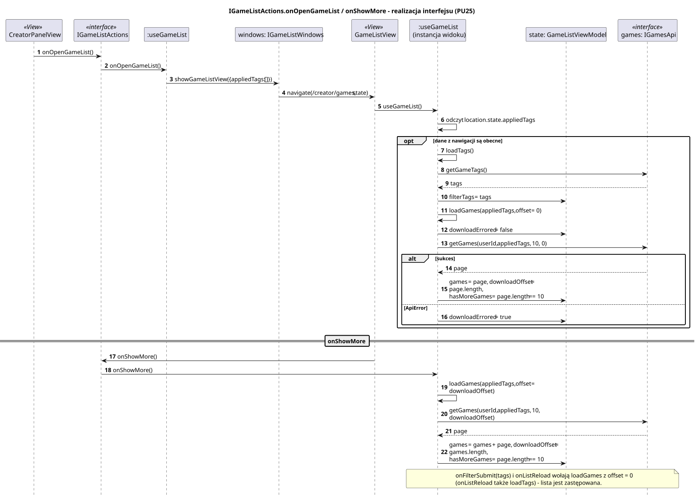

<div hidden>

```
@startuml game-list-load
skinparam shadowing false
skinparam roundcorner 4
skinparam sequenceMessageAlign left
skinparam responseMessageBelowArrow true
skinparam maxMessageSize 260
skinparam ParticipantPadding 8
hide footbox
autonumber

title IGameListActions.onOpenGameList / onShowMore - realizacja interfejsu (PU25)

participant "CreatorPanelView" as VC <<View>>
participant "IGameListActions" as I <<interface>>
participant ":useGameList" as H
participant "windows: IGameListWindows" as W
participant "GameListView" as V <<View>>
participant ":useGameList\n(instancja widoku)" as H2
participant "state: GameListViewModel" as ST
participant "games: IGamesApi" as API <<interface>>

VC -> I : onOpenGameList()
I -> H : onOpenGameList()
H -> W : showGameListView({appliedTags: []})
W -> V : navigate(/creator/games, state)
V -> H2 : useGameList()
H2 -> H2 : odczyt location.state.appliedTags
opt dane z nawigacji są obecne
    H2 -> H2 : loadTags()
    H2 -> API : getGameTags()
    API --> H2 : tags
    H2 -> ST : filterTags = tags
    H2 -> H2 : loadGames(appliedTags, offset = 0)
    H2 -> ST : downloadErrored = false
    H2 -> API : getGames(userId, appliedTags, 10, 0)
    alt sukces
        API --> H2 : page
        H2 -> ST : games = page, downloadOffset = page.length,\nhasMoreGames = page.length == 10
    else ApiError
        H2 -> ST : downloadErrored = true
    end
end

== onShowMore ==
V -> I : onShowMore()
I -> H2 : onShowMore()
H2 -> H2 : loadGames(appliedTags, offset = downloadOffset)
H2 -> API : getGames(userId, appliedTags, 10, downloadOffset)
API --> H2 : page
H2 -> ST : games = games + page, downloadOffset = games.length,\nhasMoreGames = page.length == 10

note over H2, API
    onFilterSubmit(tags) i onListReload wołają loadGames z offset = 0
    (onListReload także loadTags) - lista jest zastępowana.
end note
@enduml
```

</div>


