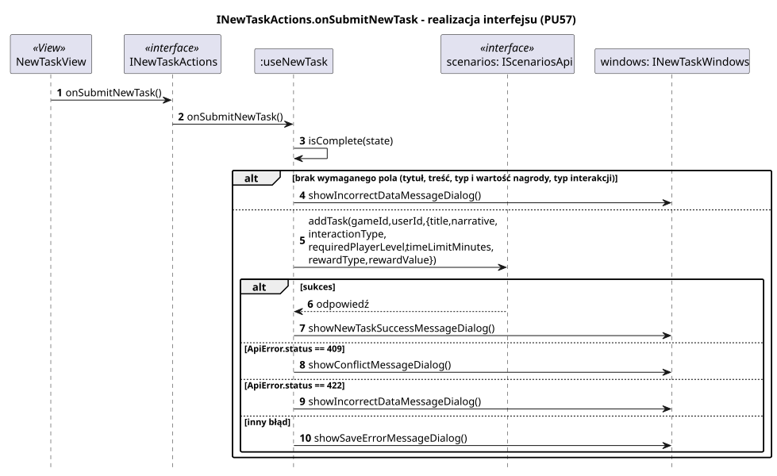

<div hidden>

```
@startuml new-task-on-submit
skinparam shadowing false
skinparam roundcorner 4
skinparam sequenceMessageAlign left
skinparam responseMessageBelowArrow true
skinparam maxMessageSize 260
skinparam ParticipantPadding 8
hide footbox
autonumber

title INewTaskActions.onSubmitNewTask - realizacja interfejsu (PU57)

participant "NewTaskView" as V <<View>>
participant "INewTaskActions" as I <<interface>>
participant ":useNewTask" as H
participant "scenarios: IScenariosApi" as API <<interface>>
participant "windows: INewTaskWindows" as W

V -> I : onSubmitNewTask()
I -> H : onSubmitNewTask()
H -> H : isComplete(state)
alt brak wymaganego pola (tytuł, treść, typ i wartość nagrody, typ interakcji)
    H -> W : showIncorrectDataMessageDialog()
else
    H -> API : addTask(gameId, userId, {title, narrative, interactionType,\nrequiredPlayerLevel, timeLimitMinutes, rewardType, rewardValue})
    alt sukces
        API --> H : odpowiedź
        H -> W : showNewTaskSuccessMessageDialog()
    else ApiError.status == 409
        H -> W : showConflictMessageDialog()
    else ApiError.status == 422
        H -> W : showIncorrectDataMessageDialog()
    else inny błąd
        H -> W : showSaveErrorMessageDialog()
    end
end
@enduml
```

</div>


