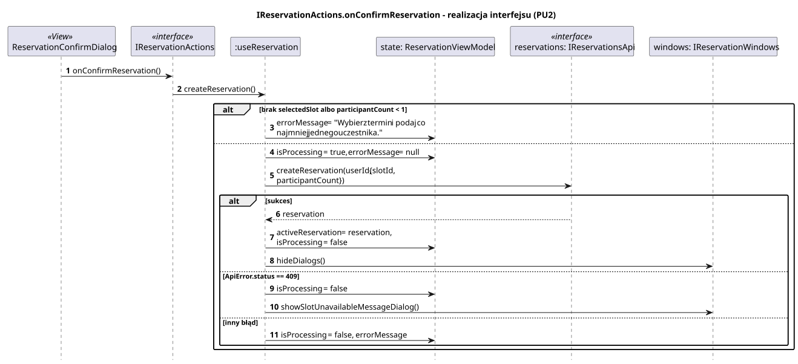
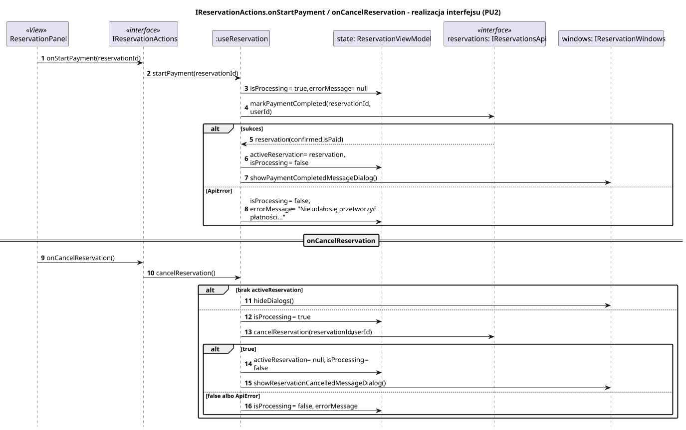

<div hidden>

```
@startuml reservation-on-confirm-reservation
skinparam shadowing false
skinparam roundcorner 4
skinparam sequenceMessageAlign left
skinparam responseMessageBelowArrow true
skinparam maxMessageSize 260
skinparam ParticipantPadding 8
hide footbox
autonumber

title IReservationActions.onConfirmReservation - realizacja interfejsu (PU2)

participant "ReservationConfirmDialog" as V <<View>>
participant "IReservationActions" as I <<interface>>
participant ":useReservation" as H
participant "state: ReservationViewModel" as ST
participant "reservations: IReservationsApi" as API <<interface>>
participant "windows: IReservationWindows" as W

V -> I : onConfirmReservation()
I -> H : createReservation()
alt brak selectedSlot albo participantCount < 1
    H -> ST : errorMessage = "Wybierz termin i podaj co najmniej jednego uczestnika."
else
    H -> ST : isProcessing = true, errorMessage = null
    H -> API : createReservation(userId, {slotId, participantCount})
    alt sukces
        API --> H : reservation
        H -> ST : activeReservation = reservation, isProcessing = false
        H -> W : hideDialogs()
    else ApiError.status == 409
        H -> ST : isProcessing = false
        H -> W : showSlotUnavailableMessageDialog()
    else inny błąd
        H -> ST : isProcessing = false, errorMessage
    end
end
@enduml
```

</div>



<div hidden>

```
@startuml reservation-on-start-payment
skinparam shadowing false
skinparam roundcorner 4
skinparam sequenceMessageAlign left
skinparam responseMessageBelowArrow true
skinparam maxMessageSize 260
skinparam ParticipantPadding 8
hide footbox
autonumber

title IReservationActions.onStartPayment / onCancelReservation - realizacja interfejsu (PU2)

participant "ReservationPanel" as V <<View>>
participant "IReservationActions" as I <<interface>>
participant ":useReservation" as H
participant "state: ReservationViewModel" as ST
participant "reservations: IReservationsApi" as API <<interface>>
participant "windows: IReservationWindows" as W

V -> I : onStartPayment(reservationId)
I -> H : startPayment(reservationId)
H -> ST : isProcessing = true, errorMessage = null
H -> API : markPaymentCompleted(reservationId, userId)
alt sukces
    API --> H : reservation (confirmed, isPaid)
    H -> ST : activeReservation = reservation, isProcessing = false
    H -> W : showPaymentCompletedMessageDialog()
else ApiError
    H -> ST : isProcessing = false,\nerrorMessage = "Nie udało się przetworzyć płatności..."
end

== onCancelReservation ==
V -> I : onCancelReservation()
I -> H : cancelReservation()
alt brak activeReservation
    H -> W : hideDialogs()
else
    H -> ST : isProcessing = true
    H -> API : cancelReservation(reservationId, userId)
    alt true
        H -> ST : activeReservation = null, isProcessing = false
        H -> W : showReservationCancelledMessageDialog()
    else false albo ApiError
        H -> ST : isProcessing = false, errorMessage
    end
end
@enduml
```

</div>


