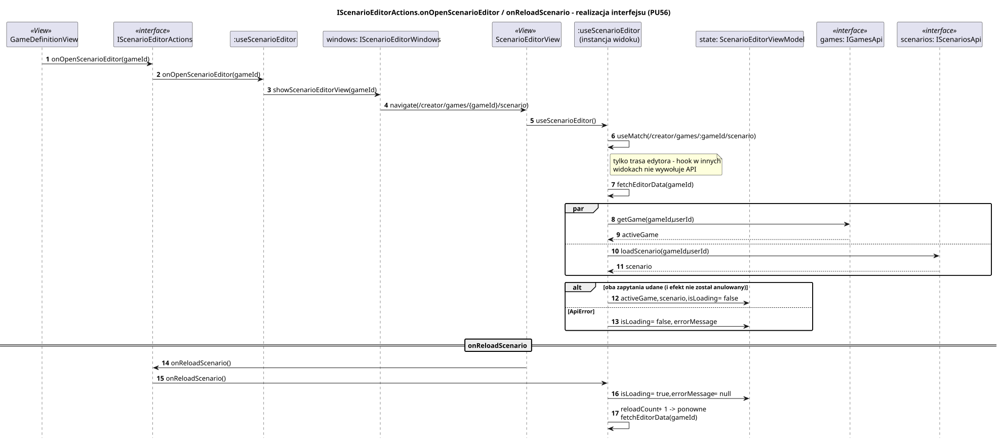

<div hidden>

```
@startuml scenario-editor-load
skinparam shadowing false
skinparam roundcorner 4
skinparam sequenceMessageAlign left
skinparam responseMessageBelowArrow true
skinparam maxMessageSize 260
skinparam ParticipantPadding 8
hide footbox
autonumber

title IScenarioEditorActions.onOpenScenarioEditor / onReloadScenario - realizacja interfejsu (PU56)

participant "GameDefinitionView" as VG <<View>>
participant "IScenarioEditorActions" as I <<interface>>
participant ":useScenarioEditor" as H
participant "windows: IScenarioEditorWindows" as W
participant "ScenarioEditorView" as V <<View>>
participant ":useScenarioEditor\n(instancja widoku)" as H2
participant "state: ScenarioEditorViewModel" as ST
participant "games: IGamesApi" as GA <<interface>>
participant "scenarios: IScenariosApi" as SA <<interface>>

VG -> I : onOpenScenarioEditor(gameId)
I -> H : onOpenScenarioEditor(gameId)
H -> W : showScenarioEditorView(gameId)
W -> V : navigate(/creator/games/{gameId}/scenario)
V -> H2 : useScenarioEditor()
H2 -> H2 : useMatch(/creator/games/:gameId/scenario)
note right of H2 : tylko trasa edytora - hook w innych\nwidokach nie wywołuje API
H2 -> H2 : fetchEditorData(gameId)
par
    H2 -> GA : getGame(gameId, userId)
    GA --> H2 : activeGame
else
    H2 -> SA : loadScenario(gameId, userId)
    SA --> H2 : scenario
end
alt oba zapytania udane (i efekt nie został anulowany)
    H2 -> ST : activeGame, scenario, isLoading = false
else ApiError
    H2 -> ST : isLoading = false, errorMessage
end

== onReloadScenario ==
V -> I : onReloadScenario()
I -> H2 : onReloadScenario()
H2 -> ST : isLoading = true, errorMessage = null
H2 -> H2 : reloadCount + 1 -> ponowne fetchEditorData(gameId)
@enduml
```

</div>


