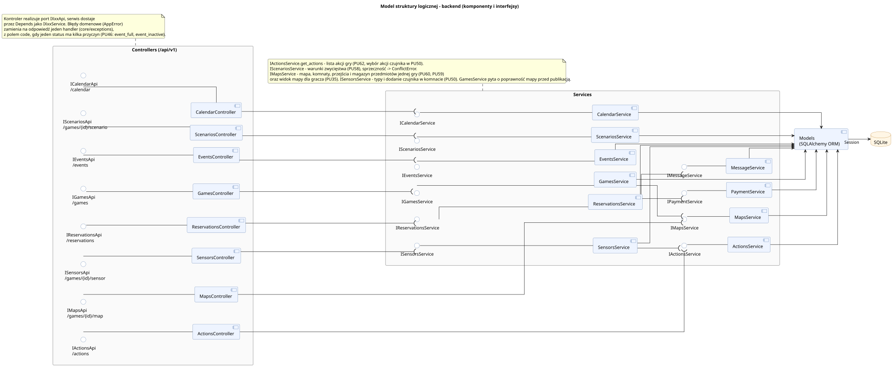

# Model struktury logicznej - backend

Backend jest podzielony na te same grupy funkcjonalne co frontend. Diagram pokazuje porty REST, kontrolery i serwisy wszystkich grup oraz zależności między serwisami.
Serwisy korzystają z encji przez warstwę modeli (SQLAlchemy) - encje: [model danych](backend/data-model.md).

Oznaczenia: kontroler realizuje port `IXxxApi` i woła `IXxxService` o tych samych metodach. Strzałki pokazują tylko, który komponent korzysta z którego - bez podpisów.
Metody portów i serwisów: [interfejsy backendu](backend/interfaces.md).
Definicję mapy (PU60) i czujnika (PU50) obsługują `GamesController` / `GamesService` (`/games/{id}/map`, `/games/{id}/sensor`), edycję komnaty (PU59) i mapę gracza (PU35) - `MapsController` / `MapsService`.

## Grupy funkcjonalne i zależności między serwisami

<div hidden>

```
@startuml logic_structure_backend
left to right direction
skinparam componentStyle uml2
skinparam packageStyle rectangle
skinparam shadowing false
skinparam roundcorner 6
skinparam linetype polyline
skinparam nodesep 18
skinparam ranksep 80
skinparam package {
    BackgroundColor #FAFAFA
    BorderColor #888888
}
skinparam component {
    BackgroundColor #EEF4FF
    BorderColor #4A6FA5
}
skinparam interface {
    BackgroundColor #FFFFFF
    BorderColor #4A6FA5
}
skinparam database {
    BackgroundColor #FFF6E5
    BorderColor #B7791F
}

title Model struktury logicznej - backend: grupy funkcjonalne i zależności między serwisami

package "Kalendarz i wydarzenia (PU1, PU2, PU46)" as G_Cal {
    () "ICalendarApi\n/calendar" as R_Calendar
    () "IReservationsApi\n/reservations" as R_Reservations
    () "IEventsApi\n/events" as R_Events
    component [CalendarController] as C_Calendar
    component [ReservationsController] as C_Reservations
    component [EventsController] as C_Events
    () "ICalendarService" as IS_Calendar
    () "IReservationsService" as IS_Reservations
    () "IEventsService" as IS_Events
    () "IPaymentService" as IS_Payment
    () "IMessageService" as IS_Message
    component [CalendarService] as S_Calendar
    component [ReservationsService] as S_Reservations
    component [EventsService] as S_Events
    component [PaymentService] as S_Payment
    component [MessageService] as S_Message
    R_Calendar -- C_Calendar
    R_Reservations -- C_Reservations
    R_Events -- C_Events
    C_Calendar --( IS_Calendar
    C_Reservations --( IS_Reservations
    C_Events --( IS_Events
    IS_Calendar -- S_Calendar
    IS_Reservations -- S_Reservations
    IS_Events -- S_Events
    IS_Payment -- S_Payment
    IS_Message -- S_Message
}

package "Gry, mapa gry i czujniki (PU25, PU49, PU60, PU50)" as G_Games {
    () "IGamesApi\n/games" as R_Games
    component [GamesController] as C_Games
    () "IGamesService" as IS_Games
    component [GamesService] as S_Games
    R_Games -- C_Games
    C_Games --( IS_Games
    IS_Games -- S_Games
}

package "Akcje (PU51, PU62)" as G_Actions {
    () "IActionsApi\n/actions" as R_Actions
    component [ActionsController] as C_Actions
    () "IActionsService" as IS_Actions
    component [ActionsService] as S_Actions
    R_Actions -- C_Actions
    C_Actions --( IS_Actions
    IS_Actions -- S_Actions
}

package "Scenariusz (PU56, PU57, PU58)" as G_Scenario {
    () "IScenariosApi\n/games/{id}/scenario" as R_Scenarios
    component [ScenariosController] as C_Scenarios
    () "IScenariosService" as IS_Scenarios
    component [ScenariosService] as S_Scenarios
    R_Scenarios -- C_Scenarios
    C_Scenarios --( IS_Scenarios
    IS_Scenarios -- S_Scenarios
}

package "Komnaty i mapa gracza (PU59, PU35)" as G_Map {
    () "IMapsApi\n/games/{id}/map/..." as R_Maps
    component [MapsController] as C_Maps
    () "IMapsService" as IS_Maps
    component [MapsService] as S_Maps
    R_Maps -- C_Maps
    C_Maps --( IS_Maps
    IS_Maps -- S_Maps
}

component "Models\n(SQLAlchemy ORM)" as M
database "SQLite" as DB

S_Reservations --( IS_Payment
S_Reservations --( IS_Message

S_Calendar --> M
S_Reservations --> M
S_Events --> M
S_Payment --> M
S_Message --> M
S_Games --> M
S_Actions --> M
S_Scenarios --> M
S_Maps --> M
M --> DB

note as N1
    Kontroler dostaje serwis przez Depends jako IXxxService.
    Błędy domenowe (AppError) zamienia na odpowiedź {detail}
    jeden handler (core/exceptions). Walidacja schematów -> 422 (FastAPI).
end note
@enduml
```

</div>


