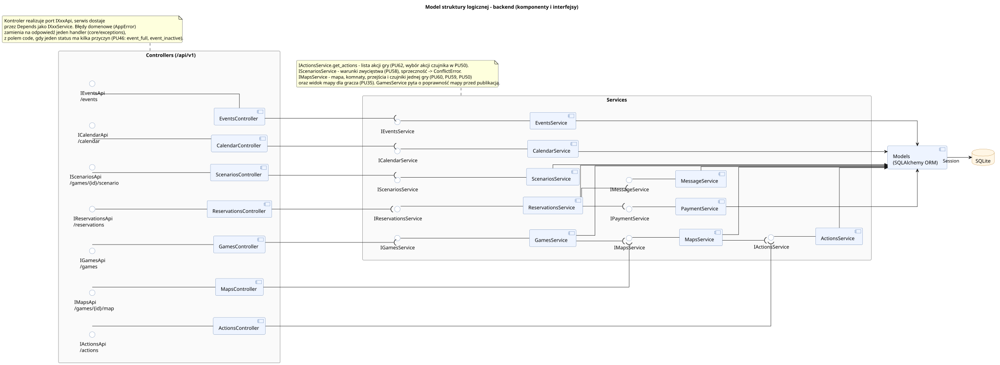

<div hidden>

```
@startuml logic_structure_backend
left to right direction
skinparam componentStyle uml2
skinparam packageStyle rectangle
skinparam shadowing false
skinparam roundcorner 6
skinparam linetype ortho
skinparam nodesep 22
skinparam ranksep 70
skinparam package {
    BackgroundColor #FAFAFA
    BorderColor #888888
}
skinparam component {
    BackgroundColor #EEF4FF
    BorderColor #4A6FA5
}
skinparam interface {
    BackgroundColor #FFFFFF
    BorderColor #4A6FA5
}
skinparam database {
    BackgroundColor #FFF6E5
    BorderColor #B7791F
}

title Model struktury logicznej - backend (komponenty i interfejsy)

package "Controllers (/api/v1)" as C {
    () "ICalendarApi\n/calendar" as R_Calendar
    () "IGamesApi\n/games" as R_Games
    () "IScenariosApi\n/games/{id}/scenario" as R_Scenarios
    () "IActionsApi\n/actions" as R_Actions
    () "IReservationsApi\n/reservations" as R_Reservations
    () "IMapsApi\n/games/{id}/map" as R_Maps
    () "IEventsApi\n/events" as R_Events

    component [CalendarController] as C_Calendar
    component [GamesController] as C_Games
    component [ScenariosController] as C_Scenarios
    component [ActionsController] as C_Actions
    component [ReservationsController] as C_Reservations
    component [MapsController] as C_Maps
    component [EventsController] as C_Events

    R_Calendar -- C_Calendar
    R_Games -- C_Games
    R_Scenarios -- C_Scenarios
    R_Actions -- C_Actions
    R_Reservations -- C_Reservations
    R_Maps -- C_Maps
    R_Events -- C_Events
}

package "Services" as S {
    () "ICalendarService" as IS_Calendar
    () "IGamesService" as IS_Games
    () "IScenariosService" as IS_Scenarios
    () "IActionsService" as IS_Actions
    () "IReservationsService" as IS_Reservations
    () "IMapsService" as IS_Maps
    () "IEventsService" as IS_Events

    component [CalendarService] as S_Calendar
    component [GamesService] as S_Games
    component [ScenariosService] as S_Scenarios
    component [ActionsService] as S_Actions
    component [ReservationsService] as S_Reservations
    component [MapsService] as S_Maps
    component [EventsService] as S_Events

    () "IPaymentService" as IS_Payment
    () "IMessageService" as IS_Message
    component [PaymentService] as S_Payment
    component [MessageService] as S_Message

    IS_Calendar -- S_Calendar
    IS_Games -- S_Games
    IS_Scenarios -- S_Scenarios
    IS_Actions -- S_Actions
    IS_Reservations -- S_Reservations
    IS_Payment -- S_Payment
    IS_Message -- S_Message
    IS_Maps -- S_Maps
    IS_Events -- S_Events

    S_Reservations --( IS_Payment
    S_Reservations --( IS_Message
    S_Games --( IS_Maps
    S_Maps --( IS_Actions
}

component "Models\n(SQLAlchemy ORM)" as M
database "SQLite" as DB

C_Calendar --( IS_Calendar
C_Games --( IS_Games
C_Scenarios --( IS_Scenarios
C_Actions --( IS_Actions
C_Reservations --( IS_Reservations
C_Maps --( IS_Maps
C_Events --( IS_Events

S_Calendar --> M
S_Games --> M
S_Scenarios --> M
S_Actions --> M
S_Reservations --> M
S_Payment --> M
S_Message --> M
S_Maps --> M
S_Events --> M
M --> DB : Session

note bottom of C
    Kontroler realizuje port IXxxApi, serwis dostaje
    przez Depends jako IXxxService. Błędy domenowe (AppError)
    zamienia na odpowiedź jeden handler (core/exceptions),
    z polem code, gdy jeden status ma kilka przyczyn (PU46: event_full, event_inactive).
end note

note bottom of S
    IActionsService.get_actions - lista akcji gry (PU62, wybór akcji czujnika w PU50).
    IScenariosService - warunki zwycięstwa (PU58), sprzeczność -> ConflictError.
    IMapsService - mapa, komnaty, przejścia i czujniki jednej gry (PU60, PU59, PU50)
    oraz widok mapy dla gracza (PU35). GamesService pyta o poprawność mapy przed publikacją.
end note

@enduml
```

</div>


