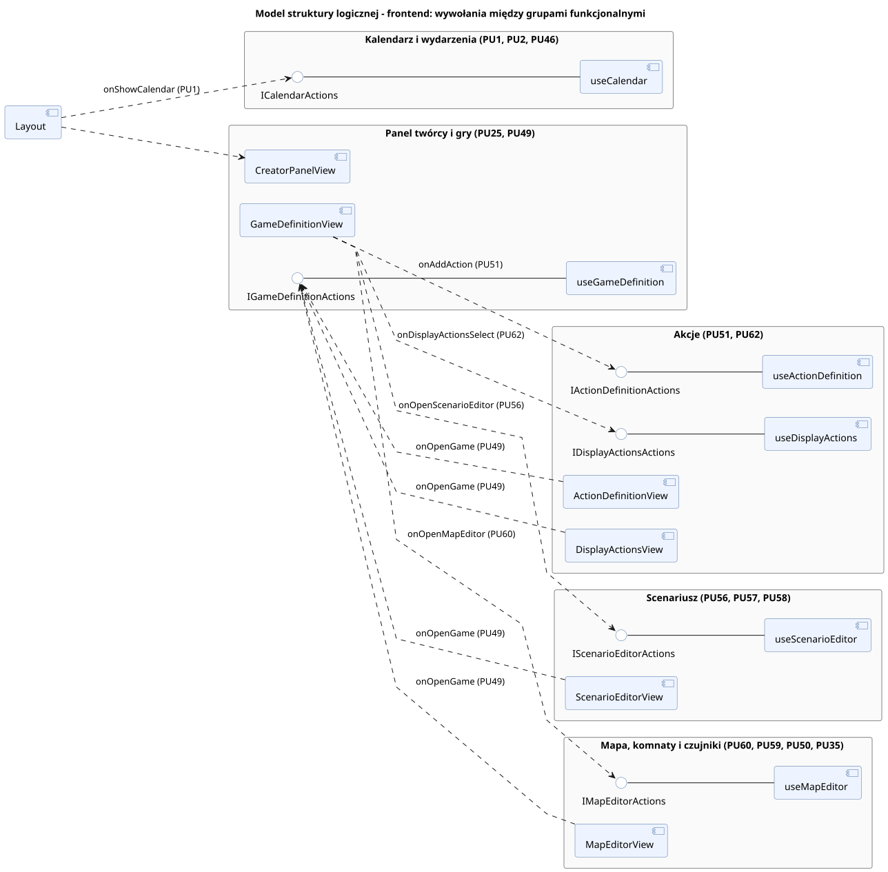
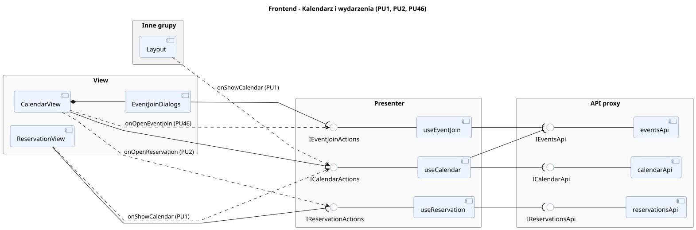
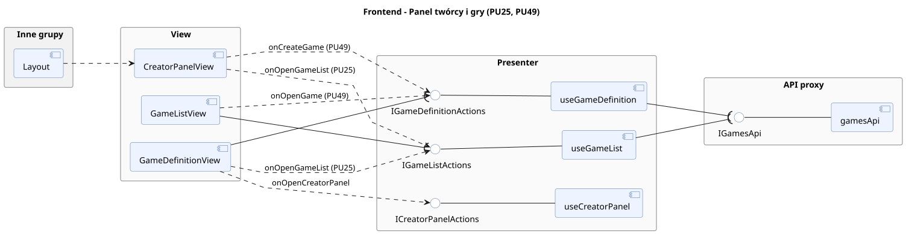
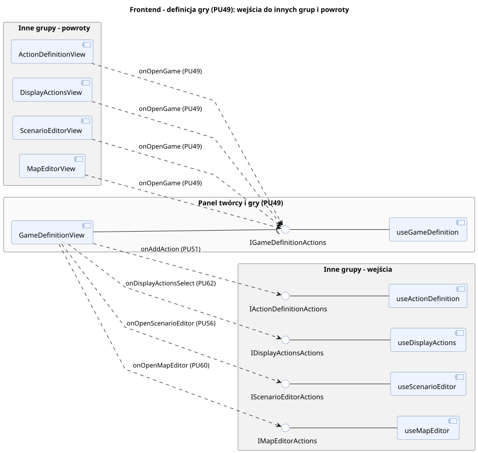
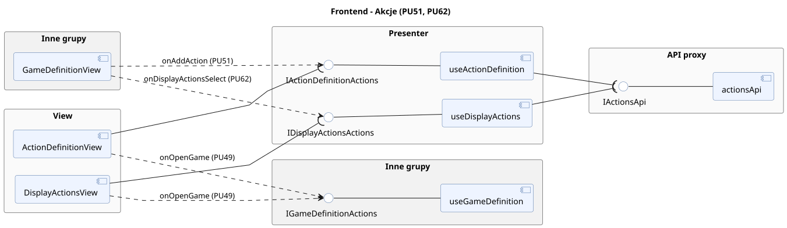
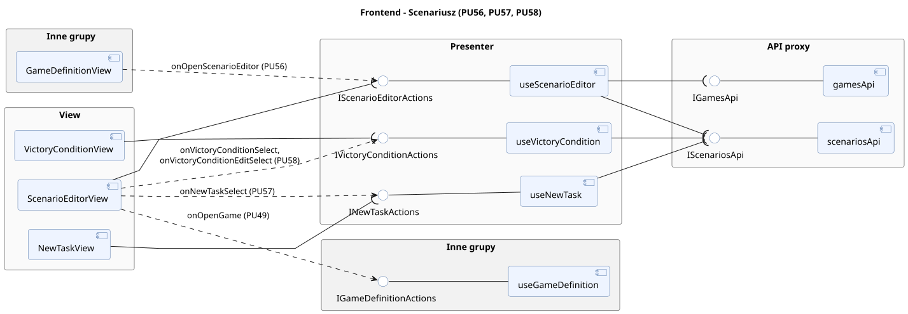
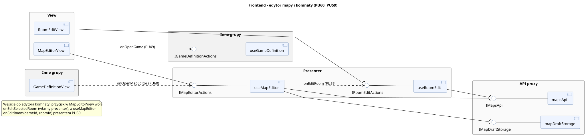
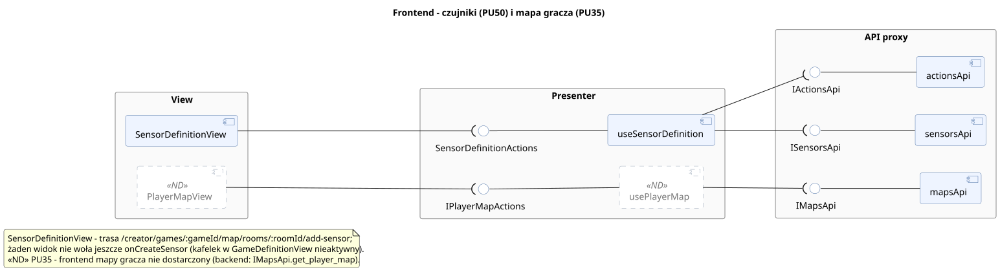
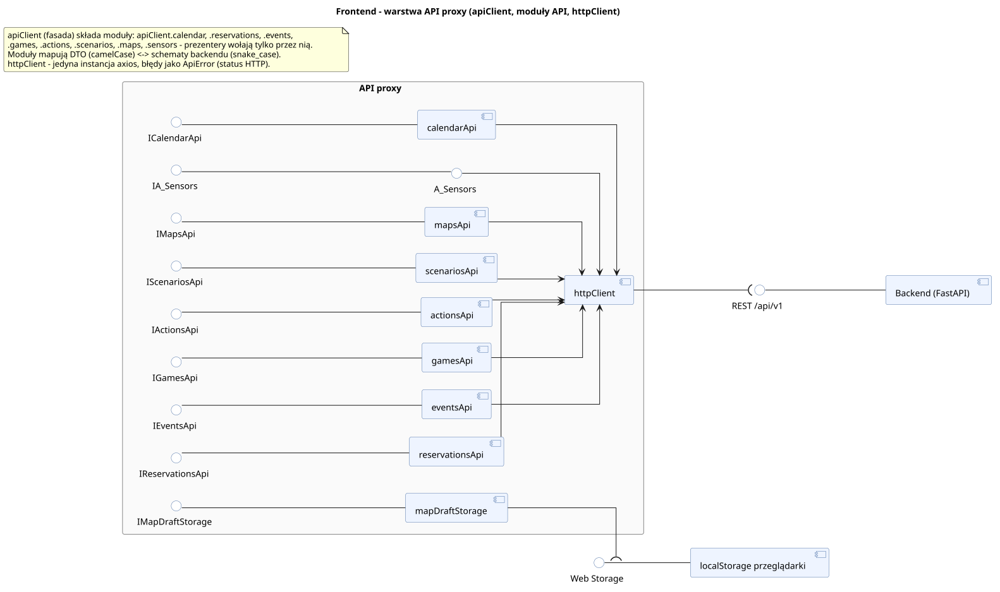

# Model struktury logicznej - frontend

Frontend jest podzielony na grupy funkcjonalne, czyli przypadki użycia, które się wzajemnie wywołują i korzystają z tych samych portów API.
Pierwszy diagram to przegląd wywołań między grupami. Kolejne diagramy pokazują każdą grupę w całości (widok -> prezenter -> port API) razem z wywołaniami z innych grup i do innych grup.

Oznaczenia:
- Strzałka podpisana metodą - wywołanie prezentera innego PU (z widoku, jego dialogu albo z prezentera). Pozostałe połączenia nie mają podpisów.
- `widok --( IXxxActions` - widok korzysta z własnego prezentera, `prezenter --( IXxxApi` - prezenter korzysta z portu API (metody: [interfejsy frontendu](frontend/interfaces.md)).
- Dialogi są zwinięte do swojego widoku. `IXxxWindows` każdego PU realizuje klasa okien jego widoku - nie jest rysowane na diagramach architektury.
- `<<ND>>` - nie dostarczone (not delivered): frontend PU35 (mapa gracza) - jest tylko backend.

## Przegląd - wywołania między grupami

<div hidden>

```
@startuml logic_structure_frontend
left to right direction
skinparam componentStyle uml2
skinparam packageStyle rectangle
skinparam shadowing false
skinparam roundcorner 6
skinparam linetype polyline
skinparam nodesep 30
skinparam ranksep 120
skinparam package {
    BackgroundColor #FAFAFA
    BorderColor #888888
}
skinparam component {
    BackgroundColor #EEF4FF
    BorderColor #4A6FA5
}
skinparam interface {
    BackgroundColor #FFFFFF
    BorderColor #4A6FA5
}

title Model struktury logicznej - frontend: wywołania między grupami funkcjonalnymi

component [Layout] as V_Layout

package "Kalendarz i wydarzenia (PU1, PU2, PU46)" as G_Cal {
    () "ICalendarActions" as I_Calendar
    component [useCalendar] as P_Calendar
    I_Calendar -- P_Calendar
}

package "Panel twórcy i gry (PU25, PU49)" as G_Games {
    component [CreatorPanelView] as V_Creator
    component [GameDefinitionView] as V_GameDef
    () "IGameDefinitionActions" as I_GameDef
    component [useGameDefinition] as P_GameDef
    I_GameDef -- P_GameDef
}

package "Akcje (PU51, PU62)" as G_Actions {
    component [ActionDefinitionView] as V_Action
    component [DisplayActionsView] as V_DisplayActions
    () "IActionDefinitionActions" as I_Action
    () "IDisplayActionsActions" as I_DisplayActions
    component [useActionDefinition] as P_Action
    component [useDisplayActions] as P_DisplayActions
    I_Action -- P_Action
    I_DisplayActions -- P_DisplayActions
}

package "Scenariusz (PU56, PU57, PU58)" as G_Scenario {
    component [ScenarioEditorView] as V_Scenario
    () "IScenarioEditorActions" as I_Scenario
    component [useScenarioEditor] as P_Scenario
    I_Scenario -- P_Scenario
}

package "Mapa, komnaty i czujniki (PU60, PU59, PU50, PU35)" as G_Map {
    component [MapEditorView] as V_MapEditor
    () "IMapEditorActions" as I_MapEditor
    component [useMapEditor] as P_MapEditor
    I_MapEditor -- P_MapEditor
}

V_Layout ..> I_Calendar : onShowCalendar (PU1)
V_Layout ..> V_Creator

V_GameDef ..> I_Action : onAddAction (PU51)
V_GameDef ..> I_DisplayActions : onDisplayActionsSelect (PU62)
V_GameDef ..> I_Scenario : onOpenScenarioEditor (PU56)
V_GameDef ..> I_MapEditor : onOpenMapEditor (PU60)

V_Action ..> I_GameDef : onOpenGame (PU49)
V_DisplayActions ..> I_GameDef : onOpenGame (PU49)
V_Scenario ..> I_GameDef : onOpenGame (PU49)
V_MapEditor ..> I_GameDef : onOpenGame (PU49)
@enduml
```

</div>



## Kalendarz i wydarzenia (PU1, PU2, PU46)

<div hidden>

```
@startuml logic_structure_frontend_calendar
left to right direction
skinparam componentStyle uml2
skinparam packageStyle rectangle
skinparam shadowing false
skinparam roundcorner 6
skinparam linetype polyline
skinparam nodesep 30
skinparam ranksep 110
skinparam package {
    BackgroundColor #FAFAFA
    BorderColor #888888
}
skinparam component {
    BackgroundColor #EEF4FF
    BorderColor #4A6FA5
}
skinparam interface {
    BackgroundColor #FFFFFF
    BorderColor #4A6FA5
}

title Frontend - Kalendarz i wydarzenia (PU1, PU2, PU46)

package "Inne grupy" as EXT_IN #F2F2F2 {
    component [Layout] as X_Layout
}

package "View" as V {
    component [CalendarView] as V_Calendar
    component [EventJoinDialogs] as V_EventJoin
    component [ReservationView] as V_Reservation
}

package "Presenter" as P {
    () "ICalendarActions" as I_Calendar
    () "IReservationActions" as I_Reservation
    () "IEventJoinActions" as I_EventJoin
    component [useCalendar] as P_Calendar
    component [useReservation] as P_Reservation
    component [useEventJoin] as P_EventJoin
    I_Calendar -- P_Calendar
    I_Reservation -- P_Reservation
    I_EventJoin -- P_EventJoin
}

package "API proxy" as A {
    () "ICalendarApi" as IA_Calendar
    () "IEventsApi" as IA_Events
    () "IReservationsApi" as IA_Reservations
    component [calendarApi] as A_Calendar
    component [eventsApi] as A_Events
    component [reservationsApi] as A_Reservations
    IA_Calendar -- A_Calendar
    IA_Events -- A_Events
    IA_Reservations -- A_Reservations
}

X_Layout ..> I_Calendar : onShowCalendar (PU1)

V_Calendar --( I_Calendar
V_Calendar *-- V_EventJoin
V_Calendar ..> I_Reservation : onOpenReservation (PU2)
V_Calendar ..> I_EventJoin : onOpenEventJoin (PU46)
V_EventJoin --( I_EventJoin
V_Reservation --( I_Reservation
V_Reservation ..> I_Calendar : onShowCalendar (PU1)

P_Calendar --( IA_Calendar
P_Calendar --( IA_Events
P_Reservation --( IA_Reservations
P_EventJoin --( IA_Events
@enduml
```

</div>



## Panel twórcy i gry (PU25, PU49)

Wywołania między definicją gry a innymi grupami: następny diagram.

<div hidden>

```
@startuml logic_structure_frontend_games
left to right direction
skinparam componentStyle uml2
skinparam packageStyle rectangle
skinparam shadowing false
skinparam roundcorner 6
skinparam linetype polyline
skinparam nodesep 30
skinparam ranksep 110
skinparam package {
    BackgroundColor #FAFAFA
    BorderColor #888888
}
skinparam component {
    BackgroundColor #EEF4FF
    BorderColor #4A6FA5
}
skinparam interface {
    BackgroundColor #FFFFFF
    BorderColor #4A6FA5
}

title Frontend - Panel twórcy i gry (PU25, PU49)

package "Inne grupy" as EXT_IN #F2F2F2 {
    component [Layout] as X_Layout
}

package "View" as V {
    component [CreatorPanelView] as V_Creator
    component [GameListView] as V_GameList
    component [GameDefinitionView] as V_GameDef
}

package "Presenter" as P {
    () "ICreatorPanelActions" as I_Creator
    () "IGameListActions" as I_GameList
    () "IGameDefinitionActions" as I_GameDef
    component [useCreatorPanel] as P_Creator
    component [useGameList] as P_GameList
    component [useGameDefinition] as P_GameDef
    I_Creator -- P_Creator
    I_GameList -- P_GameList
    I_GameDef -- P_GameDef
}

package "API proxy" as A {
    () "IGamesApi" as IA_Games
    component [gamesApi] as A_Games
    IA_Games -- A_Games
}

X_Layout ..> V_Creator

V_Creator ..> I_GameDef : onCreateGame (PU49)
V_Creator ..> I_GameList : onOpenGameList (PU25)

V_GameList --( I_GameList
V_GameList ..> I_GameDef : onOpenGame (PU49)

V_GameDef --( I_GameDef
V_GameDef ..> I_Creator : onOpenCreatorPanel
V_GameDef ..> I_GameList : onOpenGameList (PU25)

P_GameList --( IA_Games
P_GameDef --( IA_Games
@enduml
```

</div>



## Definicja gry - przejścia do innych grup

<div hidden>

```
@startuml logic_structure_frontend_game_hub
left to right direction
skinparam componentStyle uml2
skinparam packageStyle rectangle
skinparam shadowing false
skinparam roundcorner 6
skinparam linetype polyline
skinparam nodesep 30
skinparam ranksep 130
skinparam package {
    BackgroundColor #FAFAFA
    BorderColor #888888
}
skinparam component {
    BackgroundColor #EEF4FF
    BorderColor #4A6FA5
}
skinparam interface {
    BackgroundColor #FFFFFF
    BorderColor #4A6FA5
}

title Frontend - definicja gry (PU49): wejścia do innych grup i powroty

package "Inne grupy - powroty" as EXT_IN #F2F2F2 {
    component [ActionDefinitionView] as X_Action
    component [DisplayActionsView] as X_DisplayActions
    component [ScenarioEditorView] as X_Scenario
    component [MapEditorView] as X_MapEditor
}

package "Panel twórcy i gry (PU49)" as G {
    component [GameDefinitionView] as V_GameDef
    () "IGameDefinitionActions" as I_GameDef
    component [useGameDefinition] as P_GameDef
    I_GameDef -- P_GameDef
}

package "Inne grupy - wejścia" as EXT_OUT #F2F2F2 {
    () "IActionDefinitionActions" as X_I_Action
    () "IDisplayActionsActions" as X_I_DisplayActions
    () "IScenarioEditorActions" as X_I_Scenario
    () "IMapEditorActions" as X_I_MapEditor
    component [useActionDefinition] as X_P_Action
    component [useDisplayActions] as X_P_DisplayActions
    component [useScenarioEditor] as X_P_Scenario
    component [useMapEditor] as X_P_MapEditor
    X_I_Action -- X_P_Action
    X_I_DisplayActions -- X_P_DisplayActions
    X_I_Scenario -- X_P_Scenario
    X_I_MapEditor -- X_P_MapEditor
}

V_GameDef --( I_GameDef
V_GameDef ..> X_I_Action : onAddAction (PU51)
V_GameDef ..> X_I_DisplayActions : onDisplayActionsSelect (PU62)
V_GameDef ..> X_I_Scenario : onOpenScenarioEditor (PU56)
V_GameDef ..> X_I_MapEditor : onOpenMapEditor (PU60)

X_Action ..> I_GameDef : onOpenGame (PU49)
X_DisplayActions ..> I_GameDef : onOpenGame (PU49)
X_Scenario ..> I_GameDef : onOpenGame (PU49)
X_MapEditor ..> I_GameDef : onOpenGame (PU49)
@enduml
```

</div>



## Akcje (PU51, PU62)

<div hidden>

```
@startuml logic_structure_frontend_actions
left to right direction
skinparam componentStyle uml2
skinparam packageStyle rectangle
skinparam shadowing false
skinparam roundcorner 6
skinparam linetype polyline
skinparam nodesep 30
skinparam ranksep 110
skinparam package {
    BackgroundColor #FAFAFA
    BorderColor #888888
}
skinparam component {
    BackgroundColor #EEF4FF
    BorderColor #4A6FA5
}
skinparam interface {
    BackgroundColor #FFFFFF
    BorderColor #4A6FA5
}

title Frontend - Akcje (PU51, PU62)

package "Inne grupy" as EXT_IN #F2F2F2 {
    component [GameDefinitionView] as X_GameDef
}

package "View" as V {
    component [ActionDefinitionView] as V_Action
    component [DisplayActionsView] as V_DisplayActions
}

package "Presenter" as P {
    () "IActionDefinitionActions" as I_Action
    () "IDisplayActionsActions" as I_DisplayActions
    component [useActionDefinition] as P_Action
    component [useDisplayActions] as P_DisplayActions
    I_Action -- P_Action
    I_DisplayActions -- P_DisplayActions
}

package "API proxy" as A {
    () "IActionsApi" as IA_Actions
    component [actionsApi] as A_Actions
    IA_Actions -- A_Actions
}

package "Inne grupy " as EXT_OUT #F2F2F2 {
    () "IGameDefinitionActions" as X_I_GameDef
    component [useGameDefinition] as X_P_GameDef
    X_I_GameDef -- X_P_GameDef
}

X_GameDef ..> I_Action : onAddAction (PU51)
X_GameDef ..> I_DisplayActions : onDisplayActionsSelect (PU62)

V_Action --( I_Action
V_Action ..> X_I_GameDef : onOpenGame (PU49)
V_DisplayActions --( I_DisplayActions
V_DisplayActions ..> X_I_GameDef : onOpenGame (PU49)

P_Action --( IA_Actions
P_DisplayActions --( IA_Actions
@enduml
```

</div>



## Scenariusz (PU56, PU57, PU58)

<div hidden>

```
@startuml logic_structure_frontend_scenario
left to right direction
skinparam componentStyle uml2
skinparam packageStyle rectangle
skinparam shadowing false
skinparam roundcorner 6
skinparam linetype polyline
skinparam nodesep 30
skinparam ranksep 110
skinparam package {
    BackgroundColor #FAFAFA
    BorderColor #888888
}
skinparam component {
    BackgroundColor #EEF4FF
    BorderColor #4A6FA5
}
skinparam interface {
    BackgroundColor #FFFFFF
    BorderColor #4A6FA5
}

title Frontend - Scenariusz (PU56, PU57, PU58)

package "Inne grupy" as EXT_IN #F2F2F2 {
    component [GameDefinitionView] as X_GameDef
}

package "View" as V {
    component [ScenarioEditorView] as V_Scenario
    component [NewTaskView] as V_NewTask
    component [VictoryConditionView] as V_Victory
}

package "Presenter" as P {
    () "IScenarioEditorActions" as I_Scenario
    () "INewTaskActions" as I_NewTask
    () "IVictoryConditionActions" as I_Victory
    component [useScenarioEditor] as P_Scenario
    component [useNewTask] as P_NewTask
    component [useVictoryCondition] as P_Victory
    I_Scenario -- P_Scenario
    I_NewTask -- P_NewTask
    I_Victory -- P_Victory
}

package "API proxy" as A {
    () "IScenariosApi" as IA_Scenarios
    () "IGamesApi" as IA_Games
    component [scenariosApi] as A_Scenarios
    component [gamesApi] as A_Games
    IA_Scenarios -- A_Scenarios
    IA_Games -- A_Games
}

package "Inne grupy " as EXT_OUT #F2F2F2 {
    () "IGameDefinitionActions" as X_I_GameDef
    component [useGameDefinition] as X_P_GameDef
    X_I_GameDef -- X_P_GameDef
}

X_GameDef ..> I_Scenario : onOpenScenarioEditor (PU56)

V_Scenario --( I_Scenario
V_Scenario ..> I_NewTask : onNewTaskSelect (PU57)
V_Scenario ..> I_Victory : onVictoryConditionSelect,\nonVictoryConditionEditSelect (PU58)
V_Scenario ..> X_I_GameDef : onOpenGame (PU49)
V_NewTask --( I_NewTask
V_Victory --( I_Victory

P_Scenario --( IA_Scenarios
P_Scenario --( IA_Games
P_NewTask --( IA_Scenarios
P_Victory --( IA_Scenarios
@enduml
```

</div>



## Mapa - edytor mapy i komnaty (PU60, PU59)

<div hidden>

```
@startuml logic_structure_frontend_map
left to right direction
skinparam componentStyle uml2
skinparam packageStyle rectangle
skinparam shadowing false
skinparam roundcorner 6
skinparam linetype polyline
skinparam nodesep 30
skinparam ranksep 110
skinparam package {
    BackgroundColor #FAFAFA
    BorderColor #888888
}
skinparam component {
    BackgroundColor #EEF4FF
    BorderColor #4A6FA5
}
skinparam interface {
    BackgroundColor #FFFFFF
    BorderColor #4A6FA5
}

title Frontend - edytor mapy i komnaty (PU60, PU59)

package "Inne grupy" as EXT_IN #F2F2F2 {
    component [GameDefinitionView] as X_GameDef
}

package "View" as V {
    component [MapEditorView] as V_MapEditor
    component [RoomEditView] as V_RoomEdit
}

package "Presenter" as P {
    () "IMapEditorActions" as I_MapEditor
    () "IRoomEditActions" as I_RoomEdit
    component [useMapEditor] as P_MapEditor
    component [useRoomEdit] as P_RoomEdit
    I_MapEditor -- P_MapEditor
    I_RoomEdit -- P_RoomEdit
}

package "API proxy" as A {
    () "IMapsApi" as IA_Maps
    () "IMapDraftStorage" as IA_Draft
    component [mapsApi] as A_Maps
    component [mapDraftStorage] as A_Draft
    IA_Maps -- A_Maps
    IA_Draft -- A_Draft
}

package "Inne grupy " as EXT_OUT #F2F2F2 {
    () "IGameDefinitionActions" as X_I_GameDef
    component [useGameDefinition] as X_P_GameDef
    X_I_GameDef -- X_P_GameDef
}

X_GameDef ..> I_MapEditor : onOpenMapEditor (PU60)

V_MapEditor --( I_MapEditor
V_MapEditor ..> X_I_GameDef : onOpenGame (PU49)
V_RoomEdit --( I_RoomEdit

P_MapEditor ..> I_RoomEdit : onEditRoom (PU59)

P_MapEditor --( IA_Maps
P_MapEditor --( IA_Draft
P_RoomEdit --( IA_Maps

note as N1
    Wejście do edytora komnaty: przycisk w MapEditorView woła
    onEditSelectedRoom (własny prezenter), a useMapEditor -
    onEditRoom(gameId, roomId) prezentera PU59.
end note
@enduml
```

</div>



## Czujniki i mapa gracza (PU50, PU35)

<div hidden>

```
@startuml logic_structure_frontend_sensors
left to right direction
skinparam componentStyle uml2
skinparam packageStyle rectangle
skinparam shadowing false
skinparam roundcorner 6
skinparam linetype polyline
skinparam nodesep 30
skinparam ranksep 110
skinparam package {
    BackgroundColor #FAFAFA
    BorderColor #888888
}
skinparam component {
    BackgroundColor #EEF4FF
    BorderColor #4A6FA5
}
skinparam component<<ND>> {
    BackgroundColor #FFFFFF
    BorderColor #9AA7B8
    BorderStyle dashed
    FontColor #777777
}
skinparam interface {
    BackgroundColor #FFFFFF
    BorderColor #4A6FA5
}

title Frontend - czujniki (PU50) i mapa gracza (PU35)

package "View" as V {
    component [SensorDefinitionView] as V_Sensor
    component [PlayerMapView] <<ND>> as V_PlayerMap
}

package "Presenter" as P {
    () "SensorDefinitionActions" as I_Sensor
    () "IPlayerMapActions" as I_PlayerMap
    component [useSensorDefinition] as P_Sensor
    component [usePlayerMap] <<ND>> as P_PlayerMap
    I_Sensor -- P_Sensor
    I_PlayerMap -- P_PlayerMap
}

package "API proxy" as A {
    () "ISensorsApi" as IA_Sensors
    () "IMapsApi" as IA_Maps
    () "IActionsApi" as IA_Actions
    component [sensorsApi] as A_Sensors
    component [mapsApi] as A_Maps
    component [actionsApi] as A_Actions
    IA_Sensors -- A_Sensors
    IA_Maps -- A_Maps
    IA_Actions -- A_Actions
}

V_Sensor --( I_Sensor
V_PlayerMap --( I_PlayerMap

P_Sensor --( IA_Sensors
P_Sensor --( IA_Actions
P_PlayerMap --( IA_Maps

note as N1
    SensorDefinitionView - trasa /creator/games/:gameId/map/rooms/:roomId/add-sensor;
    żaden widok nie woła jeszcze onCreateSensor (kafelek w GameDefinitionView nieaktywny).
    <<ND>> PU35 - frontend mapy gracza nie dostarczony (backend: IMapsApi.get_player_map).
end note
@enduml
```

</div>



## Warstwa API proxy

<div hidden>

```
@startuml logic_structure_frontend_api
left to right direction
skinparam componentStyle uml2
skinparam packageStyle rectangle
skinparam shadowing false
skinparam roundcorner 6
skinparam linetype ortho
skinparam nodesep 18
skinparam ranksep 90
skinparam package {
    BackgroundColor #FAFAFA
    BorderColor #888888
}
skinparam component {
    BackgroundColor #EEF4FF
    BorderColor #4A6FA5
}
skinparam interface {
    BackgroundColor #FFFFFF
    BorderColor #4A6FA5
}

title Frontend - warstwa API proxy (apiClient, moduły API, httpClient)

package "API proxy" as A {
    () "ICalendarApi" as IA_Calendar
    () "IReservationsApi" as IA_Reservations
    () "IEventsApi" as IA_Events
    () "IGamesApi" as IA_Games
    () "IActionsApi" as IA_Actions
    () "IScenariosApi" as IA_Scenarios
    () "IMapsApi" as IA_Maps
    () "ISensorsApi" as IA_Sensors
    () "IMapDraftStorage" as IA_Draft

    component [calendarApi] as A_Calendar
    component [reservationsApi] as A_Reservations
    component [eventsApi] as A_Events
    component [gamesApi] as A_Games
    component [actionsApi] as A_Actions
    component [scenariosApi] as A_Scenarios
    component [mapsApi] as A_Maps
    component [sensorsApi] as A_Sensors
    component [mapDraftStorage] as A_Draft
    component [httpClient] as A_Http

    IA_Calendar -- A_Calendar
    IA_Reservations -- A_Reservations
    IA_Events -- A_Events
    IA_Games -- A_Games
    IA_Actions -- A_Actions
    IA_Scenarios -- A_Scenarios
    IA_Maps -- A_Maps
    IA_Sensors -- A_Sensors
    IA_Draft -- A_Draft

    A_Calendar --> A_Http
    A_Reservations --> A_Http
    A_Events --> A_Http
    A_Games --> A_Http
    A_Actions --> A_Http
    A_Scenarios --> A_Http
    A_Maps --> A_Http
    A_Sensors --> A_Http
}

() "REST /api/v1" as REST
() "Web Storage" as LS
component [Backend (FastAPI)] as BE
component [localStorage przeglądarki] as BROWSER
REST -- BE
LS -- BROWSER
A_Http --( REST
A_Draft --( LS

note as N1
    apiClient (fasada) składa moduły: apiClient.calendar, .reservations, .events,
    .games, .actions, .scenarios, .maps, .sensors - prezentery wołają tylko przez nią.
    Moduły mapują DTO (camelCase) <-> schematy backendu (snake_case).
    httpClient - jedyna instancja axios, błędy jako ApiError (status HTTP).
end note
@enduml
```

</div>


