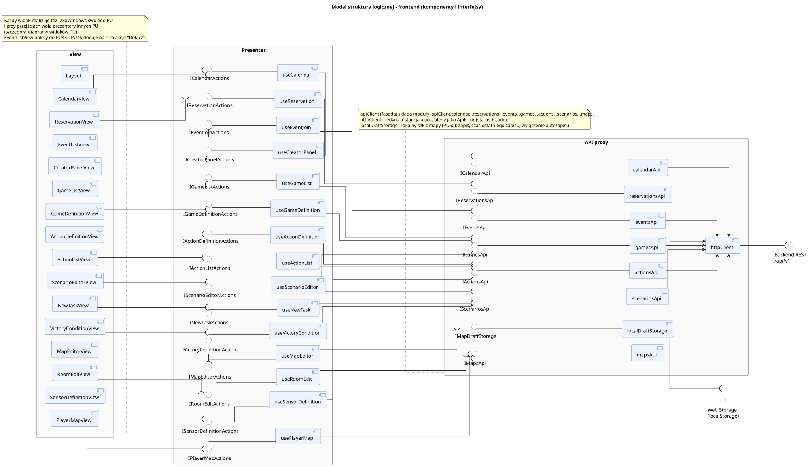

<div hidden>

```
@startuml logic_structure_frontend
left to right direction
skinparam componentStyle uml2
skinparam packageStyle rectangle
skinparam shadowing false
skinparam roundcorner 6
skinparam linetype ortho
skinparam nodesep 18
skinparam ranksep 90
skinparam package {
    BackgroundColor #FAFAFA
    BorderColor #888888
}
skinparam component {
    BackgroundColor #EEF4FF
    BorderColor #4A6FA5
}
skinparam interface {
    BackgroundColor #FFFFFF
    BorderColor #4A6FA5
}

title Model struktury logicznej - frontend (komponenty i interfejsy)

package "View" as V {
    component [Layout] as V_Layout
    component [CalendarView] as V_Calendar
    component [ReservationView] as V_Reservation
    component [EventListView] as V_EventList
    component [CreatorPanelView] as V_Creator
    component [GameListView] as V_GameList
    component [GameDefinitionView] as V_GameDef
    component [ActionDefinitionView] as V_Action
    component [ActionListView] as V_ActionList
    component [ScenarioEditorView] as V_Scenario
    component [NewTaskView] as V_NewTask
    component [VictoryConditionView] as V_Victory
    component [MapEditorView] as V_MapEditor
    component [RoomEditView] as V_RoomEdit
    component [SensorDefinitionView] as V_Sensor
    component [PlayerMapView] as V_PlayerMap
}

package "Presenter" as P {
    () "ICalendarActions" as I_Calendar
    () "IReservationActions" as I_Reservation
    () "IEventJoinActions" as I_EventJoin
    () "ICreatorPanelActions" as I_Creator
    () "IGameListActions" as I_GameList
    () "IGameDefinitionActions" as I_GameDef
    () "IActionDefinitionActions" as I_Action
    () "IActionListActions" as I_ActionList
    () "IScenarioEditorActions" as I_Scenario
    () "INewTaskActions" as I_NewTask
    () "IVictoryConditionActions" as I_Victory
    () "IMapEditorActions" as I_MapEditor
    () "IRoomEditActions" as I_RoomEdit
    () "ISensorDefinitionActions" as I_Sensor
    () "IPlayerMapActions" as I_PlayerMap

    component [useCalendar] as P_Calendar
    component [useReservation] as P_Reservation
    component [useEventJoin] as P_EventJoin
    component [useCreatorPanel] as P_Creator
    component [useGameList] as P_GameList
    component [useGameDefinition] as P_GameDef
    component [useActionDefinition] as P_Action
    component [useActionList] as P_ActionList
    component [useScenarioEditor] as P_Scenario
    component [useNewTask] as P_NewTask
    component [useVictoryCondition] as P_Victory
    component [useMapEditor] as P_MapEditor
    component [useRoomEdit] as P_RoomEdit
    component [useSensorDefinition] as P_Sensor
    component [usePlayerMap] as P_PlayerMap

    I_Calendar -- P_Calendar
    I_Reservation -- P_Reservation
    I_EventJoin -- P_EventJoin
    I_Creator -- P_Creator
    I_GameList -- P_GameList
    I_GameDef -- P_GameDef
    I_Action -- P_Action
    I_ActionList -- P_ActionList
    I_Scenario -- P_Scenario
    I_NewTask -- P_NewTask
    I_Victory -- P_Victory
    I_MapEditor -- P_MapEditor
    I_RoomEdit -- P_RoomEdit
    I_Sensor -- P_Sensor
    I_PlayerMap -- P_PlayerMap
}

package "API proxy" as A {
    () "ICalendarApi" as IA_Calendar
    () "IReservationsApi" as IA_Reservations
    () "IEventsApi" as IA_Events
    () "IGamesApi" as IA_Games
    () "IActionsApi" as IA_Actions
    () "IScenariosApi" as IA_Scenarios
    () "IMapsApi" as IA_Maps
    () "IMapDraftStorage" as IA_Draft

    component [calendarApi] as A_Calendar
    component [reservationsApi] as A_Reservations
    component [eventsApi] as A_Events
    component [gamesApi] as A_Games
    component [actionsApi] as A_Actions
    component [scenariosApi] as A_Scenarios
    component [mapsApi] as A_Maps
    component [localDraftStorage] as A_Draft
    component [httpClient] as A_Http

    IA_Calendar -- A_Calendar
    IA_Reservations -- A_Reservations
    IA_Events -- A_Events
    IA_Games -- A_Games
    IA_Actions -- A_Actions
    IA_Scenarios -- A_Scenarios
    IA_Maps -- A_Maps
    IA_Draft -- A_Draft

    A_Calendar --> A_Http
    A_Reservations --> A_Http
    A_Events --> A_Http
    A_Games --> A_Http
    A_Actions --> A_Http
    A_Scenarios --> A_Http
    A_Maps --> A_Http
}

() "Backend REST\n/api/v1" as REST
() "Web Storage\n(localStorage)" as LS
A_Http --( REST
A_Draft --( LS

V_Calendar --( I_Calendar
V_Reservation --( I_Reservation
V_Creator --( I_Creator
V_GameList --( I_GameList
V_GameDef --( I_GameDef
V_Action --( I_Action
V_ActionList --( I_ActionList
V_Scenario --( I_Scenario
V_NewTask --( I_NewTask
V_Victory --( I_Victory
V_MapEditor --( I_MapEditor
V_RoomEdit --( I_RoomEdit
V_Sensor --( I_Sensor
V_PlayerMap --( I_PlayerMap

V_Layout --( I_Calendar
V_EventList --( I_EventJoin

P_Calendar --( IA_Calendar
P_Reservation --( IA_Reservations
P_EventJoin --( IA_Events
P_GameList --( IA_Games
P_GameDef --( IA_Games
P_Action --( IA_Actions
P_ActionList --( IA_Actions
P_Scenario --( IA_Games
P_Scenario --( IA_Scenarios
P_NewTask --( IA_Scenarios
P_Victory --( IA_Scenarios
P_MapEditor --( IA_Maps
P_MapEditor --( IA_Draft
P_RoomEdit --( IA_Maps
P_Sensor --( IA_Maps
P_Sensor --( IA_Actions
P_PlayerMap --( IA_Maps

note bottom of A
    apiClient (fasada) składa moduły: apiClient.calendar, .reservations, .events, .games, .actions, .scenarios, .maps.
    httpClient - jedyna instancja axios, błędy jako ApiError (status + code).
    localDraftStorage - lokalny szkic mapy (PU60): zapis, czas ostatniego zapisu, wyłączenie autozapisu.
end note

note bottom of V
    Każdy widok realizuje też IXxxWindows swojego PU
    i przy przejściach woła prezentery innych PU
    (szczegóły: diagramy widoków PU).
    EventListView należy do PU45 - PU46 dodaje na nim akcję "Dołącz".
end note
@enduml
```

</div>


