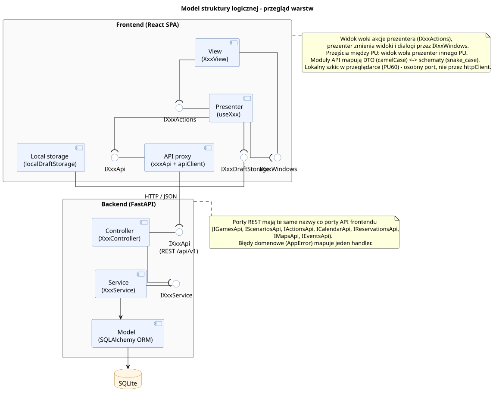

<div hidden>

```
@startuml logic_structure_model
skinparam componentStyle uml2
skinparam packageStyle rectangle
skinparam shadowing false
skinparam roundcorner 6
skinparam linetype ortho
skinparam nodesep 60
skinparam ranksep 50
skinparam defaultTextAlignment center
skinparam package {
    BackgroundColor #FAFAFA
    BorderColor #888888
}
skinparam component {
    BackgroundColor #EEF4FF
    BorderColor #4A6FA5
}
skinparam interface {
    BackgroundColor #FFFFFF
    BorderColor #4A6FA5
}
skinparam database {
    BackgroundColor #FFF6E5
    BorderColor #B7791F
}

title Model struktury logicznej - przegląd warstw

package "Frontend (React SPA)" as FE {
    component "View\n(XxxView)" as V
    component "Presenter\n(useXxx)" as P
    component "API proxy\n(xxxApi + apiClient)" as A
    () "IXxxActions" as IA
    () "IXxxWindows" as IW
    () "IXxxApi" as IAPI
    component "Local storage\n(localDraftStorage)" as LS
    () "IXxxDraftStorage" as ILS

    P - IA
    V - IW
    A - IAPI
    V --( IA
    P --( IW
    P --( IAPI
    LS - ILS
    P --( ILS
}

package "Backend (FastAPI)" as BE {
    component "Controller\n(XxxController)" as C
    component "Service\n(XxxService)" as S
    component "Model\n(SQLAlchemy ORM)" as M
    () "IXxxApi\n(REST /api/v1)" as IREST
    () "IXxxService" as IS

    C - IREST
    S - IS
    C --( IS
    S --> M
}

database "SQLite" as DB

A --( IREST : HTTP / JSON
M --> DB

note right of FE
    Widok woła akcje prezentera (IXxxActions),
    prezenter zmienia widoki i dialogi przez IXxxWindows.
    Przejścia między PU: widok woła prezenter innego PU.
    Moduły API mapują DTO (camelCase) <-> schematy (snake_case).
    Lokalny szkic w przeglądarce (PU60) - osobny port, nie przez httpClient.
end note

note right of BE
    Porty REST mają te same nazwy co porty API frontendu
    (IGamesApi, IScenariosApi, IActionsApi, ICalendarApi, IReservationsApi,
    IMapsApi, IEventsApi).
    Błędy domenowe (AppError) mapuje jeden handler.
end note
@enduml
```

</div>



Szczegóły warstw: [frontend](logic_structure_frontend.md), [backend](logic_structure_backend.md).
