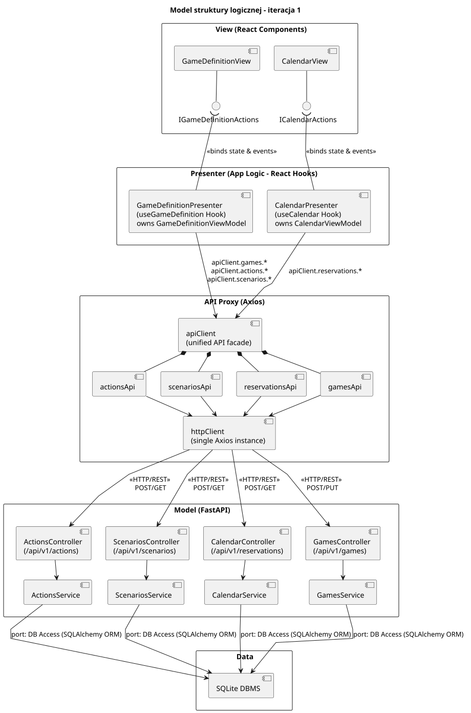

<div hidden>

```
@startuml logic_structure_model
skinparam componentStyle uml2
skinparam packageStyle rectangle
skinparam shadowing false
skinparam roundcorner 4
skinparam nodesep 28
skinparam ranksep 38
skinparam linetype polyline

title Model struktury logicznej - iteracja 1

package "View (React Components)" as V {
    component [GameDefinitionView] as V_GameDefinition
    component [CalendarView] as V_Calendar

    interface "IGameDefinitionActions" as IV_Definition
    interface "ICalendarActions" as IV_Calendar

    V_GameDefinition -down- IV_Definition
    V_Calendar -down- IV_Calendar
}

package "Presenter (App Logic - React Hooks)" as P {
    component [GameDefinitionPresenter\n(useGameDefinition Hook)\nowns GameDefinitionViewModel] as P_Definition
    component [CalendarPresenter\n(useCalendar Hook)\nowns CalendarViewModel] as P_Calendar

    P_Definition -up-( IV_Definition : <<binds state & events>>
    P_Calendar -up-( IV_Calendar : <<binds state & events>>
}

package "API Proxy (Axios)" as A {
    component [apiClient\n(unified API facade)] as A_Client
    component [gamesApi] as A_Games
    component [actionsApi] as A_Actions
    component [scenariosApi] as A_Scenarios
    component [reservationsApi] as A_Reservations
    component [httpClient\n(single Axios instance)] as A_Http

    A_Client *-down- A_Games
    A_Client *-down- A_Actions
    A_Client *-down- A_Scenarios
    A_Client *-down- A_Reservations

    A_Games -down-> A_Http
    A_Actions -down-> A_Http
    A_Scenarios -down-> A_Http
    A_Reservations -down-> A_Http
}

P_Definition -down-> A_Client : apiClient.games.*\napiClient.actions.*\napiClient.scenarios.*
P_Calendar -down-> A_Client : apiClient.reservations.*

package "Model (FastAPI)" as M {
    component [GamesController\n(/api/v1/games)] as C_Games
    component [ActionsController\n(/api/v1/actions)] as C_Actions
    component [ScenariosController\n(/api/v1/scenarios)] as C_Scenarios
    component [CalendarController\n(/api/v1/reservations)] as C_Calendar

    component [GamesService] as M_Games
    component [ActionsService] as M_Actions
    component [ScenariosService] as M_Scenarios
    component [CalendarService] as M_Calendar

    C_Games -down-> M_Games
    C_Actions -down-> M_Actions
    C_Scenarios -down-> M_Scenarios
    C_Calendar -down-> M_Calendar
}

A_Http -down-> C_Games : <<HTTP/REST>>\nPOST/PUT
A_Http -down-> C_Actions : <<HTTP/REST>>\nPOST/GET
A_Http -down-> C_Scenarios : <<HTTP/REST>>\nPOST/GET
A_Http -down-> C_Calendar : <<HTTP/REST>>\nPOST/GET

package "Data" as D {
    database [SQLite DBMS] as DB_Sqlite
}

M_Games -down-> DB_Sqlite : port: DB Access (SQLAlchemy ORM)
M_Actions -down-> DB_Sqlite : port: DB Access (SQLAlchemy ORM)
M_Scenarios -down-> DB_Sqlite : port: DB Access (SQLAlchemy ORM)
M_Calendar -down-> DB_Sqlite : port: DB Access (SQLAlchemy ORM)

V -[hidden]down-> P
P -[hidden]down-> A
A -[hidden]down-> M
M -[hidden]down-> D

V_GameDefinition -[hidden]right-> V_Calendar
P_Definition -[hidden]right-> P_Calendar
A_Games -[hidden]right-> A_Actions
A_Actions -[hidden]right-> A_Scenarios
A_Scenarios -[hidden]right-> A_Reservations
C_Games -[hidden]right-> C_Actions
C_Actions -[hidden]right-> C_Scenarios
C_Scenarios -[hidden]right-> C_Calendar
M_Games -[hidden]right-> M_Actions
M_Actions -[hidden]right-> M_Scenarios
M_Scenarios -[hidden]right-> M_Calendar

@enduml
```

</div>


