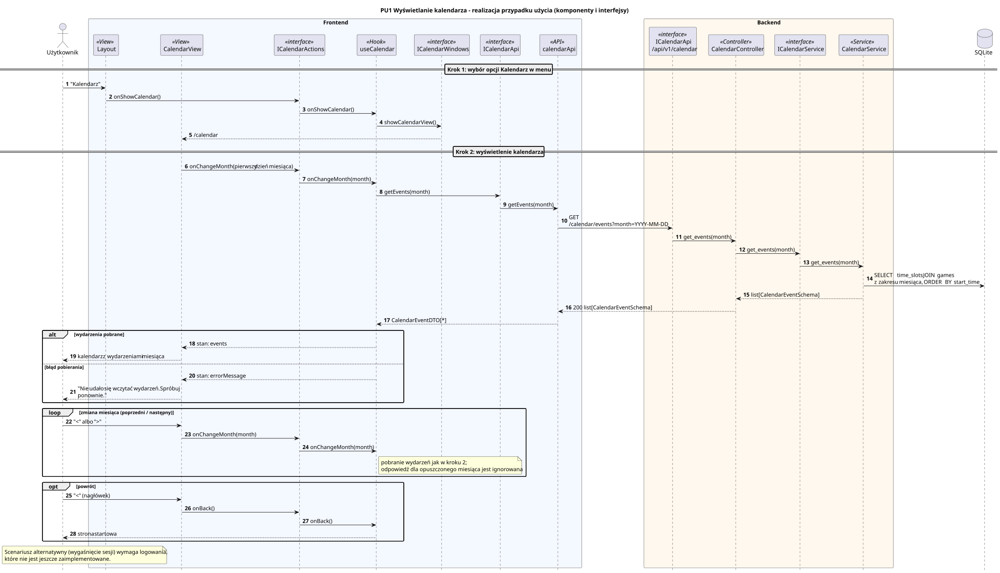

<div hidden>

```
@startuml pu1-wyswietlanie-kalendarza
skinparam shadowing false
skinparam roundcorner 4
skinparam sequenceMessageAlign left
skinparam responseMessageBelowArrow true
skinparam maxMessageSize 260
skinparam ParticipantPadding 8
hide footbox
autonumber

title PU1 Wyświetlanie kalendarza - realizacja przypadku użycia (komponenty i interfejsy)

actor "Użytkownik" as U
box "Frontend" #F4F8FF
    participant "Layout" as VL <<View>>
    participant "CalendarView" as V <<View>>
    participant "ICalendarActions" as IA <<interface>>
    participant "useCalendar" as P <<Hook>>
    participant "ICalendarWindows" as IW <<interface>>
    participant "ICalendarApi" as IAPI <<interface>>
    participant "calendarApi" as API <<API>>
end box
box "Backend" #FFF8EE
    participant "ICalendarApi\n/api/v1/calendar" as REST <<interface>>
    participant "CalendarController" as C <<Controller>>
    participant "ICalendarService" as IS <<interface>>
    participant "CalendarService" as S <<Service>>
end box
database "SQLite" as DB

== Krok 1: wybór opcji Kalendarz w menu ==
U -> VL : "Kalendarz"
VL -> IA : onShowCalendar()
IA -> P : onShowCalendar()
P -> IW : showCalendarView()
IW --> V : /calendar

== Krok 2: wyświetlenie kalendarza ==
V -> IA : onChangeMonth(pierwszy dzień miesiąca)
IA -> P : onChangeMonth(month)
P -> IAPI : getEvents(month)
IAPI -> API : getEvents(month)
API -> REST : GET /calendar/events?month=YYYY-MM-DD
REST -> C : get_events(month)
C -> IS : get_events(month)
IS -> S : get_events(month)
S -> DB : SELECT time_slots JOIN games\nz zakresu miesiąca, ORDER BY start_time
S --> C : list[CalendarEventSchema]
C --> API : 200 list[CalendarEventSchema]
API --> P : CalendarEventDTO[*]

alt wydarzenia pobrane
    P --> V : stan: events
    V --> U : kalendarz z wydarzeniami miesiąca
else błąd pobierania
    P --> V : stan: errorMessage
    V --> U : "Nie udało się wczytać wydarzeń. Spróbuj ponownie."
end

loop zmiana miesiąca (poprzedni / następny)
    U -> V : "<" albo ">"
    V -> IA : onChangeMonth(month)
    IA -> P : onChangeMonth(month)
    note right of P : pobranie wydarzeń jak w kroku 2;\nodpowiedź dla opuszczonego miesiąca jest ignorowana
end

opt powrót
    U -> V : "<" (nagłówek)
    V -> IA : onBack()
    IA -> P : onBack()
    P --> U : strona startowa
end

note over U, VL
    Scenariusz alternatywny (wygaśnięcie sesji) wymaga logowania,
    które nie jest jeszcze zaimplementowane.
end note
@enduml
```

</div>


