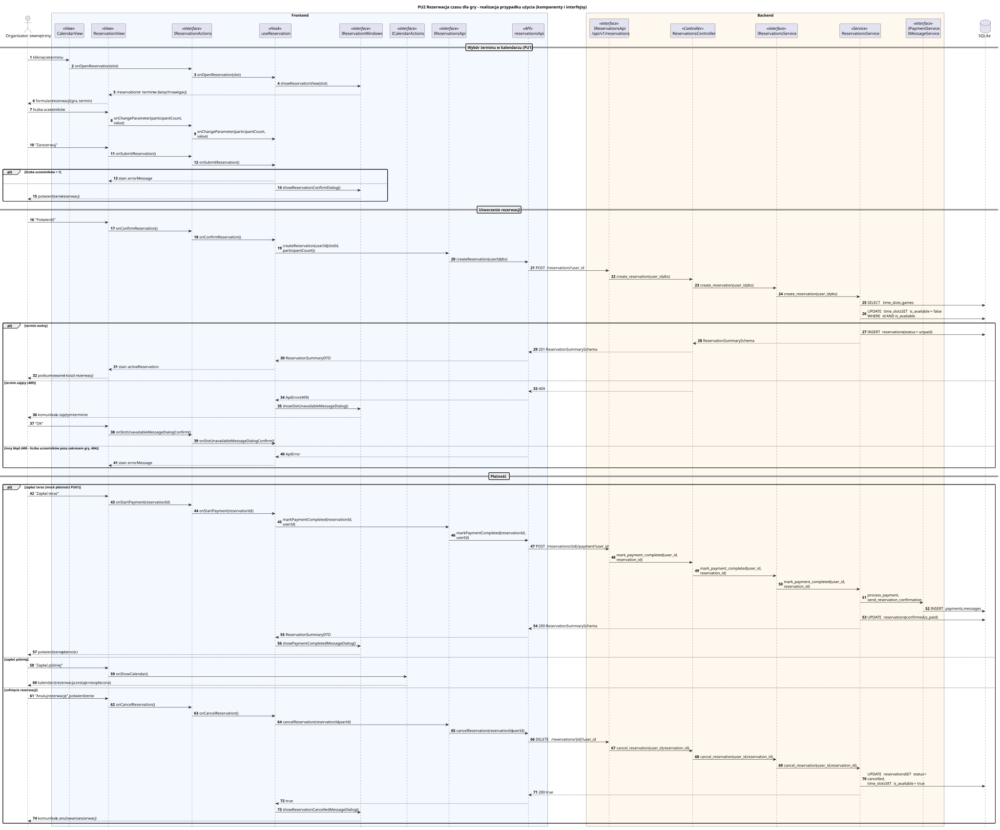

<div hidden>

```
@startuml pu2-rezerwacja-czasu
skinparam shadowing false
skinparam roundcorner 4
skinparam sequenceMessageAlign left
skinparam responseMessageBelowArrow true
skinparam maxMessageSize 260
skinparam ParticipantPadding 8
hide footbox
autonumber

title PU2 Rezerwacja czasu dla gry - realizacja przypadku użycia (komponenty i interfejsy)

actor "Organizator zewnętrzny" as U
box "Frontend" #F4F8FF
    participant "CalendarView" as VC <<View>>
    participant "ReservationView" as V <<View>>
    participant "IReservationActions" as IA <<interface>>
    participant "useReservation" as P <<Hook>>
    participant "IReservationWindows" as IW <<interface>>
    participant "ICalendarActions" as ICAL <<interface>>
    participant "IReservationsApi" as IAPI <<interface>>
    participant "reservationsApi" as API <<API>>
end box
box "Backend" #FFF8EE
    participant "IReservationsApi\n/api/v1/reservations" as REST <<interface>>
    participant "ReservationsController" as C <<Controller>>
    participant "IReservationsService" as IS <<interface>>
    participant "ReservationsService" as S <<Service>>
    participant "IPaymentService\nIMessageService" as IPM <<interface>>
end box
database "SQLite" as DB

== Wybór terminu w kalendarzu (PU1) ==
U -> VC : kliknięcie terminu
VC -> IA : onOpenReservation(slot)
IA -> P : onOpenReservation(slot)
P -> IW : showReservationView(slot)
IW --> V : /reservations + termin w danych nawigacji
V --> U : formularz rezerwacji (gra, termin)

U -> V : liczba uczestników
V -> IA : onChangeParameter(participantCount, value)
IA -> P : onChangeParameter(participantCount, value)
U -> V : "Zarezerwuj"
V -> IA : onSubmitReservation()
IA -> P : onSubmitReservation()
alt liczba uczestników < 1
    P --> V : stan: errorMessage
else
    P -> IW : showReservationConfirmDialog()
    IW --> U : potwierdzenie rezerwacji
end

== Utworzenie rezerwacji ==
U -> V : "Potwierdź"
V -> IA : onConfirmReservation()
IA -> P : onConfirmReservation()
P -> IAPI : createReservation(userId, {slotId, participantCount})
IAPI -> API : createReservation(userId, dto)
API -> REST : POST /reservations?user_id
REST -> C : create_reservation(user_id, dto)
C -> IS : create_reservation(user_id, dto)
IS -> S : create_reservation(user_id, dto)
S -> DB : SELECT time_slots, games
S -> DB : UPDATE time_slots SET is_available = false\nWHERE id AND is_available
alt termin wolny
    S -> DB : INSERT reservations (status = unpaid)
    S --> C : ReservationSummarySchema
    C --> API : 201 ReservationSummarySchema
    API --> P : ReservationSummaryDTO
    P --> V : stan: activeReservation
    V --> U : podsumowanie i koszt rezerwacji
else termin zajęty (409)
    C --> API : 409
    API --> P : ApiError(409)
    P -> IW : showSlotUnavailableMessageDialog()
    IW --> U : komunikat o zajętym terminie
    U -> V : "OK"
    V -> IA : onSlotUnavailableMessageDialogConfirm()
    IA -> P : onSlotUnavailableMessageDialogConfirm()
else inny błąd (400 - liczba uczestników poza zakresem gry, 404)
    API --> P : ApiError
    P --> V : stan: errorMessage
end

== Płatność ==
alt zapłać teraz (mock płatności PU61)
    U -> V : "Zapłać teraz"
    V -> IA : onStartPayment(reservationId)
    IA -> P : onStartPayment(reservationId)
    P -> IAPI : markPaymentCompleted(reservationId, userId)
    IAPI -> API : markPaymentCompleted(reservationId, userId)
    API -> REST : POST /reservations/{id}/payment?user_id
    REST -> C : mark_payment_completed(user_id, reservation_id)
    C -> IS : mark_payment_completed(user_id, reservation_id)
    IS -> S : mark_payment_completed(user_id, reservation_id)
    S -> IPM : process_payment, send_reservation_confirmation
    IPM -> DB : INSERT payments, messages
    S -> DB : UPDATE reservations (confirmed, is_paid)
    S --> API : 200 ReservationSummarySchema
    API --> P : ReservationSummaryDTO
    P -> IW : showPaymentCompletedMessageDialog()
    IW --> U : potwierdzenie płatności
else zapłać później
    U -> V : "Zapłać później"
    V -> ICAL : onShowCalendar()
    ICAL --> U : kalendarz (rezerwacja zostaje nieopłacona)
else cofnięcie rezerwacji
    U -> V : "Anuluj rezerwację", potwierdzenie
    V -> IA : onCancelReservation()
    IA -> P : onCancelReservation()
    P -> IAPI : cancelReservation(reservationId, userId)
    IAPI -> API : cancelReservation(reservationId, userId)
    API -> REST : DELETE /reservations/{id}?user_id
    REST -> C : cancel_reservation(user_id, reservation_id)
    C -> IS : cancel_reservation(user_id, reservation_id)
    IS -> S : cancel_reservation(user_id, reservation_id)
    S -> DB : UPDATE reservations SET status = cancelled,\ntime_slots SET is_available = true
    S --> API : 200 true
    API --> P : true
    P -> IW : showReservationCancelledMessageDialog()
    IW --> U : komunikat o anulowaniu rezerwacji
end
@enduml
```

</div>


