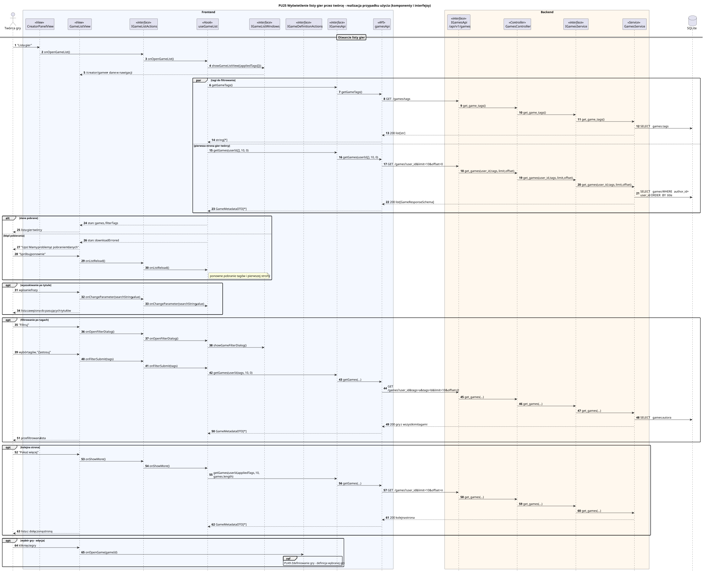

<div hidden>

```
@startuml pu25-lista-gier
skinparam shadowing false
skinparam roundcorner 4
skinparam sequenceMessageAlign left
skinparam responseMessageBelowArrow true
skinparam maxMessageSize 260
skinparam ParticipantPadding 8
hide footbox
autonumber

title PU25 Wyświetlenie listy gier przez twórcę - realizacja przypadku użycia (komponenty i interfejsy)

actor "Twórca gry" as U
box "Frontend" #F4F8FF
    participant "CreatorPanelView" as VC <<View>>
    participant "GameListView" as V <<View>>
    participant "IGameListActions" as IA <<interface>>
    participant "useGameList" as P <<Hook>>
    participant "IGameListWindows" as IW <<interface>>
    participant "IGameDefinitionActions" as IG <<interface>>
    participant "IGamesApi" as IAPI <<interface>>
    participant "gamesApi" as API <<API>>
end box
box "Backend" #FFF8EE
    participant "IGamesApi\n/api/v1/games" as REST <<interface>>
    participant "GamesController" as C <<Controller>>
    participant "IGamesService" as IS <<interface>>
    participant "GamesService" as S <<Service>>
end box
database "SQLite" as DB

== Otwarcie listy gier ==
U -> VC : "Lista gier"
VC -> IA : onOpenGameList()
IA -> P : onOpenGameList()
P -> IW : showGameListView({appliedTags: []})
IW --> V : /creator/games + dane w nawigacji

par tagi do filtrowania
    P -> IAPI : getGameTags()
    IAPI -> API : getGameTags()
    API -> REST : GET /games/tags
    REST -> C : get_game_tags()
    C -> IS : get_game_tags()
    IS -> S : get_game_tags()
    S -> DB : SELECT games.tags
    S --> API : 200 list[str]
    API --> P : string[*]
else pierwsza strona gier twórcy
    P -> IAPI : getGames(userId, [], 10, 0)
    IAPI -> API : getGames(userId, [], 10, 0)
    API -> REST : GET /games?user_id&limit=10&offset=0
    REST -> C : get_games(user_id, tags, limit, offset)
    C -> IS : get_games(user_id, tags, limit, offset)
    IS -> S : get_games(user_id, tags, limit, offset)
    S -> DB : SELECT games WHERE author_id = user_id ORDER BY title
    S --> API : 200 list[GameResponseSchema]
    API --> P : GameMetadataDTO[*]
end

alt dane pobrane
    P --> V : stan: games, filterTags
    V --> U : lista gier twórcy
else błąd pobierania
    P --> V : stan: downloadErrored
    V --> U : "Ups! Mamy problemy z pobraniem danych"
    U -> V : "Spróbuj ponownie"
    V -> IA : onListReload()
    IA -> P : onListReload()
    note right of P : ponowne pobranie tagów i pierwszej strony
end

opt wyszukiwanie po tytule
    U -> V : wpisanie frazy
    V -> IA : onChangeParameter(searchString, value)
    IA -> P : onChangeParameter(searchString, value)
    V --> U : lista zawężona do pasujących tytułów
end

opt filtrowanie po tagach
    U -> V : "Filtruj"
    V -> IA : onOpenFilterDialog()
    IA -> P : onOpenFilterDialog()
    P -> IW : showGameFilterDialog()
    U -> V : wybór tagów, "Zastosuj"
    V -> IA : onFilterSubmit(tags)
    IA -> P : onFilterSubmit(tags)
    P -> IAPI : getGames(userId, tags, 10, 0)
    IAPI -> API : getGames(...)
    API -> REST : GET /games?user_id&tags=a&tags=b&limit=10&offset=0
    REST -> C : get_games(...)
    C -> IS : get_games(...)
    IS -> S : get_games(...)
    S -> DB : SELECT games autora
    S --> API : 200 gry z wszystkimi tagami
    API --> P : GameMetadataDTO[*]
    V --> U : przefiltrowana lista
end

opt kolejna strona
    U -> V : "Pokaż więcej"
    V -> IA : onShowMore()
    IA -> P : onShowMore()
    P -> IAPI : getGames(userId, appliedTags, 10, games.length)
    IAPI -> API : getGames(...)
    API -> REST : GET /games?user_id&limit=10&offset=n
    REST -> C : get_games(...)
    C -> IS : get_games(...)
    IS -> S : get_games(...)
    S --> API : 200 kolejna strona
    API --> P : GameMetadataDTO[*]
    V --> U : lista z dołączoną stroną
end

opt wybór gry - edycja
    U -> V : kliknięcie gry
    V -> IG : onOpenGame(gameId)
    ref over IG : PU49 Zdefiniowanie gry - definicja wybranej gry
end
@enduml
```

</div>


