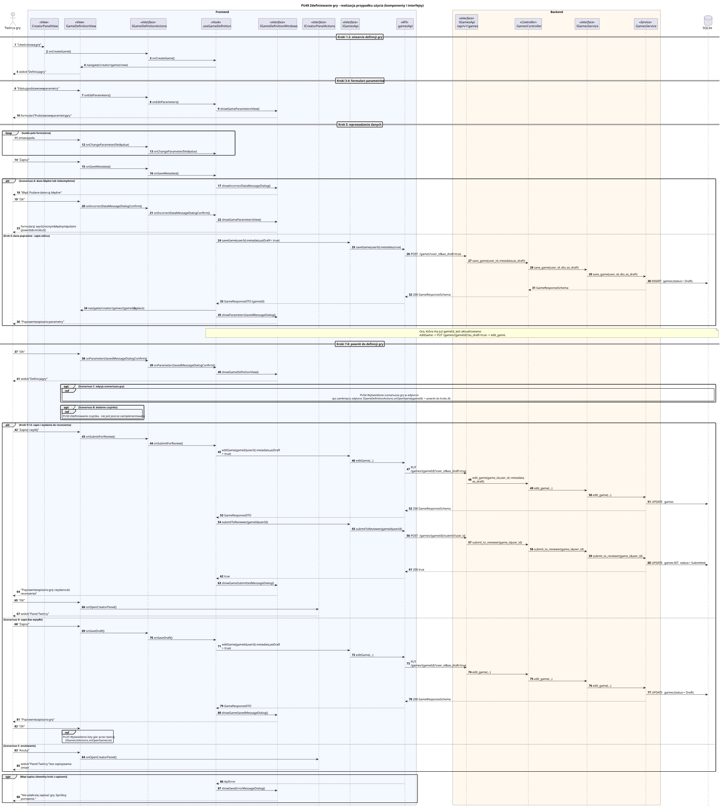

<div hidden>

```
@startuml pu49-zdefiniowanie-gry
skinparam shadowing false
skinparam roundcorner 4
skinparam sequenceMessageAlign left
skinparam responseMessageBelowArrow true
skinparam maxMessageSize 260
skinparam ParticipantPadding 8
hide footbox
autonumber

title PU49 Zdefiniowanie gry - realizacja przypadku użycia (komponenty i interfejsy)

actor "Twórca gry" as U
box "Frontend" #F4F8FF
    participant "CreatorPanelView" as VC <<View>>
    participant "GameDefinitionView" as V <<View>>
    participant "IGameDefinitionActions" as IA <<interface>>
    participant "useGameDefinition" as P <<Hook>>
    participant "IGameDefinitionWindows" as IW <<interface>>
    participant "ICreatorPanelActions" as ICP <<interface>>
    participant "IGamesApi" as IAPI <<interface>>
    participant "gamesApi" as API <<API>>
end box
box "Backend" #FFF8EE
    participant "IGamesApi\n/api/v1/games" as REST <<interface>>
    participant "GamesController" as C <<Controller>>
    participant "IGamesService" as IS <<interface>>
    participant "GamesService" as S <<Service>>
end box
database "SQLite" as DB

== Kroki 1-2: otwarcie definicji gry ==
U -> VC : "Utwórz nową grę"
VC -> IA : onCreateGame()
IA -> P : onCreateGame()
P -> V : navigate(/creator/games/new)
V --> U : widok "Definicja gry"

== Kroki 3-4: formularz parametrów ==
U -> V : "Edytuj podstawowe parametry"
V -> IA : onEditParameters()
IA -> P : onEditParameters()
P -> IW : showGameParametersView()
IW --> U : formularz "Podstawowe parametry gry"

== Krok 5: wprowadzenie danych ==
loop każde pole formularza
    U -> V : zmiana pola
    V -> IA : onChangeParameter(field, value)
    IA -> P : onChangeParameter(field, value)
end
U -> V : "Zapisz"
V -> IA : onSaveMetadata()
IA -> P : onSaveMetadata()

alt Scenariusz A: dane błędne lub niekompletne
    P -> IW : showIncorrectDataMessageDialog()
    IW --> U : "Błąd: Podane dane są błędne"
    U -> V : "OK"
    V -> IA : onIncorrectDataMessageDialogConfirm()
    IA -> P : onIncorrectDataMessageDialogConfirm()
    P -> IW : showGameParametersView()
    IW --> U : formularz z wyróżnionymi błędnymi polami (powrót do kroku 5)
else Krok 6: dane poprawne - zapis szkicu
    P -> IAPI : saveGame(userId, metadata, asDraft = true)
    IAPI -> API : saveGame(userId, metadata, true)
    API -> REST : POST /games?user_id&as_draft=true
    REST -> C : save_game(user_id, metadata, as_draft)
    C -> IS : save_game(user_id, dto, as_draft)
    IS -> S : save_game(user_id, dto, as_draft)
    S -> DB : INSERT games (status = Draft)
    S --> C : GameResponseSchema
    C --> API : 200 GameResponseSchema
    API --> P : GameResponseDTO (gameId)
    P -> V : navigate(/creator/games/{gameId}, replace)
    P -> IW : showParametersSavedMessageDialog()
    IW --> U : "Poprawnie zapisano parametry"
end
note over P, DB
    Gra, która ma już gameId, jest aktualizowana:
    editGame -> PUT /games/{gameId}?as_draft=true -> edit_game.
end note

== Kroki 7-8: powrót do definicji gry ==
U -> V : "OK"
V -> IA : onParametersSavedMessageDialogConfirm()
IA -> P : onParametersSavedMessageDialogConfirm()
P -> IW : showGameDefinitionView()
IW --> U : widok "Definicja gry"

opt Scenariusz C: edycja scenariusza gry
    ref over V, DB : PU56 Wyświetlenie scenariusza gry w edytorze\n(po zamknięciu edytora: IGameDefinitionActions.onOpenGame(gameId) -> powrót do kroku 8)
end
opt Scenariusz B: dodanie czujnika
    ref over V : PU50 Zdefiniowanie czujnika - nie jest jeszcze zaimplementowany
end

alt Kroki 9-12: zapis i wysłanie do recenzenta
    U -> V : "Zapisz i wyślij"
    V -> IA : onSubmitForReview()
    IA -> P : onSubmitForReview()
    P -> IAPI : editGame(gameId, userId, metadata, asDraft = true)
    IAPI -> API : editGame(...)
    API -> REST : PUT /games/{gameId}?user_id&as_draft=true
    REST -> C : edit_game(game_id, user_id, metadata, as_draft)
    C -> IS : edit_game(...)
    IS -> S : edit_game(...)
    S -> DB : UPDATE games
    S --> API : 200 GameResponseSchema
    API --> P : GameResponseDTO
    P -> IAPI : submitToReviewer(gameId, userId)
    IAPI -> API : submitToReviewer(gameId, userId)
    API -> REST : POST /games/{gameId}/submit?user_id
    REST -> C : submit_to_reviewer(game_id, user_id)
    C -> IS : submit_to_reviewer(game_id, user_id)
    IS -> S : submit_to_reviewer(game_id, user_id)
    S -> DB : UPDATE games SET status = Submitted
    S --> API : 200 true
    API --> P : true
    P -> IW : showGameSubmittedMessageDialog()
    IW --> U : "Poprawnie zapisano grę i wysłano do recenzenta"
    U -> V : "OK"
    V -> ICP : onOpenCreatorPanel()
    ICP --> U : widok "Panel Twórcy"
else Scenariusz D: zapis bez wysyłki
    U -> V : "Zapisz"
    V -> IA : onSaveDraft()
    IA -> P : onSaveDraft()
    P -> IAPI : editGame(gameId, userId, metadata, asDraft = true)
    IAPI -> API : editGame(...)
    API -> REST : PUT /games/{gameId}?user_id&as_draft=true
    REST -> C : edit_game(...)
    C -> IS : edit_game(...)
    IS -> S : edit_game(...)
    S -> DB : UPDATE games (status = Draft)
    S --> API : 200 GameResponseSchema
    API --> P : GameResponseDTO
    P -> IW : showGameSavedMessageDialog()
    IW --> U : "Poprawnie zapisano grę"
    U -> V : "OK"
    ref over V : PU25 Wyświetlenie listy gier przez twórcę\n(IGameListActions.onOpenGameList)
else Scenariusz E: anulowanie
    U -> V : "Anuluj"
    V -> ICP : onOpenCreatorPanel()
    ICP --> U : widok "Panel Twórcy" bez zapisywania zmian
end

opt Błąd zapisu (dowolny krok z zapisem)
    API --> P : ApiError
    P -> IW : showSaveErrorMessageDialog()
    IW --> U : "Nie udało się zapisać gry. Spróbuj ponownie."
end
@enduml
```

</div>


