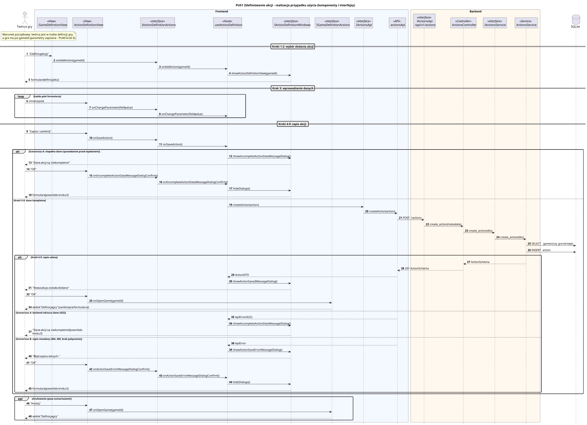

<div hidden>

```
@startuml pu51-zdefiniowanie-akcji
skinparam shadowing false
skinparam roundcorner 4
skinparam sequenceMessageAlign left
skinparam responseMessageBelowArrow true
skinparam maxMessageSize 260
skinparam ParticipantPadding 8
hide footbox
autonumber

title PU51 Zdefiniowanie akcji - realizacja przypadku użycia (komponenty i interfejsy)

actor "Twórca gry" as U
box "Frontend" #F4F8FF
    participant "GameDefinitionView" as VG <<View>>
    participant "ActionDefinitionView" as V <<View>>
    participant "IActionDefinitionActions" as IA <<interface>>
    participant "useActionDefinition" as P <<Hook>>
    participant "IActionDefinitionWindows" as IW <<interface>>
    participant "IGameDefinitionActions" as IG <<interface>>
    participant "IActionsApi" as IAPI <<interface>>
    participant "actionsApi" as API <<API>>
end box
box "Backend" #FFF8EE
    participant "IActionsApi\n/api/v1/actions" as REST <<interface>>
    participant "ActionsController" as C <<Controller>>
    participant "IActionsService" as IS <<interface>>
    participant "ActionsService" as S <<Service>>
end box
database "SQLite" as DB

note over U, VG
    Warunek początkowy: twórca jest w trybie definicji gry,
    a gra ma już gameId (parametry zapisane - PU49 krok 6).
end note

== Kroki 1-2: wybór dodania akcji ==
U -> VG : "Zdefiniuj akcję"
VG -> IA : onAddAction(gameId)
IA -> P : onAddAction(gameId)
P -> IW : showActionDefinitionView(gameId)
IW --> U : formularz definicji akcji

== Krok 3: wprowadzenie danych ==
loop każde pole formularza
    U -> V : zmiana pola
    V -> IA : onChangeParameter(field, value)
    IA -> P : onChangeParameter(field, value)
end

== Kroki 4-9: zapis akcji ==
U -> V : "Zapisz i zamknij"
V -> IA : onSaveAction()
IA -> P : onSaveAction()

alt Scenariusz A: niepełne dane (sprawdzenie przed wysłaniem)
    P -> IW : showIncompleteActionDataMessageDialog()
    IW --> U : "Dane akcji są niekompletne"
    U -> V : "OK"
    V -> IA : onIncompleteActionDataMessageDialogConfirm()
    IA -> P : onIncompleteActionDataMessageDialogConfirm()
    P -> IW : hideDialogs()
    IW --> U : formularz (powrót do kroku 3)
else Kroki 5-9: dane kompletne
    P -> IAPI : createAction(action)
    IAPI -> API : createAction(action)
    API -> REST : POST /actions
    REST -> C : create_action(metadata)
    C -> IS : create_action(dto)
    IS -> S : create_action(dto)
    S -> DB : SELECT games (czy gra istnieje)
    S -> DB : INSERT action
    alt Kroki 6-9: zapis udany
        S --> C : ActionSchema
        C --> API : 201 ActionSchema
        API --> P : ActionDTO
        P -> IW : showActionSavedMessageDialog()
        IW --> U : "Nowa akcja została dodana"
        U -> V : "OK"
        V -> IG : onOpenGame(gameId)
        IG --> U : widok "Definicja gry" (zamknięcie formularza)
    else Scenariusz A: backend odrzuca dane (422)
        API --> P : ApiError(422)
        P -> IW : showIncompleteActionDataMessageDialog()
        IW --> U : "Dane akcji są niekompletne" (powrót do kroku 3)
    else Scenariusz B: zapis nieudany (404, 409, brak połączenia)
        API --> P : ApiError
        P -> IW : showActionSaveErrorMessageDialog()
        IW --> U : "Błąd zapisu danych."
        U -> V : "OK"
        V -> IA : onActionSaveErrorMessageDialogConfirm()
        IA -> P : onActionSaveErrorMessageDialogConfirm()
        P -> IW : hideDialogs()
        IW --> U : formularz (powrót do kroku 3)
    end
end

opt Anulowanie (poza scenariuszem)
    U -> V : "Anuluj"
    V -> IG : onOpenGame(gameId)
    IG --> U : widok "Definicja gry"
end
@enduml
```

</div>


