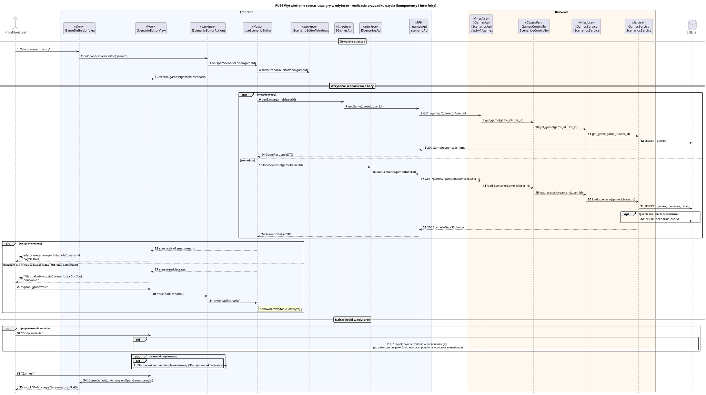

<div hidden>

```
@startuml pu56-scenariusz-w-edytorze
skinparam shadowing false
skinparam roundcorner 4
skinparam sequenceMessageAlign left
skinparam responseMessageBelowArrow true
skinparam maxMessageSize 260
skinparam ParticipantPadding 8
hide footbox
autonumber

title PU56 Wyświetlenie scenariusza gry w edytorze - realizacja przypadku użycia (komponenty i interfejsy)

actor "Projektant gier" as U
box "Frontend" #F4F8FF
    participant "GameDefinitionView" as VG <<View>>
    participant "ScenarioEditorView" as V <<View>>
    participant "IScenarioEditorActions" as IA <<interface>>
    participant "useScenarioEditor" as P <<Hook>>
    participant "IScenarioEditorWindows" as IW <<interface>>
    participant "IGamesApi" as IGAPI <<interface>>
    participant "IScenariosApi" as ISAPI <<interface>>
    participant "gamesApi\nscenarioApi" as API <<API>>
end box
box "Backend" #FFF8EE
    participant "IGamesApi\nIScenariosApi\n/api/v1/games" as REST <<interface>>
    participant "GamesController\nScenariosController" as C <<Controller>>
    participant "IGamesService\nIScenariosService" as IS <<interface>>
    participant "GamesService\nScenariosService" as S <<Service>>
end box
database "SQLite" as DB

== Otwarcie edytora ==
U -> VG : "Edytuj scenariusz gry"
VG -> IA : onOpenScenarioEditor(gameId)
IA -> P : onOpenScenarioEditor(gameId)
P -> IW : showScenarioEditorView(gameId)
IW --> V : /creator/games/{gameId}/scenario

== Wczytanie scenariusza z bazy ==
par metadane gry
    P -> IGAPI : getGame(gameId, userId)
    IGAPI -> API : getGame(gameId, userId)
    API -> REST : GET /games/{gameId}?user_id
    REST -> C : get_game(game_id, user_id)
    C -> IS : get_game(game_id, user_id)
    IS -> S : get_game(game_id, user_id)
    S -> DB : SELECT games
    S --> API : 200 GameResponseSchema
    API --> P : GameResponseDTO
else scenariusz
    P -> ISAPI : loadScenario(gameId, userId)
    ISAPI -> API : loadScenario(gameId, userId)
    API -> REST : GET /games/{gameId}/scenario?user_id
    REST -> C : load_scenario(game_id, user_id)
    C -> IS : load_scenario(game_id, user_id)
    IS -> S : load_scenario(game_id, user_id)
    S -> DB : SELECT games, scenarios, tasks
    opt gra nie ma jeszcze scenariusza
        S -> DB : INSERT scenarios (pusty)
    end
    S --> API : 200 ScenarioDetailSchema
    API --> P : ScenarioDetailDTO
end

alt wczytanie udane
    P --> V : stan: activeGame, scenario
    V --> U : edytor: metadane gry, lista zadań, warunki zwycięstwa
else błąd (gra nie istnieje albo jest cudza - 404, brak połączenia)
    P --> V : stan: errorMessage
    V --> U : "Nie udało się wczytać scenariusza. Spróbuj ponownie."
    U -> V : "Spróbuj ponownie"
    V -> IA : onReloadScenario()
    IA -> P : onReloadScenario()
    note right of P : ponowne wczytanie jak wyżej
end

== Dalsze kroki w edytorze ==
opt projektowanie zadania
    U -> V : "Dodaj zadanie"
    ref over V, DB : PU57 Projektowanie zadania w scenariuszu gry\n(po zakończeniu: powrót do edytora i ponowne wczytanie scenariusza)
end
opt warunki zwycięstwa
    ref over V : PU58 - nie jest jeszcze zaimplementowany ("Dodaj warunek" nieaktywne)
end
U -> V : "Zamknij"
V -> VG : IGameDefinitionActions.onOpenGame(gameId)
VG --> U : widok "Definicja gry" tej samej gry (PU49)
@enduml
```

</div>


