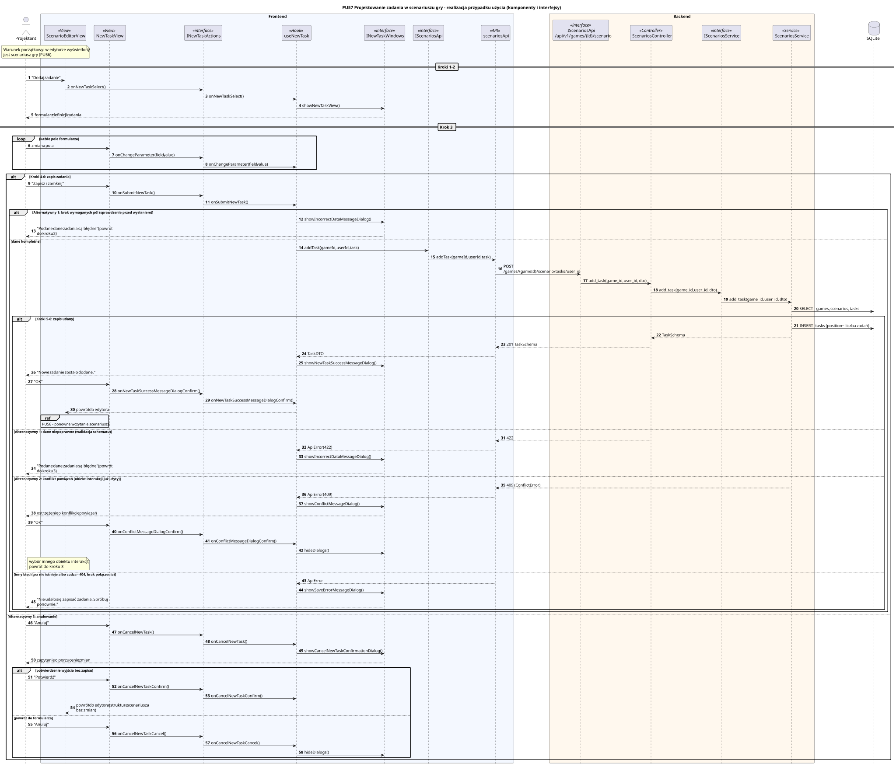

<div hidden>

```
@startuml pu57-projektowanie-zadania
skinparam shadowing false
skinparam roundcorner 4
skinparam sequenceMessageAlign left
skinparam responseMessageBelowArrow true
skinparam maxMessageSize 260
skinparam ParticipantPadding 8
hide footbox
autonumber

title PU57 Projektowanie zadania w scenariuszu gry - realizacja przypadku użycia (komponenty i interfejsy)

actor "Projektant" as U
box "Frontend" #F4F8FF
    participant "ScenarioEditorView" as VS <<View>>
    participant "NewTaskView" as V <<View>>
    participant "INewTaskActions" as IA <<interface>>
    participant "useNewTask" as P <<Hook>>
    participant "INewTaskWindows" as IW <<interface>>
    participant "IScenariosApi" as IAPI <<interface>>
    participant "scenariosApi" as API <<API>>
end box
box "Backend (w przygotowaniu)" #FFF8EE
    participant "IScenariosApi\n/api/v1/games/{id}/scenario" as REST <<interface>>
end box

note over U, VS
    Warunek początkowy: w edytorze wyświetlony
    jest scenariusz gry (PU56).
end note

== Kroki 1-2 ==
U -> VS : "Dodaj zadanie"
VS -> IA : onNewTaskSelect()
IA -> P : onNewTaskSelect()
P -> IW : showNewTaskView()
IW --> U : formularz definicji zadania

== Krok 3 ==
loop każde pole formularza
    U -> V : zmiana pola
    V -> IA : onChangeParameter(field, value)
    IA -> P : onChangeParameter(field, value)
end

alt Kroki 4-6: zapis zadania
    U -> V : "Zapisz i zamknij"
    V -> IA : onSubmitNewTask()
    IA -> P : onSubmitNewTask()
    alt Scenariusz alternatywny 1: brak wymaganych pól (sprawdzenie przed wysłaniem)
        P -> IW : showIncorrectDataMessageDialog()
        IW --> U : "Podane dane zadania są błędne" (powrót do kroku 3)
    else dane kompletne
        P -> IAPI : addTask(gameId, userId, task)
        IAPI -> API : addTask(gameId, userId, task)
        API -> REST : POST /games/{gameId}/scenario/tasks?user_id
        note right of REST
            Backend PU57 w przygotowaniu -
            walidacja i zapis zadania po stronie serwera.
        end note
        alt Kroki 5-6: zapis udany
            REST --> API : 201
            API --> P : odpowiedź
            P -> IW : showNewTaskSuccessMessageDialog()
            IW --> U : "Nowe zadanie zostało dodane."
            U -> V : "OK"
            V -> IA : onNewTaskSuccessMessageDialogConfirm()
            IA -> P : onNewTaskSuccessMessageDialogConfirm()
            P --> VS : powrót do edytora
            ref over VS : PU56 - ponowne wczytanie scenariusza
        else Scenariusz alternatywny 1: dane niepoprawne (422)
            REST --> API : 422
            API --> P : ApiError(422)
            P -> IW : showIncorrectDataMessageDialog()
            IW --> U : "Podane dane zadania są błędne" (powrót do kroku 3)
        else Scenariusz alternatywny 2: konflikt powiązań (409)
            REST --> API : 409
            API --> P : ApiError(409)
            P -> IW : showConflictMessageDialog()
            IW --> U : ostrzeżenie o konflikcie powiązań
            U -> V : "OK"
            V -> IA : onConflictMessageDialogConfirm()
            IA -> P : onConflictMessageDialogConfirm()
            P -> IW : hideDialogs()
            note right of U : wybór innego obiektu interakcji,\npowrót do kroku 3
        else inny błąd (np. 404, brak połączenia)
            API --> P : ApiError
            P -> IW : showSaveErrorMessageDialog()
            IW --> U : "Nie udało się zapisać zadania. Spróbuj ponownie."
        end
    end
else Scenariusz alternatywny 3: anulowanie
    U -> V : "Anuluj"
    V -> IA : onCancelNewTask()
    IA -> P : onCancelNewTask()
    P -> IW : showCancelNewTaskConfirmationDialog()
    IW --> U : zapytanie o porzucenie zmian
    alt potwierdzenie wyjścia bez zapisu
        U -> V : "Potwierdź"
        V -> IA : onCancelNewTaskConfirm()
        IA -> P : onCancelNewTaskConfirm()
        P --> VS : powrót do edytora (struktura scenariusza bez zmian)
    else powrót do formularza
        U -> V : "Anuluj"
        V -> IA : onCancelNewTaskCancel()
        IA -> P : onCancelNewTaskCancel()
        P -> IW : hideDialogs()
    end
end
@enduml
```

</div>


